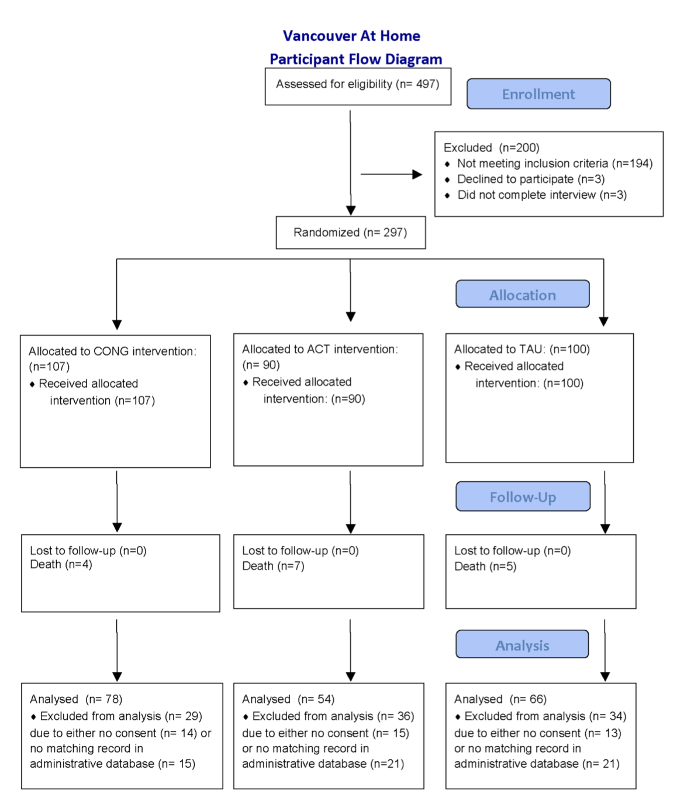
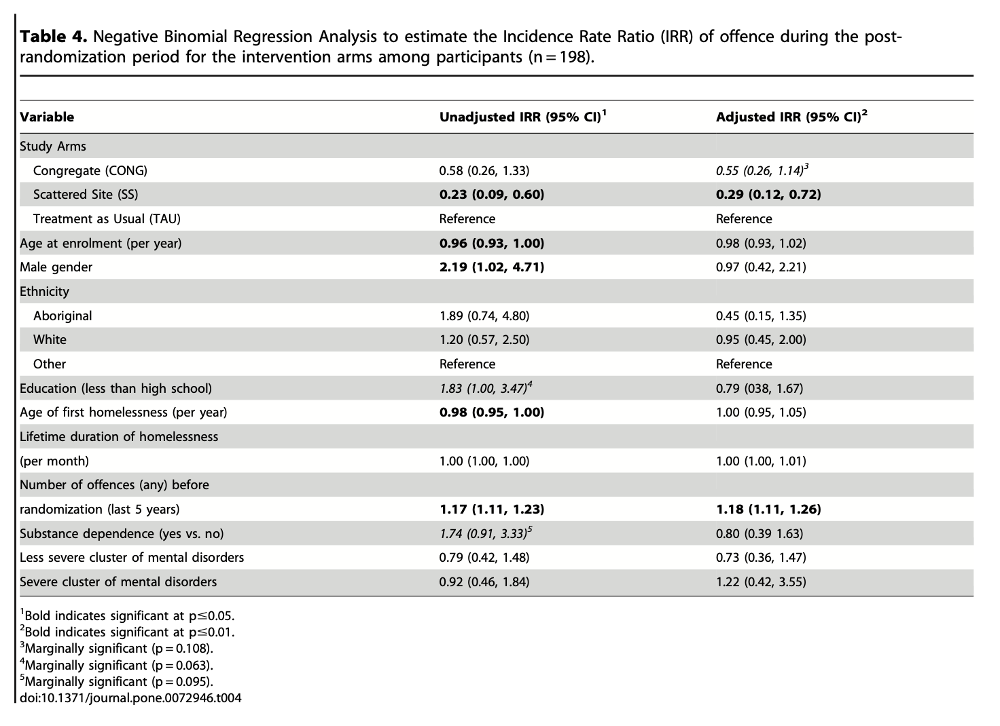

# Interaction Effect Review

```{r}
#| message: false
#| warning: false
#| include: false
library(jtools)
library(interactions)
x <- read.csv("https://www.dropbox.com/scl/fi/kxh61tvf01ur4shqb230h/trust_in_science.csv?rlkey=9ythtv5mz6medhkme3m88j6sk&dl=1",
              stringsAsFactors = T)
DV <- scale(x$climatepol)
IV1 <- scale(x$climateneg)
IV2 <- scale(x$climate_past)
mod <- lm(DV ~ IV1 * IV2, data = x)
```

::::: columns
::: {.column width="50%"}
```{r}
#| echo: false
#| message: false
#| warning: false
interact_plot(mod, 
              pred = IV1,
              modx = IV2,
              modx.values = "plus-minus",
              legend.main =  "Belief in Climate Change",
              x.label = "Negative Emotions About Climate Change\n(Higher Numbers = More Anxiety About Climate Change)",
              y.label = "Support for Climate Policy",
              line.thickness = 0)
```
:::

::: {.column width="50%"}
```{r}
#| echo: false
#| message: false
#| warning: false
jtools::export_summs(mod,
                     coefs = c("Intercept" = "(Intercept)",
                               "Negative Emotions" = "IV1",
                               "Belief in Climate Change" = "IV2",
                               "Negative Emotions x Belief" = "IV1:IV2"),
                     error_format = "")
```
:::
:::::

# Logistic Regression

### what's wrong?

```{r}
#| fig-width: 5
#| fig-height: 5

h <- read.csv("~/Dropbox/!GRADSTATS/Datasets/Hormone Data/hormone_dataset.csv")
h$sexF <- as.factor(h$sex)
levels(h$sexF) <- c("Male", "Female")
h$sexF <- relevel(h$sexF, ref = "Female")

plot(sex ~ test_mean, data = h, xlab = "Testosterone", ylab = "Sex (1 = Male, 2 = Female)")
mod2 <- lm(sex ~ test_mean, data = h)
abline(mod2)
```

### what's better?

::: panel-tabset
#### the graph

```{r}
#| fig-width: 5
#| fig-height: 5

h$sexR <- h$sex - 1
glmod <- glm(sexR ~ test_mean, data = h, family = "binomial")
plot(sexR ~ test_mean, data = h,
     xlab = "Testosterone",
     ylab = "Probability of Being Female")
curve(predict(glmod, data.frame(test_mean=x), type = "resp"), add = T, col = "red", lwd = 2)
```

#### the model

```{r}
summary(glmod)
```
:::

### Real-Life Example {.smaller}

::: panel-tabset
#### Study Design

[**Link to Article**](https://journals.plos.org/plosone/article/file?id=10.1371/journal.pone.0072946&type=printable) **:** Somers, J. M., Rezansoff, S. N., Moniruzzaman, A., Palepu, A., & Patterson, M. (2013). Housing First reduces re-offending among formerly homeless adults with mental disorders: results of a randomized controlled trial. PloS one, 8(9), e72946.

{width="473"}

#### A Regression Table

{width="658"}
:::

### [see chapter 12](https://catterson.github.io/ystats/chapters/12R_LogisticRegression.html)

##  {.smaller}
