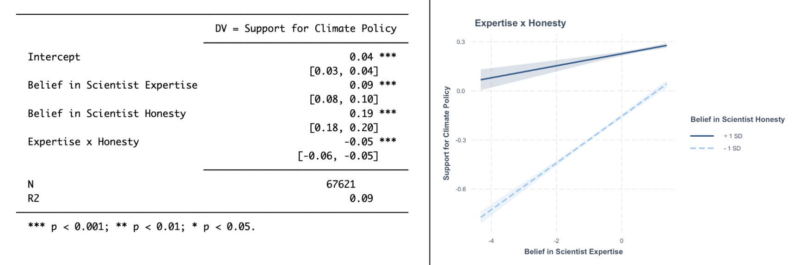
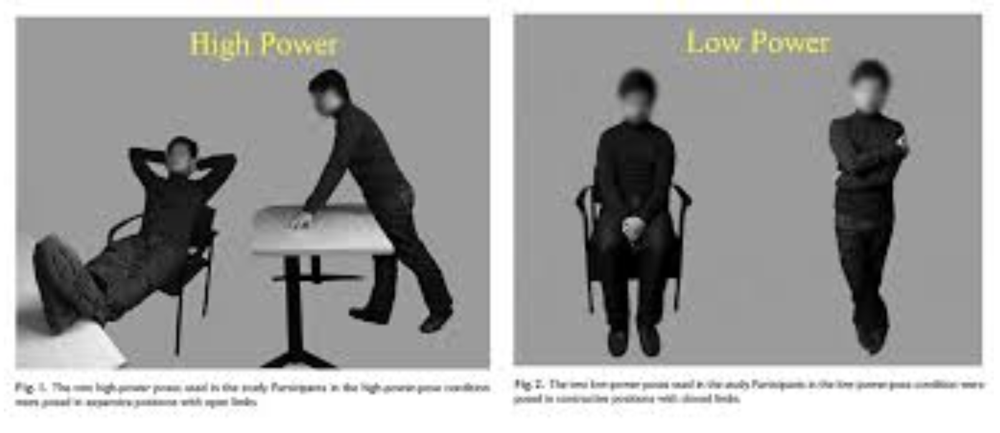
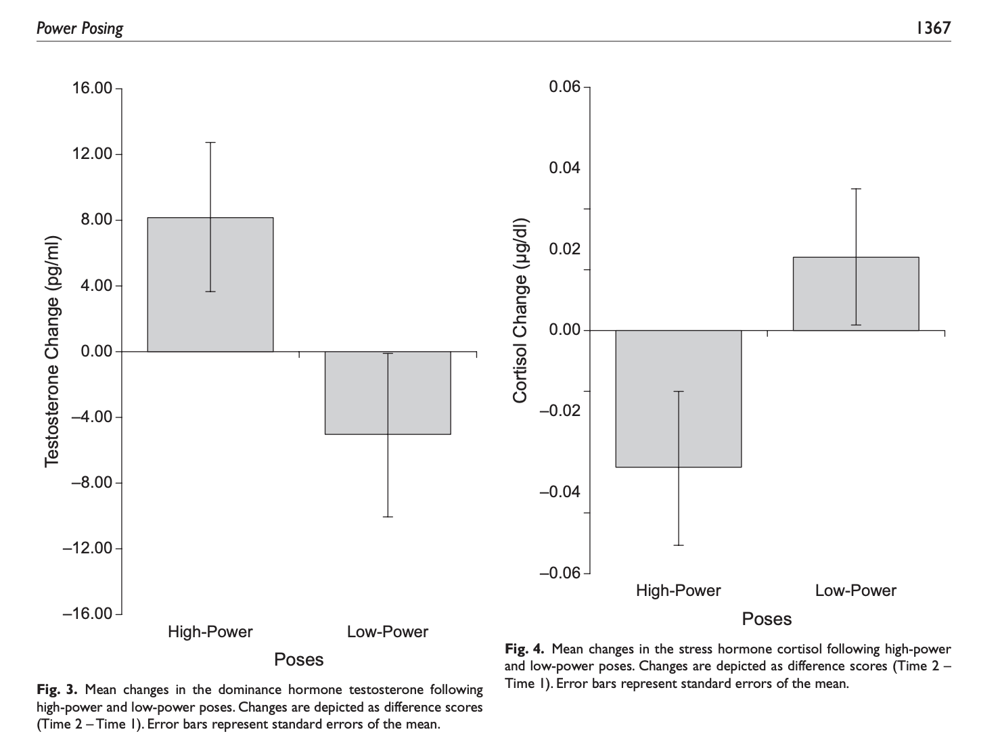
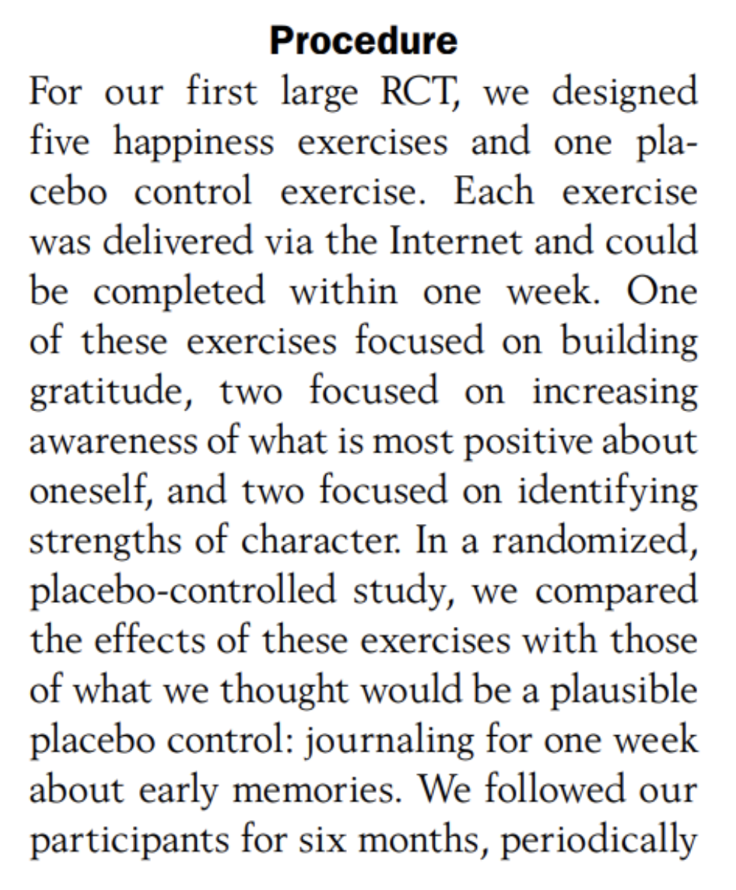
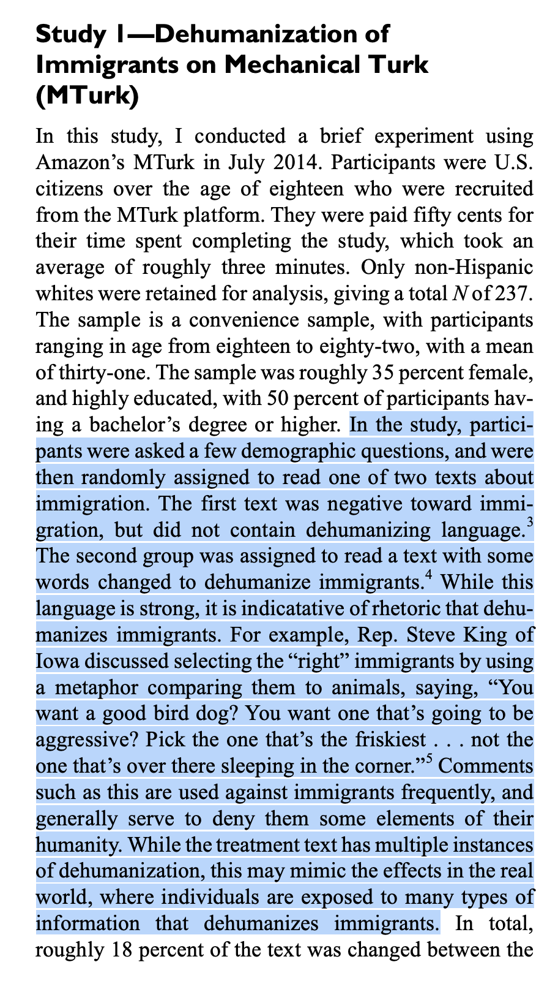
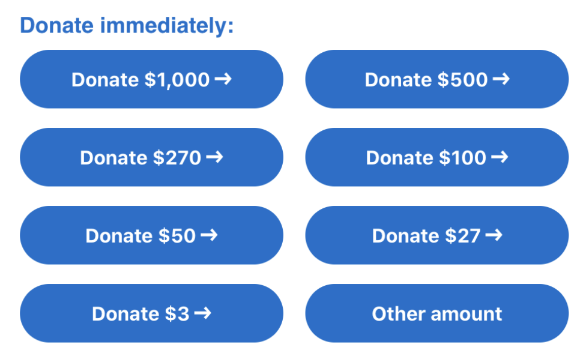
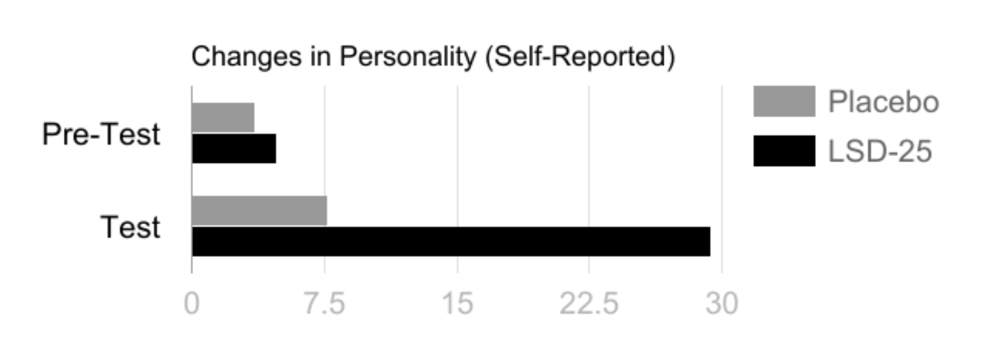
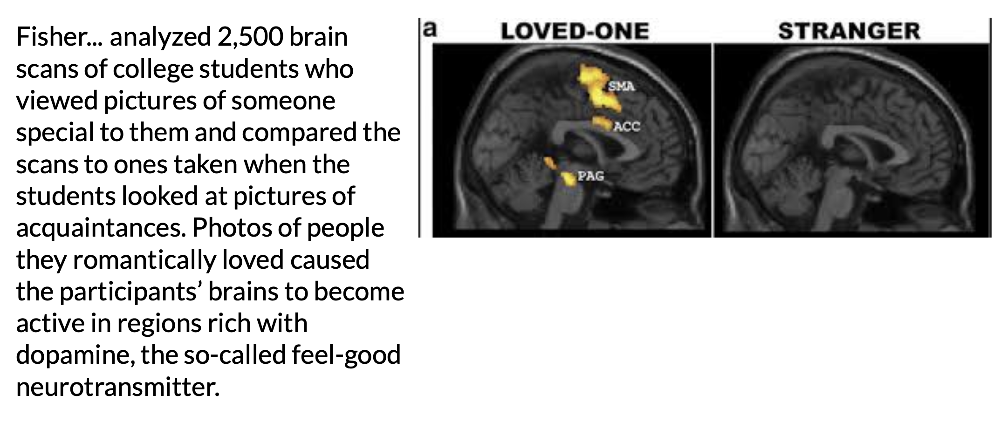
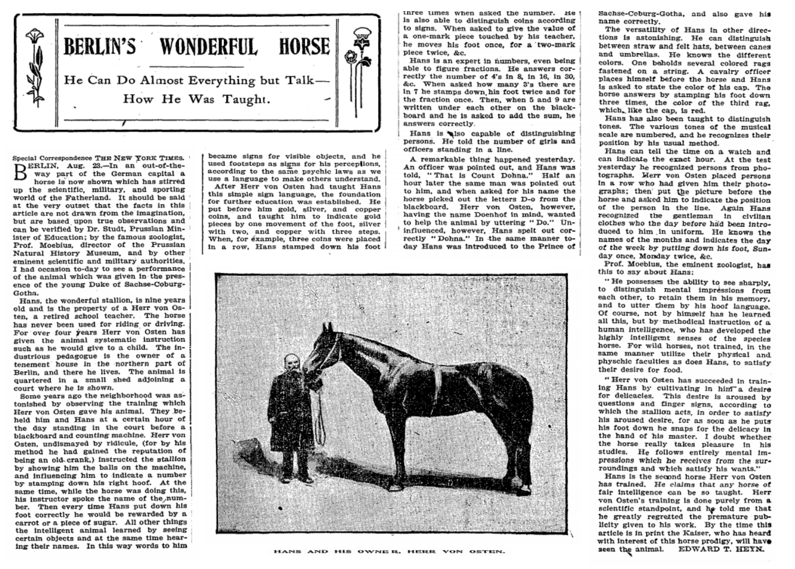
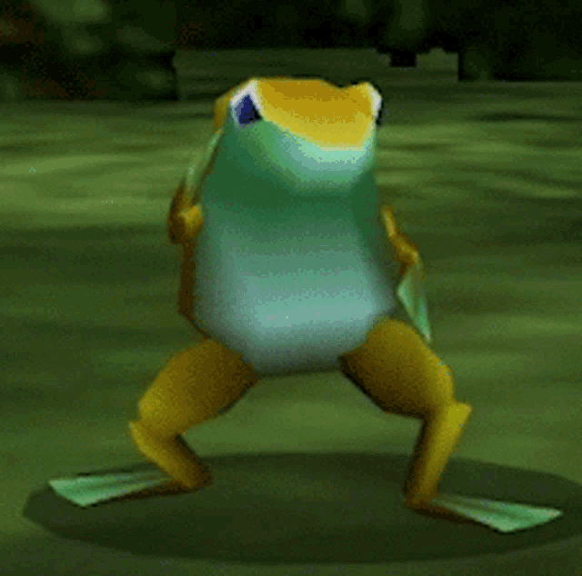

## RECAP : Interaction Effects



## RECAP : Experiments

### DEFINITION : Principles of an Experiment {.smaller}

::::: columns
::: {.column width="40%"}
**outcome (DV).** what the researchers want to predict or explain

**manipulation (IV).** change only [one thing]{.underline} about the variable.

- **confound variables (“noise”).** other factors that might influence the outcome variable

<!-- -->

- **random assignment.** if people put in random groups, then all other confound variables are *random error*.
:::

::: {.column width="60%"}
**In the Vision Board : think about a question that you have (real-life or research)**

- What is this question as a linear model?

- How would you measure the DV?

- What is the IV (the ONE thing that differs between the two groups)?

- How might you manipulate this variable? (What is the experimental and control group?)

- What are all the things that you would need or want to try and keep the same (avoid placebo)?
:::
:::::

### KEY IDEA : Watch out for Misleading Control Variables {.smaller}

**RECAP : the manipulation (A/B Testing) :** researchers create multiple groups (conditions) and change ONE THING (the IV) about a person’s experience in each group & observe the result (the DV).

**KEY IDEA : the comparison group matters!**

- a 1.5 hour research methods class DECREASES boredom compared to…

- a 1.5 hour research methods class INCREASES boredom compared to…

### Science is Hard : Power Posing

::::: columns
::: {.column width="50%"}

:::

::: {.column width="50%"}
{width="598"}
:::
:::::

### Example : Gratitude Study {.smaller}

::::: columns
::: {.column width="40%"}
Read the prompt below. Answer the following questions.

1.  **ICE-BREAKER :** What's something that you are grateful for?
2.  What is the experimental / control condition?
3.  Is this a fair comparison / manipulation? What would be better?
:::

::: {.column width="60%"}
{width="587"}
:::
:::::

### Lab 4 : The Dehumanization Study

{width="308"}

### Lab 6 : The Anchoring Study

::: panel-tabset
#### Anchoring Data

```{r}
#| message: false
#| warning: false
#| include: false
library(pwrss)
library(gplots)
library(jtools)
d <- read.csv("~/Dropbox/!GRADSTATS/COMPSS212/Datasets/Nobel Prize Experiment Data/anchor.csv", stringsAsFactors = T)
d$treeheight[d$treeheight > 1000] <- NA
d$meateat[d$meateat > 1000] <- NA
mod1 <- lm(catspeed ~ condition, data = d)
mod2 <- lm(treeheight ~ condition, data = d)
mod3 <- lm(meateat ~ condition, data = d)
```

```{r}
#| echo: false

export_summs(mod1, mod2, mod3,
             model.names = c("DV = Cat Speeds",
                             "DV = Tree Heights",
                             "DV = Meat Consumption"))
```

#### Anchoring Study (Real-Life Examples)

|                                      |                                      |
|------------------------------------|------------------------------------|
|  |  |
:::

### Other Questions to Consider : Does the experiment have....

::: panel-tabset
#### placebo effects

Will individuals in the study change their behavior if they expect something to have an effect?



#### external validity

How much does the experimental manipulation represent what someone might experience in real life?

[](http://neuro.hms.harvard.edu/harvard-mahoney-neuroscience-institute/brain-newsletter/and-brain-series/love-and-brain)

#### construct validity

How much does the manipulation actually change the variable of interest?

{fig-align="center"}

#### expectancy effects

If experimenters know what will happen to participants, will they change their behavior in ways that affect the results?

[{width="678"}](http://query.nytimes.com/mem/archive-free/pdf?res=9E02E2D91F3AE733A25757C0A96F9C946597D6CF)
:::

### okay.

{fig-align="center" width="466"}
