## [CHECK-IN : Three Weeks, Some Questions](https://forms.gle/vwQs4xKWuTPQeRWH7)

{width="502"}

# Experiments

## DEFINITION : Principles of an Experiment {.smaller}

::::: columns
::: {.column width="40%"}
**outcome (DV).** what the researchers want to predict or explain

**manipulation (IV).** change only [one thing]{.underline} about the variable.

- **confound variables (“noise”).** other factors that might influence the outcome variable
- **random assignment.** if people put in random groups, then all other confound variables are *random error*.
:::

::: {.column width="60%"}
**In the Vision Board : think about a question that you have (real-life or research)**

- What is this question as a linear model?

- How would you measure the DV?

- What is the IV (the ONE thing that differs between the two groups)?

- How might you manipulate this variable? (What is the experimental and control group?)

- What are all the things that you would need or want to try and keep the same (avoid placebo)?
:::
:::::

### KEY IDEA : Watch out for Misleading Control Variables {.smaller}

**RECAP : the manipulation (A/B Testing) :** researchers create multiple groups (conditions) and change ONE THING (the IV) about a person’s experience in each group & observe the result (the DV).

**KEY IDEA : the comparison group matters!**

- a 2 hour stats class DECREASES boredom compared to…

- a 2 hour stats class INCREASES boredom compared to…

### Example : Gratitude Study {.smaller}

::::: columns
::: {.column width="40%"}
Read the prompt below. Answer the following questions.

1.  **ICE-BREAKER :** What's something that you are grateful for?
2.  What is the experimental / control condition?
3.  Is this a fair comparison / manipulation? What would be better?
:::

::: {.column width="60%"}
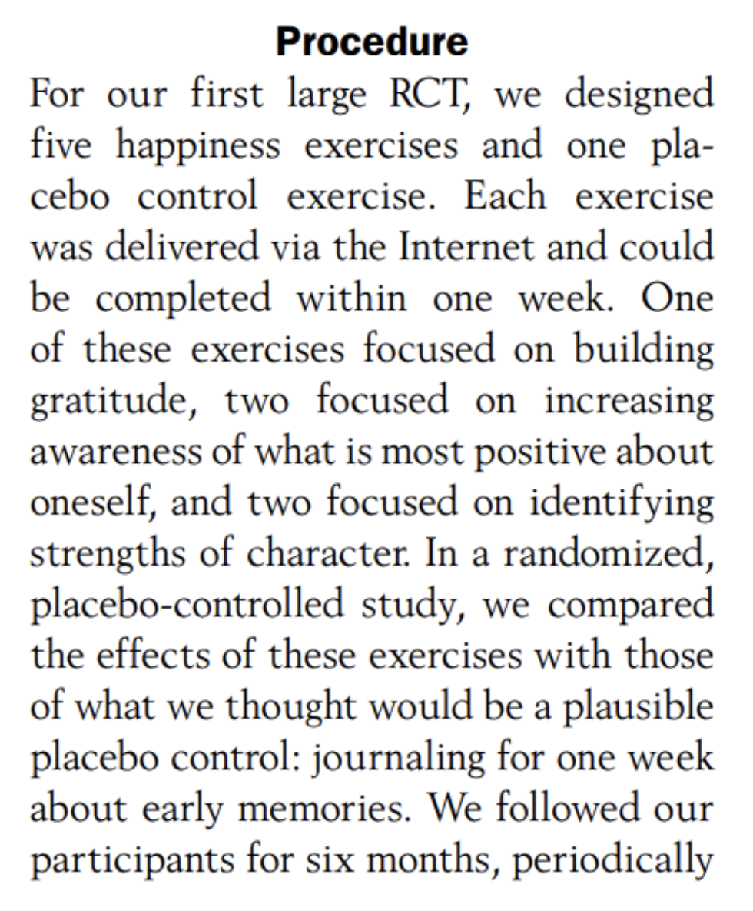{width="449"}
:::
:::::

### Other Questions to Consider : Does the experiment have....

::: panel-tabset
#### placebo effects

Will individuals in the study change their behavior if they expect something to have an effect?

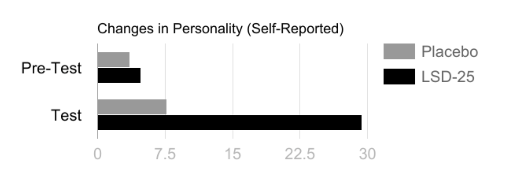

#### external validity

How much does the experimental manipulation represent what someone might experience in real life?

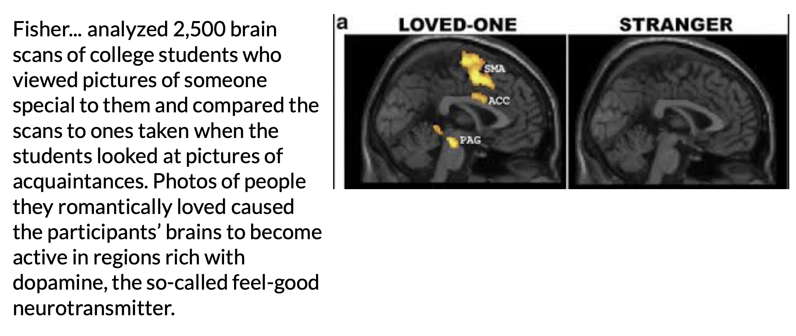

#### construct validity

How much does the manipulation actually change the variable of interest?

{fig-align="center"}

#### expectancy effects

If experimenters know what will happen to participants, will they change their behavior in ways that affect the results?

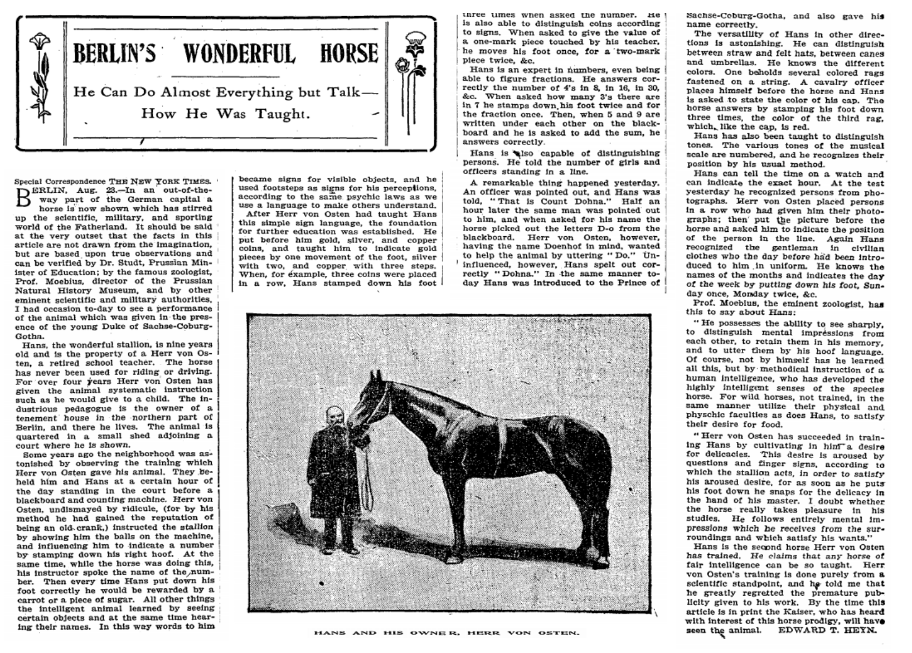{width="678"}
:::

### An Experiment!

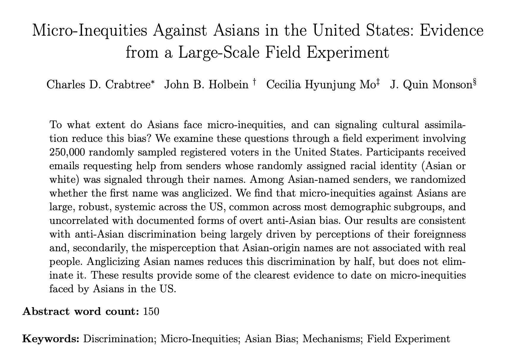

### An Experiment!

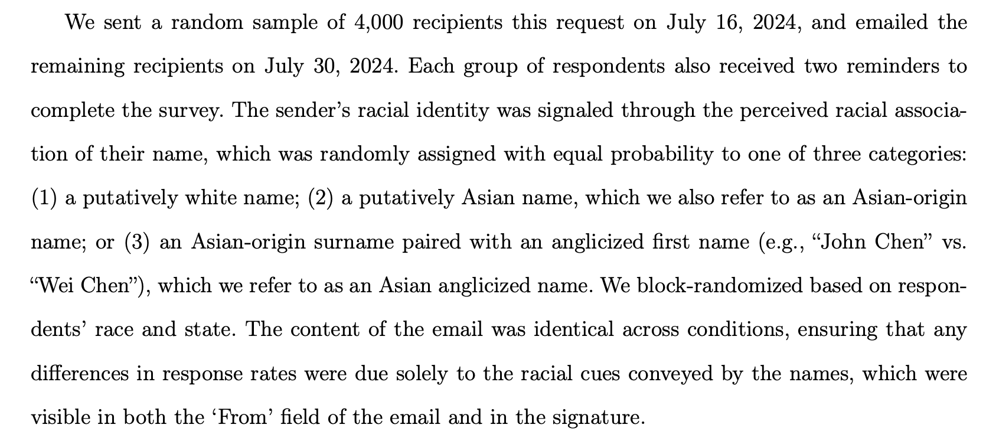

# Part 2 : GLM

## DICUSSS : What's Wrong (and WHY?)

```{r}
#| echo: false
#| message: false
#| warning: false
h <- read.csv("~/Dropbox/!GRADSTATS/Datasets/Hormone Data/hormone_dataset.csv")
h$sexF <- as.factor(h$sex)
levels(h$sexF) <- c("Male", "Female")
h$sex <- h$sex - 1
plot(sex ~ test_mean, data = h, xlab = "Testosterone", ylab = "Sex (0 = Male, 1 = Female)", yaxt = "n")
axis(side = 2, 
     at = c(0, 1), 
     labels = c("Male", "Female"),
     las = 1)
mod2 <- lm(sex ~ test_mean, data = h)
abline(mod2)
coef(mod2)
```

### Generalized Linear Models

::: panel-tabset
### the graph

```{r}
glmod <- glm(sex ~ test_mean, data = h, family = "binomial")
plot(sex ~ test_mean, data = h,
     xlab = "Testosterone",
     ylab = "Probability of Being Female")
curve(predict(glmod, data.frame(test_mean=x), type = "resp"), add = T, col = "red", lwd = 2)
```

### the summary

```{r}
summary(glmod)
```

### interpreting the slope

```{r}
#| echo: false
#| message: false
#| warning: false
glmod <- glm(sex ~ test_mean, data = h, family = "binomial")
coefz <- rbind(coef(mod2)[2]*100, coef(glmod)[2]/4, exp(coef(glmod)[2]))
row.names(coefz) <- c("LM (Probability)", "GLM/4 (Gelman & Hill Rule)", "Exponentiated GLM (Odds-Ratio)")
round(coefz, 2)
```

- **Linear Model - Probability `coef(mod)*100` :** Multiplying the coefficient by 100 gives you the *percentage-point change*in the probability that Y = 1 for a one-unit increase in the independent variable. (*But violates assumption of heteroscedasticity....so need to check.*)
- **Generalized Linear Model - Log-Odds `coef(glmod)/4` :** very confusing on its own. Gelman & Hill tell you that dividing this number by 4 gives you the upper bound of the predictive difference in Y that corresponds to a 1-unit increase in X.
- **Exponentiation Generalized Linear Model - Odds-Ratio** `exp(coef(glmod))` : how the odds change between two different outcomes.
  - **Odds Ratio less than 1 =** as X increases by 1, the probability of Y decreases (by the difference between the slope and 1).
  - **Odds Ratio greater than 1 =** as X increases by 1, the probability of Y increases (by the difference between the slope and 1).

### interpreting the "fit"

- Deviance : distance between an individual point and our line (non-linear)

- Null Deviance : the distance with just the intercept to make predictions

- Residual Deviance : the distances after our model makes predictions

- Pseudo $R^2$ = (null deviance - residual deviance) / null deviance

- AIC = Akaike Information Criterion = a measure of goodness of fit...lower is "better".
:::

## More Examples

## Climate Change Data

::: panel-tabset
#### the graph

```{r}
#| fig-width: 5
#| fig-height: 5

cl_glmod <- glm(numRes ~ sci_info, data = x, family = "binomial")
plot(numRes ~ sci_info, data = x,
     xlab = "Scientific Knowledge Seeking",
     ylab = "Probability of Being in an Urban Environment")
curve(predict(cl_glmod, data.frame(sci_info=x), type = "resp"), add = T, col = "red", lwd = 2)
```

#### the model

```{r}
summary(cl_glmod)
```
:::

### Real-Life Example {.smaller}

::: panel-tabset
#### Study Design

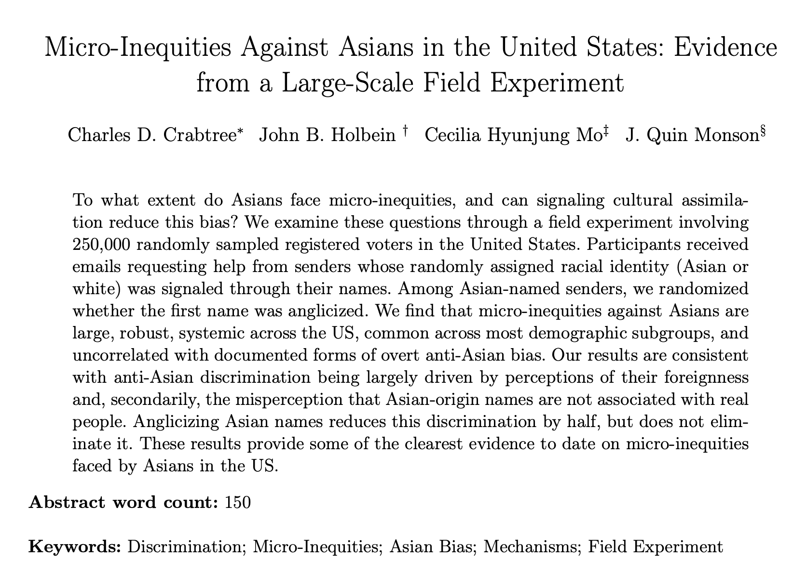

### The Result (Text)

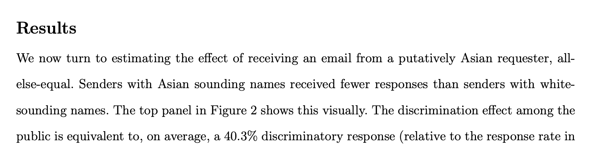{width="599"}

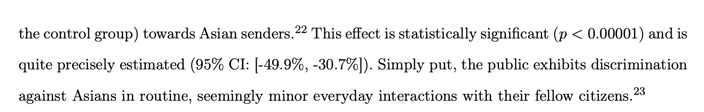{width="601"}

### Results (Different Methods)

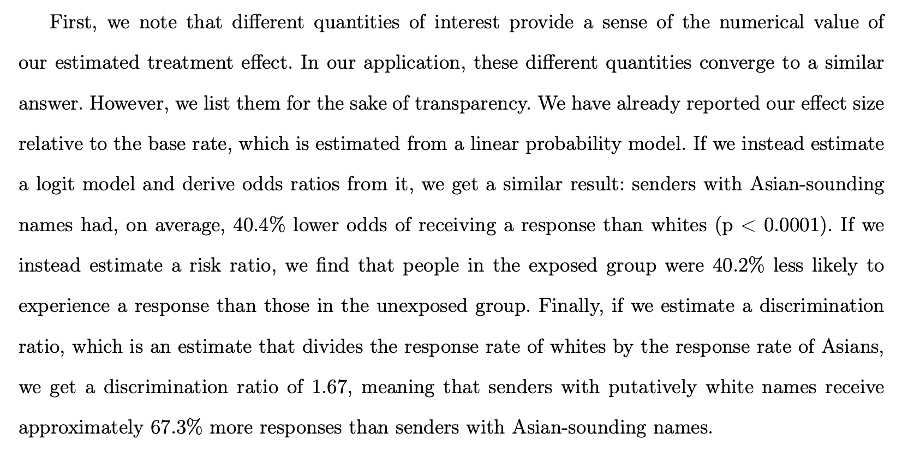

### The Result (Graph)

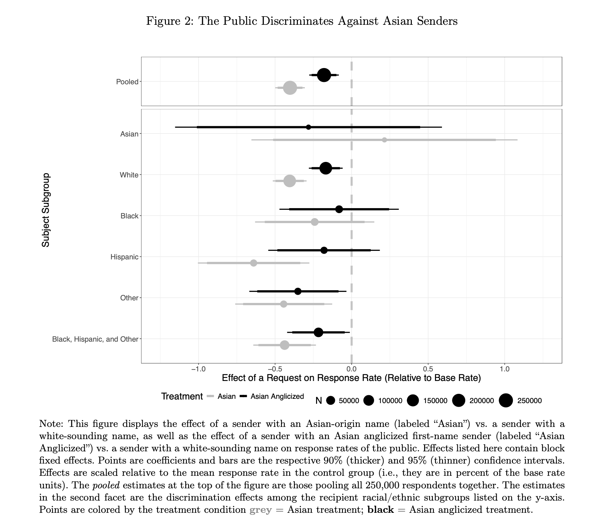{width="520"}

#### The Result (Table)

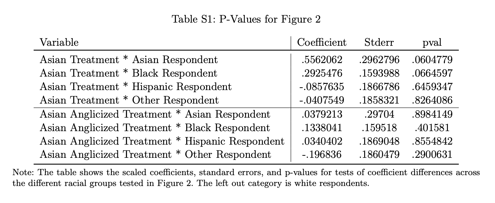{width="548"}
:::

### [see chapter 12](https://catterson.github.io/ystats/chapters/12R_LogisticRegression.html)

{fig-align="center" width="439"}
