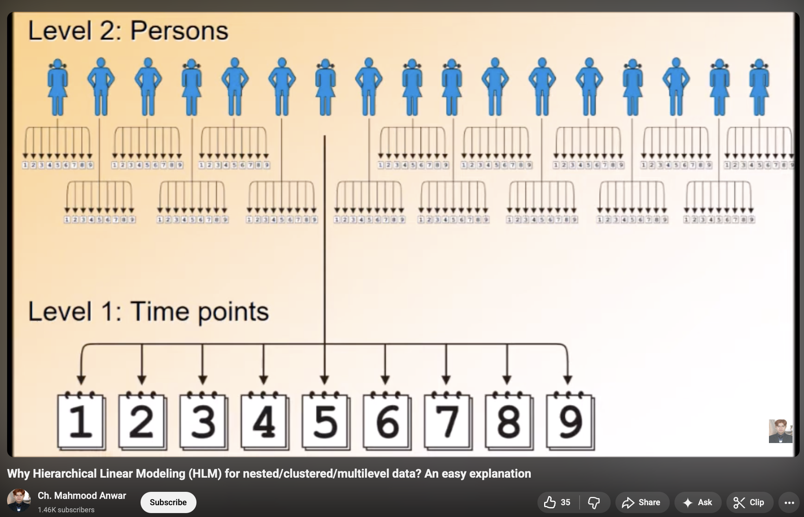
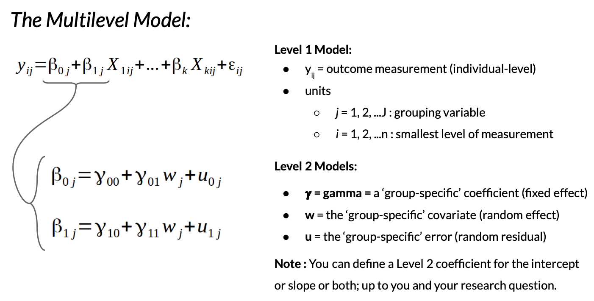

## [CHECK-IN : Generalized Linear Models](https://docs.google.com/forms/d/e/1FAIpQLSciBOqZIhOAintascD8zbH-Y2Mc9FgrD6NAear_eK7d3KGsGw/viewform?usp=header)

Try to interpret the linear model below, where we are predicting the probabiliyt of being in an Urban (vs. Rural) Environment from how much the person seeks out information about the science of climate change.

::::: panel-tabset
### the model

```{r}
#| echo: false
#| message: false
#| warning: false

options(scipen = 999)
options(digits = 2)
x <- read.csv("https://www.dropbox.com/scl/fi/kxh61tvf01ur4shqb230h/trust_in_science.csv?rlkey=9ythtv5mz6medhkme3m88j6sk&dl=1",
              stringsAsFactors = T)
x$numRes <- as.numeric(x$residence)-1
cl_glmod <- glm(residence ~ sci_info, data = x, family = "binomial")
cl_glmod <- glm(residence ~ sci_info, data = x, family = "binomial")
mod <- lm(numRes ~ sci_info, data = x)
summary(cl_glmod)
```

### the slope?

```{r}
#| echo: false
#| message: false
#| warning: false

coefz <- rbind(coef(mod)[2], coef(cl_glmod)[2]/4, exp(coef(cl_glmod)[2]))
row.names(coefz) <- c("LM (Probability)", "GLM/4 (Gelman & Hill Rule)", "Exponentiated GLM (Odds-Ratio)")
round(coefz, 2)
```

- **Linear Model (LM) Slope - Probability `coef(mod)*100` :** Multiplying the coefficient by 100 gives you the *percentage-point change* in the probability that Y = 1 for a one-unit increase in the independent variable. (*But violates assumption of heteroscedasticity....so need to check.*)
- **Generalized Linear Model (GLM) Slope (Log-Odds) `coef(cl_glmod)/4` :** very confusing on its own. Gelman & Hill tell you that dividing this number by 4 gives you the upper bound of the predictive difference in Y that corresponds to a 1-unit increase in X.
- **Exponentiation Generalized Linear Model Slope (Odds-Ratio)** `exp(coef(cl_glmod))` : how the odds change between two different outcomes.
  - **Odds Ratio less than 1 =** as X increases by 1, the probability of Y decreases (by the difference between the slope and 1).
  - **Odds Ratio greater than 1 =** as X increases by 1, the probability of Y increases (by the difference between the slope and 1).

### the "fit"??

- Deviance = distance between an individual point and our line (non-linear)

- Null Deviance = `r summary(cl_glmod)$null.deviance` = the total distances with just the intercept to make predictions

- Residual Deviance = `r summary(cl_glmod)$deviance` the total distances after our model makes predictions

- Pseudo $R^2$ = (null deviance - residual deviance) / null deviance = `r (summary(cl_glmod)$null.deviance - summary(cl_glmod)$deviance)/summary(cl_glmod)$null.deviance` = a measure of improvement to the model

- AIC = Akaike Information Criterion = a measure of goodness of fit...lower is "better".

### the graph

::: {.callout-tip collapse = "true"}

#### no peeking!!!!

```{r}
#| echo: false
#| message: false
#| warning: false
#| fig-height: 5
#| fig-width: 5

plot(numRes ~ sci_info, data = x,
     xlab = "Scientific Knowledge Seeking",
     ylab = "Probability of Being in an Urban Environment")
curve(predict(cl_glmod, data.frame(sci_info=x), type = "resp"), add = T, col = "red", lwd = 2)
```
:::

### the code

```         
## Dataset and Settings
options(scipen = 999) # removes exponents
options(digits = 2) # rounds to two digits
x <- read.csv("https://www.dropbox.com/scl/fi/kxh61tvf01ur4shqb230h/trust_in_science.csv?rlkey=9ythtv5mz6medhkme3m88j6sk&dl=1",
              stringsAsFactors = T) 
x$numRes <- as.numeric(x$residence)-1
cl_glmod <- glm(residence ~ sci_info, data = x, family = "binomial") # The generalized Linear model
plot(numRes ~ sci_info, data = x,
     xlab = "Scientific Knowledge Seeking",
     ylab = "Probability of Being in an Urban Environment")
curve(predict(cl_glmod, data.frame(sci_info=x), type = "resp"), add = T, col = "red", lwd = 2)
### Models
mod <- lm(numRes ~ sci_info, data = x) # Linear Probit Model

summary(cl_glmod)

### Making The Tables
coefz <- rbind(coef(mod)[2], coef(cl_glmod)[2]/4, exp(coef(cl_glmod)[2]))
row.names(coefz) <- c("LM (Probability)", "GLM/4 (Gelman & Hill Rule)", "Exponentiated GLM (Odds-Ratio)")
round(coefz, 2)
```

:::::

# Project Time : Milestone #2

1.  **Think about the decisions you'll need to make about your analyses :** how are the data structured? what type of linear model might you want to use?
2.  **Link to a pre-registration document.** Okay if you change this, and you will learn more about what to do as you analyze the project. But good to set some intentions!
3.  **Graph your DV.** What do you learn from this distribution?
4.  **Graph some predictive statistic (linear model).** What do you learn about the relationship between these two variables?

# Multilevel Models (MLM). Conceptual Understanding

### Definition : Multilevel Models (MLM)

- Hierarchical linear models, mixed effects models, random effects models, others?

  - **Level 1 :** the smallest unit of analysis (where the DV is measured)

  - **Level 2 :** organize non-independent responses at Level 1.

### Examples :

::: panel-tabset
#### Students in School

**non-independence :** students in a school are similar to each other

{width="80%"}

#### Repeated Measure Studies

**non-independence :** person at time 1 is still the same person at time 2

{fig-align="center" width="80%"}
:::

### The Formulas

***The Linear Model***

$$\huge y = \beta_0 + \beta_1x_1 + ... + \beta_kx_k + \epsilon$$

{width="74%"}

### Why Are We Doing This? {.smaller}

1.  **The Assumption of Independence Has Been Violated! (MLM increases our power and reliability as scientists.)**
    - Multiple measures of an individual gives you a more reliable estimate of what and who they are.
    - A person serves as their own control, so can more precisely examinine how a person changes over time.
2.  **Model more complex phenomenon.**
    - How people change over time (within-person variation).
    - Simpson's Paradox

## How Do We Do This in R?

### Example : The Sleep Dataset {.smaller}

:::::::::::: panel-tabset
##### Details

From the `?sleep` dataset: "Data which show the effect of two soporific drugs (increase in hours of sleep compared to control)."

- Extra : increase in hours of sleep
- Group : drug given (1 = control; 2 = drug)
- ID : patient ID

##### "Between Person"

::::: columns
::: {.column width="40%"}
```{r}
#| message: false
#| warning: false
#| fig-height: 8
#| fig-width: 6
library(ggplot2)
ggplot(sleep, aes(y = extra, x = group)) + 
  geom_point(size=2) + 
  stat_summary(fun.data=mean_se, color = 'red', size = 1.25, linewidth = 2)
```
:::

::: {.column width="60%"}
```{r}
#| message: false
#| warning: false
lmod <- lm(extra ~ as.factor(group), data = sleep)
summary(lmod)
```
:::
:::::

##### "Within-Person"

::::: columns
::: {.column width="50%"}
```{r}
#| message: false
#| warning: false
#| fig-height: 6
#| fig-width: 6
ggplot(sleep, aes(y = extra, x = group, color = ID)) + 
  geom_point(size=2) + 
  geom_line(aes(group = ID), linewidth = 0.75)
```
:::

::: {.column width="50%"}
**Fixed Effects :** The "Average" across all the grouping variables.

```{r}
#| message: false
#| warning: false
#install.packages("lme4")
library(lme4)
library(lmerTest)
library(Matrix)
mlmod <- lmer(extra ~ as.factor(group) + (1 | ID), data = sleep)
summary(mlmod)
```
:::
:::::

##### Random Effects

::::: columns
::: {.column width="50%"}
```{r}
#| message: false
#| warning: false
#| fig-height: 6
#| fig-width: 6
ggplot(sleep, aes(y = extra, x = group, color = ID)) + 
  geom_point(size=2) + 
  geom_line(aes(group = ID), linewidth = 0.75)
```
:::

::: {.column width="50%"}
- ICC = Intraclass Correlation Coefficient = how much the variation in our grouping variable (here : subject) explains total variation.

- To calculate : take variance of intercept / total variance

  ```{r}
  2.8483 / (2.8483 + 0.7564)
  ```

- OR :

  ```{r}
  library(performance)
  icc(mlmod)
  ```
:::
:::::
::::::::::::

# THE END.

{fig-align="center" width="439"}
