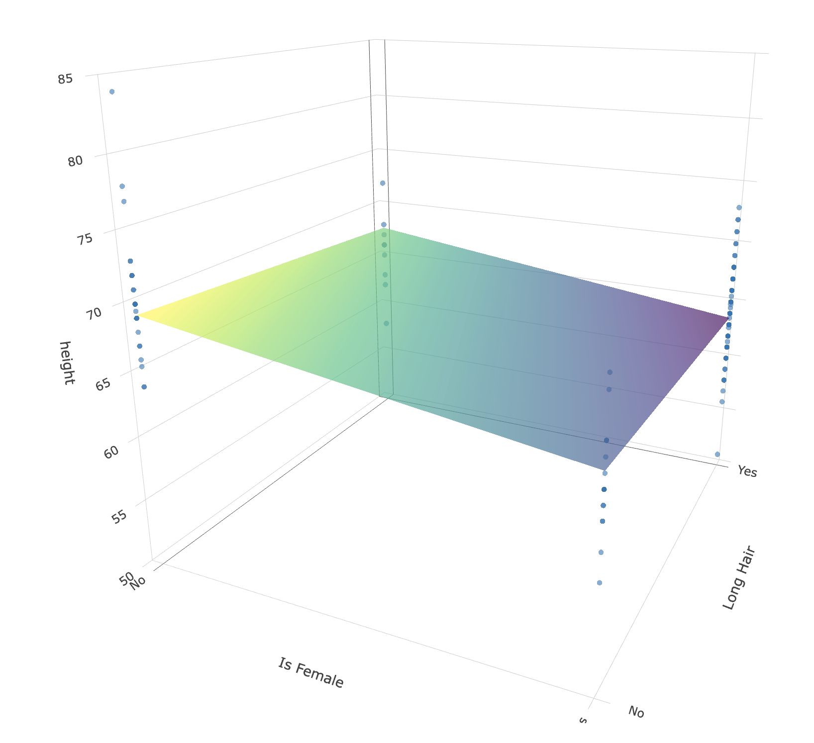
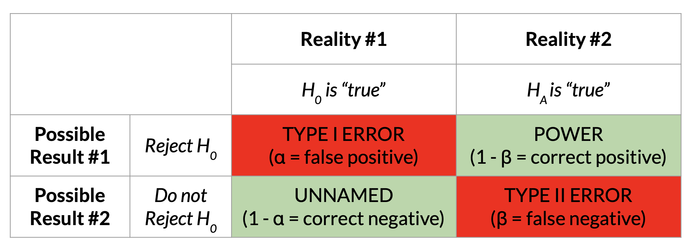
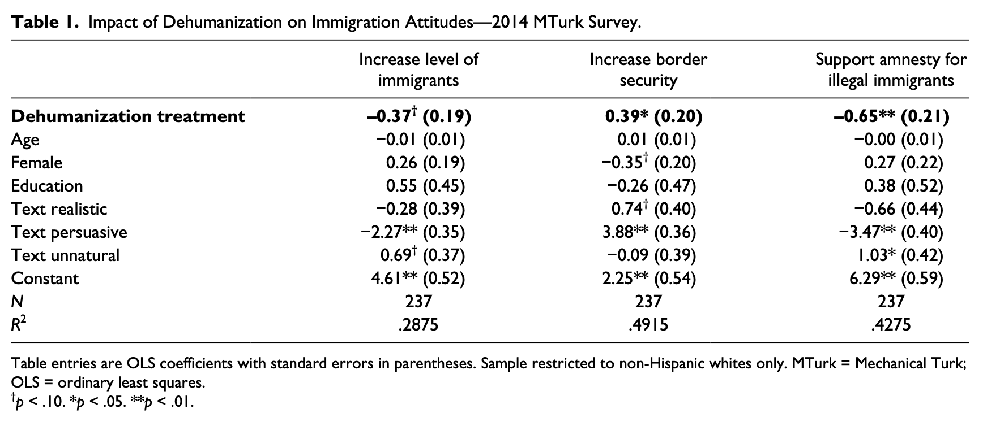

### Multiple Regression {.smaller}

```{r}
#| include: false

library(gplots)
library(jtools)
d <- read.csv("https://www.dropbox.com/scl/fi/uo4yvgkwfel5nmhzcgiej/MR_Example.csv?rlkey=2z0bmgwbgco8e78m31ldrh6pa&dl=1", stringsAsFactors = T)
par(mfrow = c(1,3))
hist(d$height)
plot(d$is.female, xlab = "Is Female?")
plot(d$long.hair, xlab = "Has Long Hair?")

## Bivariate Linear Models
par(mfrow = c(1,3))
mod1 <- lm(height ~ long.hair, d)
plotmeans(height ~ long.hair, d, connect = F)

mod2 <- lm(height ~ is.female, d)
plotmeans(height ~ is.female, d, connect = F)

plot(d$is.female ~ d$long.hair) # showing my IVs are related.
```

**Table 1.** Multiple Regression Analyses : predicting height (in Inches) from whether the person has long hair and whether the person is female.

```{r}
#| echo: false
## Multivariate Linear Model
mod3 <- lm(height ~ long.hair + is.female, d)
export_summs(mod1, mod2, mod3,
             error_format = "[{conf.low}, {conf.high}]",
             coefs = c("Intercept" = "(Intercept)",
                       "Has Long Hair (0=no, 1=yes)" = "long.hairYes",
                       "Is Female (0=no, 1=yes)" = "is.femaleYes"))
```

## Part 1 : Multiple Regression in 3-D SPACE!!!!

- see professor R Script for code, but no need to try and create these graphs. just for teaching purposes.



## Part 2 : Power

### what is power, professor?

- **Power :** the probability that you would "correctly" observe the relationship between two variables if the relationship actually exists (*i.e., if the null hypothesis were NOT true*).



- **Real-Life Examples on the vision board** : a decision you need to make (eating old pizza in the refrigerator)

- **Professor Slideshow.** Underneath this one, and then we will explore the [power visualization](https://rpsychologist.com/d3/nhst/)

### what's the point, professor?

::::: columns
::: {.column width="50%"}
- **Reasons to Calculate Power :**

  - **Post-Hoc Power :** You did a study, and want to further contextualize your guess about how much sampling error influenced your results.

  - **Power Planning :** You are planning to run a study, and want to know how many people to recruit to have the highest probability of observing the "true" effect (if it exists.)
:::

::: {.column width="50%"}

:::
:::::

### goal : you want power to be HIGH {.smaller}

DISCUSS : what could we do as researchers to increase power???

:::: fragment
::: callout-note
## spoilers

**the effect size increases :** the bigger the difference, the more likely you'll detect it.

**your sample size increases :** the more people, the less sampling error, and the easier it is to have confidence that any difference you found is not just chance.

**you increase the threshold for rejecting the null hypothesis :** if the probability of rejecting the null hypothesis = 10%, then your power increases.
:::
::::

### ACTIVITY : calculating in R (by hand) {.smaller}

::: panel-tabset
#### the model

```{r}
#|echo: true
summary(mod3) 
```

#### saving the metrics

```{r}
#|echo: true
sm <- summary(mod3) # saving this as an object
objects(sm) # there is more inside.
sm$coefficients # tadaa
sm$coefficients[2,3] # our t-value
mtval <- sm$coefficients[2,3]
```

#### distributions

- the t-distribution approaches the normal distribution (with a 95% Interval cutoff of 1.96....)
- but we are not quite there so good to look up what the t-value actually is based on our degrees of freedom (the sample size minus the number of parameters in our model)

```{r}
#|echo: true
sm$df
qt(.025, df = sm$df[2]) # 
mcut <- qt(.025, df = sm$df[2]) # saving this value
pt(mcut - mtval, df = sm$df[2]) # our power.
```

#### pwrss

similar to our calculation "by hand"

```{r}
#| echo: true
# install.packages("pwrss")
library(pwrss)
pwrss::power.t.test(ncp = mtval, df = sm$df[2], plot = FALSE)
```

#### a picture is worth....

```{r}
pwrss::power.t.test(ncp = mtval, df = sm$df[2], plot = TRUE, verbose = FALSE)
```
:::

### Using Power to Estimate Sample Size.

- Power is a function of : effect size, sample size, and the alpha level (alpha = the Type I error that the researcher sets).
- You can use these terms to estimate the sample size needed for a given power (the convention is often 80%).

### ACTIVITY : Calculating (and Planning) Power in Lab 4

::: panel-tabset

#### the data


#### estimating sd

sampling error = $\frac{\sigma}{\sqrt{n}}$

```{r}
#| echo: true

sdest <- (.19 * 237^.5) # formula for sd based on sampling error
```

#### estimating power

```{r}
#| echo: true
pwrss::power.t.student(-.37/sdest, n2 = 237, design = "one.sample")

```

#### estimating sample size

```{r}
#| echo: true
pwrss::power.t.student(-.37/sdest, power = .80, design = "one.sample")
```
:::

### okay.

{fig-align="center" width="466"}
