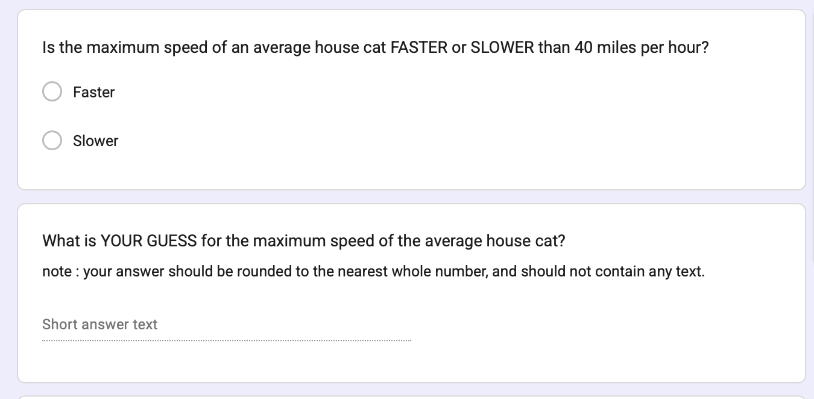
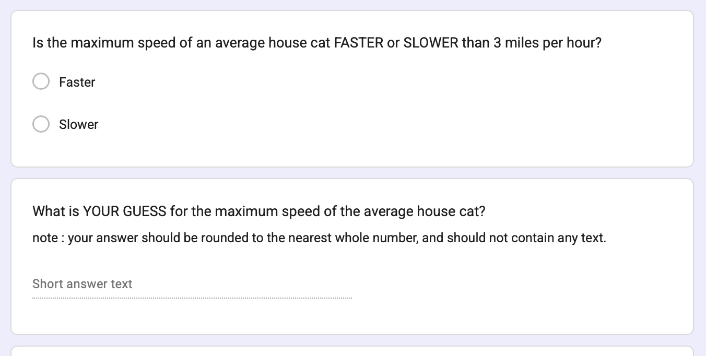
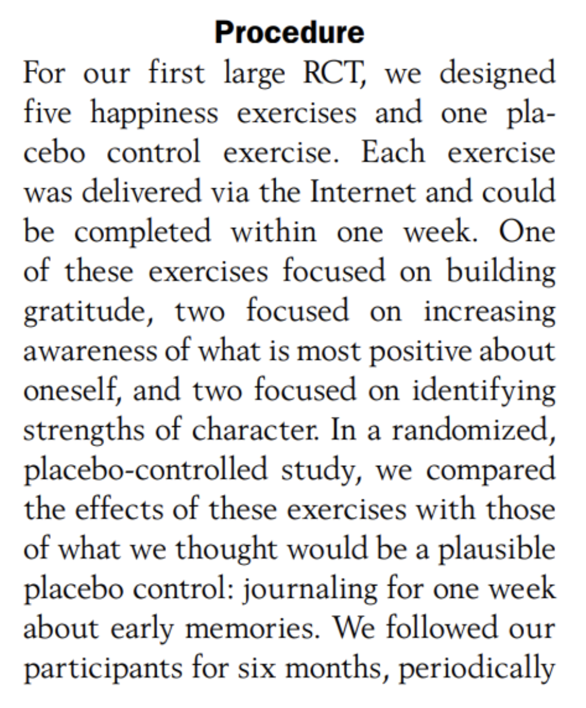

## Check-In :

## Part 1 : Power Review

### haha so what was power, professor?

**Power :** the probability that you would "correctly" observe the relationship between two variables if the relationship actually exists (*i.e., if the null hypothesis were NOT true*).


### goal : you want power to be HIGH

- [Play with the power visualization - click "solve for power"](https://rpsychologist.com/d3/nhst/)
- DISCUSS : what could we do as researchers to increase power???

:::: fragment
::: callout-note
## spoilers

**the effect size increases :** the bigger the difference, the more likely you'll detect it.

**your sample size increases :** the more people, the less sampling error, and the easier it is to have confidence that any difference you found is not just chance.

**you increase the threshold for rejecting the null hypothesis :** if the probability of rejecting the null hypothesis = 10%, then your power increases.
:::
::::

### what's the point, professor?

::::: columns
::: {.column width="50%"}
- **Reasons to Calculate Power :**

  - **Post-Hoc Power :** You did a study, and want to further contextualize your guess about how much sampling error influenced your results.

  - **Power Planning :** You are planning to run a study, and want to know how many people to recruit to have the highest probability of observing the "true" effect (if it exists.)
:::

::: {.column width="50%"}

:::
:::::

### ACTIVITY : calculating in R (by hand) {.smaller}

::: panel-tabset
#### the model

```{r}
#|echo: true
summary(mod3) 
```

#### saving the metrics

```{r}
#|echo: true
sm <- summary(mod3) # saving this as an object
objects(sm) # there is more inside.
sm$coefficients # tadaa
sm$coefficients[2,3] # our t-value
mtval <- sm$coefficients[2,3]
```

#### distributions

- the t-distribution approaches the normal distribution (with a 95% Interval cutoff of 1.96....)
- but we are not quite there so good to look up what the t-value actually is based on our degrees of freedom (the sample size minus the number of parameters in our model)

```{r}
#|echo: true
sm$df
qt(.025, df = sm$df[2]) # 
mcut <- qt(.025, df = sm$df[2]) # saving this value
pt(mcut - mtval, df = sm$df[2]) # our power.
```

#### pwrss

similar to our calculation "by hand"

```{r}
#| echo: true
# install.packages("pwrss")
library(pwrss)
pwrss::power.t.test(ncp = mtval, df = sm$df[2], plot = FALSE)
```

#### a picture is worth....

```{r}
pwrss::power.t.test(ncp = mtval, df = sm$df[2], plot = TRUE, verbose = FALSE)
```
:::

### Using Power to Estimate Sample Size.

- Power is a function of : effect size, sample size, and the alpha level (alpha = the Type I error that the researcher sets).
- You can use these terms to estimate the sample size needed for a given power (the convention is often 80%).

### ACTIVITY : Calculating (and Planning) Power in Lab 4

::: panel-tabset
#### the data


#### estimating sd

sampling error = $\frac{\sigma}{\sqrt{n}}$

```{r}
#| echo: true

sdest <- (.19 * 237^.5) # formula for sd based on sampling error
```

#### estimating power

```{r}
#| echo: true
pwrss::power.t.student(-.37/sdest, n2 = 237, design = "one.sample")

```

#### estimating sample size

```{r}
#| echo: true
pwrss::power.t.student(-.37/sdest, power = .80, design = "one.sample")
```
:::

## PART 2 : Recapping Experiments

### DEFINITION : Principles of an Experiment {.smaller}

::::: columns
::: {.column width="40%"}
```         
dependent variable. what the researchers want to predict or explain

experimental manipulation. change only one thing about the variable

extraneous variables as “noise”. other factors that might influence the outcome variable

random assignment. the group people are put in is random; this ensures that all other variables that might affect the result are evenly split across the two groups 

placebo effects. when individuals in the study change their behavior if they expect something to have an effect

external validity. how much does the experimental manipulation represent what someone might experience in real life?

construct validity. how much does the manipulation actually change the variable of interest?

experimenter expectancy effects. if experimenters know what will happen to participants, they may change their behavior in ways that affect the results
```
:::

::: {.column width="60%"}



:::
:::::

### KEY IDEA : Watch out for Misleading Control Variables {.smaller}

**RECAP : the manipulation (A/B Testing) :** researchers create multiple groups (conditions) and change ONE THING (the IV) about a person’s experience in each group & observe the result (the DV).

**KEY IDEA : the comparison group matters!**

- a 1.5 hour research methods class DECREASES boredom compared to…

- a 1.5 hour research methods class INCREASES boredom compared to…

### Science is Hard : Power Posing

- What is the experimental / control condotion?

- Is this a fair comparison / manipulation?

::::: columns
::: {.column width="50%"}

:::

::: {.column width="50%"}

:::
:::::

### Example : Gratitude Study {.smaller}

::::: columns
::: {.column width="40%"}
Read the prompt below. Answer the following questions.

1.  **ICE-BREAKER :** What's something that you are grateful for?
2.  What is the experimental / control condition?
3.  Is this a fair comparison / manipulation? What would be better?
:::

::: {.column width="60%"}

:::
:::::

### okay.

{fig-align="center" width="466"}
