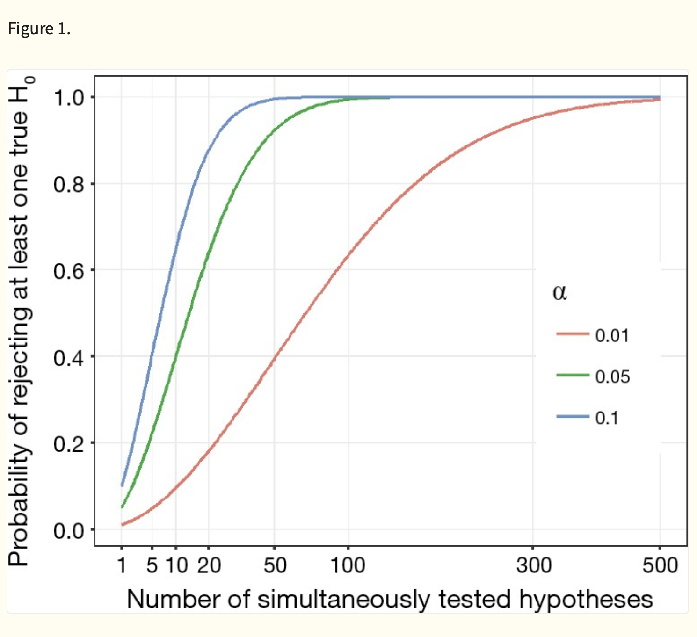
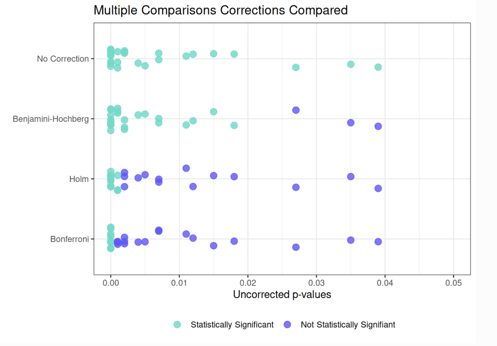
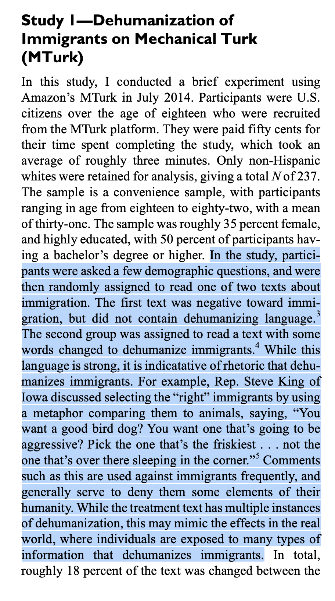
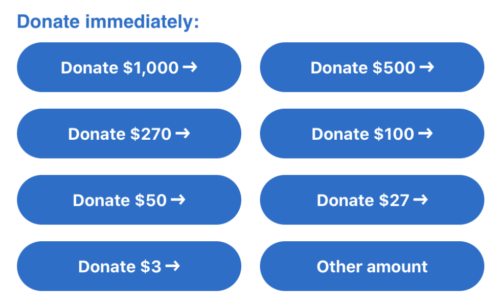
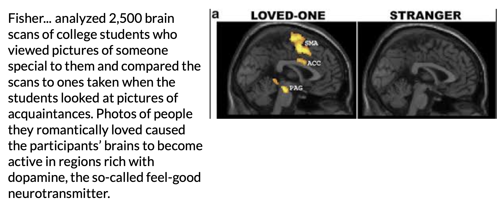
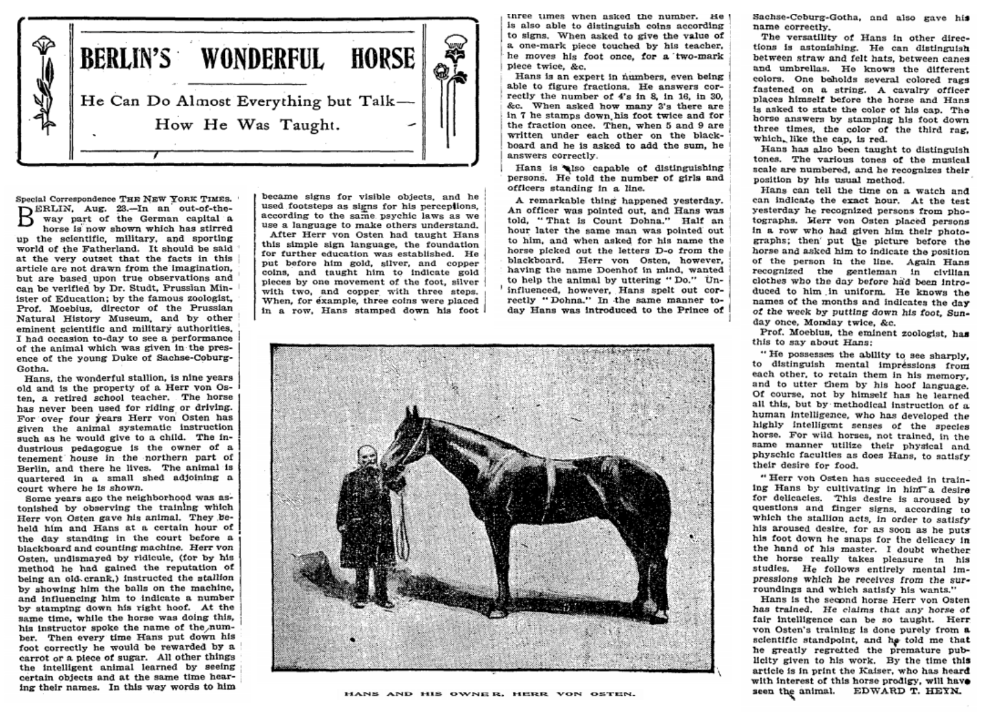

## [Check-In : Dehumanization Data](https://forms.gle/tQbHnMEiCfzAMz5W7)


### A Case of P-Hacking

- [**P-Hacking Demonstration**](https://stats.andrewheiss.com/hack-your-way/)**.** A recreation of a great interactive demonstration of how you can say anything with the "right" linear model.

- [**Tsang, B. (2025). P hacking—five ways it could happen to you. *Nature*, *10***](https://www.dropbox.com/scl/fi/qvzu81r7xkdifrybc1753/PhackingFivewaysitcouldhappentoyou.pdf?rlkey=ixxwyu3tuefn1dbgwhjyxtx7g&dl=0)**.** Do you think fear mongering is good if it's in the interest of valid science?

- [**Data Colada**](https://datacolada.org)**.** Thoughts on quality control in the social science. These authors have shed light on (and taken down) some big names in the field.

### Multiple Comparisons

::: panel-tabset
#### the problem

{fig-align="center" width="539"}

#### some corrections

{fig-align="center" width="591"}
:::

## PART 1 : Power Review

### haha so what was power, professor?

**Power :** the probability that you would "correctly" observe the relationship between two variables if the relationship actually exists (*i.e., if the null hypothesis were NOT true*).


### goal : you want power to be HIGH

- [Play with the power visualization - click "solve for power"](https://rpsychologist.com/d3/nhst/)
- DISCUSS : what could we do as researchers to increase power???

:::: fragment
::: callout-note
## spoilers

**the effect size increases :** the bigger the difference, the more likely you'll detect it.

**your sample size increases :** the more people, the less sampling error, and the easier it is to have confidence that any difference you found is not just chance.

**you increase the threshold for rejecting the null hypothesis :** if the probability of rejecting the null hypothesis = 10%, then your power increases.
:::
::::

### what's the point, professor?

::::: columns
::: {.column width="50%"}
- **Reasons to Calculate Power :**

  - **Post-Hoc Power :** You did a study, and want to further contextualize your guess about how much sampling error influenced your results.

  - **Power Planning :** You are planning to run a study, and want to know how many people to recruit to have the highest probability of observing the "true" effect (if it exists.)

    - Power is a function of : effect size, sample size, and the alpha level (alpha = the Type I error that the researcher sets).
    - You can use these terms to estimate the sample size needed for a given power (the convention is often 80%).
:::

::: {.column width="50%"}

:::
:::::

### ACTIVITY : calculating in R (by hand) {.smaller}

:::::: panel-tabset
#### the model


#### saving the metrics we need

```{r}
b <- .39
se <- .20
t <- b / se
```

#### t-distribution

- the t-distribution approaches the normal distribution (with a 95% Interval cutoff of 1.96....)
- but we are not quite there so good to look up what the t-value actually is based on our degrees of freedom (the sample size minus the number of parameters in our model)

```{r}
n <- 237 # the sample size
df <- n-1 # degrees of freedom
qt(.975, df = df) # pretty close to 1.96
mcut <- qt(.975, df = df) # saving this value

t - mcut 
tdiff <- t - mcut 
pt(tdiff, df = df) # our power.
```

#### pwrss

similar to our calculation "by hand"

```{r}
#| echo: true
#| message: false
#| warning: false
# install.packages("pwrss")
library(pwrss)
pwrss::power.t.test(ncp = t, df = df, plot = FALSE)
```

#### a picture is worth....

```{r}
pwrss::power.t.test(ncp = t, df = df, plot = TRUE, verbose = FALSE)
```

#### another method

::::: columns
::: {.column width="30%"}
- cohen's d = b / $\sigma$
- sampling error = $\frac{\sigma}{\sqrt{n}}$
- $\sigma$ = $se * \sqrt{n}$
:::

::: {.column width="70%"}
```{r}
sdest <- (.20 * 237^.5) # formula for sd based on sampling error
pwrss::power.t.student(.39/sdest, n2 = 237, design = "one.sample")
```
:::
:::::

#### estimating sample size

```{r}
#| echo: true
pwrss::power.t.student(.39/sdest, power = .80, design = "one.sample")
```
::::::

### ACTIVITY : Calculating (and Plan) Power for Another Lab 4

::::: columns
::: {.column width="50%"}

:::

::: {.column width="50%"}
- cohen's d = b / $\sigma$
- sampling error = $\frac{\sigma}{\sqrt{n}}$
- $\sigma$ = $se * \sqrt{n}$

```         
pwrss::power.t.student(d = ???, n2 = ???, design = "one.sample")
pwrss::power.t.student(d = ???, power = ???, design = "one.sample")
```
:::
:::::

## PART 2 : Recapping Experiments

### DEFINITION : Principles of an Experiment {.smaller}

::::: columns
::: {.column width="40%"}
outcome (DV). what the researchers want to predict or explain

manipulation (IV). change only one thing about the variable

confound variables (“noise”). other factors that might influence the outcome variable

random assignment. if people put in random groups, then all other confound variables are *random error*.
:::

::: {.column width="60%"}
{width="628"}

{width="625"}
:::
:::::

### KEY IDEA : Watch out for Misleading Control Variables {.smaller}

**RECAP : the manipulation (A/B Testing) :** researchers create multiple groups (conditions) and change ONE THING (the IV) about a person’s experience in each group & observe the result (the DV).

**KEY IDEA : the comparison group matters!**

- a 1.5 hour research methods class DECREASES boredom compared to…

- a 1.5 hour research methods class INCREASES boredom compared to…

### Science is Hard : Power Posing

- What is the experimental / control condotion?

- Is this a fair comparison / manipulation?

::::: columns
::: {.column width="50%"}

:::

::: {.column width="50%"}
{width="598"}
:::
:::::

### Example : Gratitude Study {.smaller}

::::: columns
::: {.column width="40%"}
Read the prompt below. Answer the following questions.

1.  **ICE-BREAKER :** What's something that you are grateful for?
2.  What is the experimental / control condition?
3.  Is this a fair comparison / manipulation? What would be better?
:::

::: {.column width="60%"}
{width="587"}
:::
:::::

### Lab 4 : The Dehumanization Study

{width="308"}

### Lab 6 : The Anchoring Study

::: panel-tabset
#### Anchoring Data

```{r}
#| message: false
#| warning: false
#| include: false
library(pwrss)
library(gplots)
library(jtools)
d <- read.csv("~/Dropbox/!GRADSTATS/COMPSS212/Datasets/Nobel Prize Experiment Data/anchor.csv", stringsAsFactors = T)
d$treeheight[d$treeheight > 1000] <- NA
d$meateat[d$meateat > 1000] <- NA
mod1 <- lm(catspeed ~ condition, data = d)
mod2 <- lm(treeheight ~ condition, data = d)
mod3 <- lm(meateat ~ condition, data = d)
```

```{r}
#| echo: false

export_summs(mod1, mod2, mod3,
             model.names = c("DV = Cat Speeds",
                             "DV = Tree Heights",
                             "DV = Meat Consumption"))
```

#### Anchoring Study (Real-Life Examples)

|                                      |                                      |
|--------------------------------------|--------------------------------------|
|  |  |
:::

### Other Questions to Consider : Does the experiment have....

::: panel-tabset
#### placebo effects

Will individuals in the study change their behavior if they expect something to have an effect?


#### external validity

How much does the experimental manipulation represent what someone might experience in real life?

[](http://neuro.hms.harvard.edu/harvard-mahoney-neuroscience-institute/brain-newsletter/and-brain-series/love-and-brain)

#### construct validity

How much does the manipulation actually change the variable of interest?

{fig-align="center"}

#### expectancy effects

If experimenters know what will happen to participants, will they change their behavior in ways that affect the results?

[{width="678"}](http://query.nytimes.com/mem/archive-free/pdf?res=9E02E2D91F3AE733A25757C0A96F9C946597D6CF)
:::

### okay.

{fig-align="center" width="466"}
