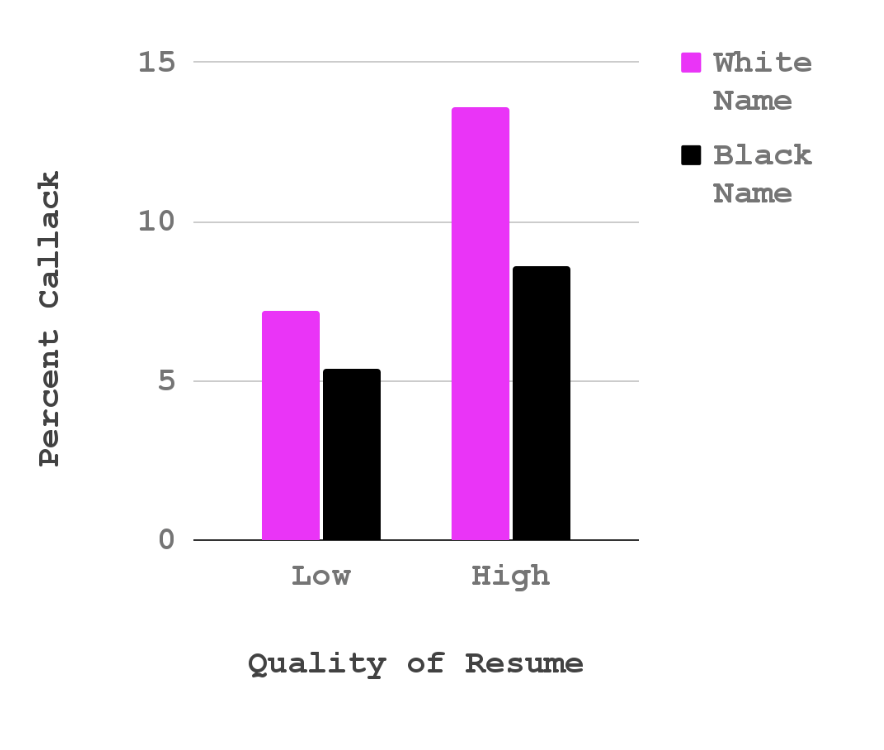
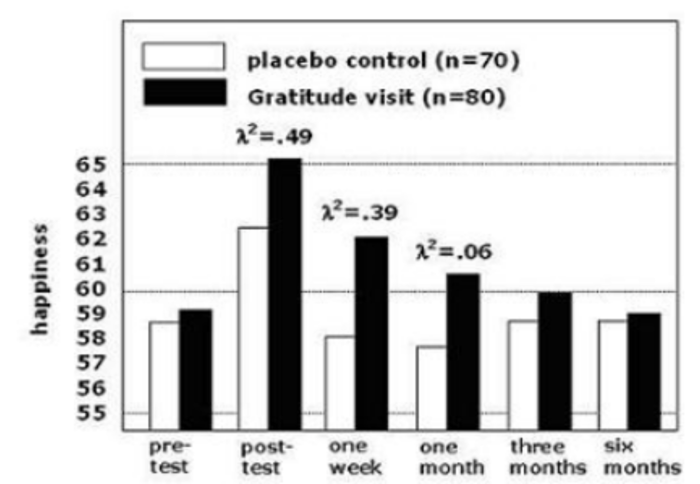
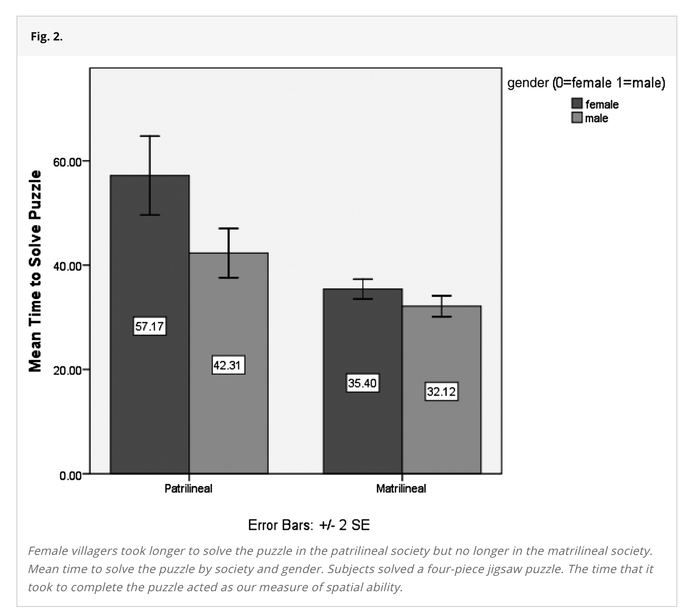
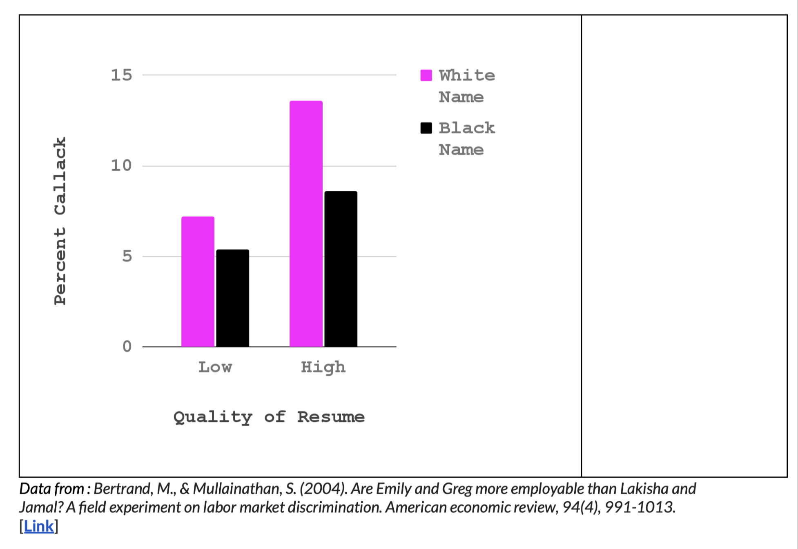

## Check-In : Power Review {.smaller}

Researchers did not find a significant relationship between Sex and Salary when controlling for years of service. Estimate a) the power that they had to detect this effect, and b) the sample size that they would need for a power of 80%.

::: panel-tabset
#### Summary Model

```{r}
#| include: false
library(car)
library(gplots)
library(jtools)
library(ggplot2)
library(arm)

mod1 <- lm(salary ~ yrs.service, data = Salaries)
mod2 <- lm(salary ~ sex, data = Salaries)
modx <- lm(yrs.service ~ sex, data = Salaries)
mod3 <- lm(salary ~ yrs.service + sex, data = Salaries)
mod4 <- lm(salary ~ yrs.service * sex, data = Salaries)

mod1x <- arm::standardize(mod1, NULL, T)
mod2x <- arm::standardize(mod2, NULL, T)
mod3x <- arm::standardize(mod3, NULL, T)
mod4x <- arm::standardize(mod4, NULL, T)

```

Table 1A. Predicting Salaries from Years of Service and Sex.

```{r}
#| echo: false
export_summs(mod1, mod2, mod3,
             coefs = c("Intercept" = "(Intercept)",
                       "Years of Service" = "yrs.service",
                       "Sex (0 = F; 1 = M)" = "sexMale"))
```

#### Standardized Model

Table 1B. Predicting Salaries from Years of Service and Sex (Standardized / Z-Scored)

```{r}
#| echo: false
export_summs(mod1x, mod2x, mod3x,
             coefs = c("Intercept" = "(Intercept)",
                       "Years of Service" = "z.yrs.service",
                       "Sex (0 = F; 1 = M)" = "c.sex"))
```

#### Variables

**Salaries Dataset.** "The 2008-09 nine-month academic salary for Assistant Professors, Associate Professors and Professors in a college in the U.S. The data were collected as part of the on-going effort of the college's administration to monitor salary differences between male and female faculty members."

```         
-   salary : the salary of the professor, in cold, hard, US American Dollars.

-   yrs.service : the years of service the professor had at the college.

-   sex : whether the professor was Male or Female
```

#### Code

```         
library(car)
library(gplots)
library(jtools)
library(ggplot2)
library(arm)

mod1 <- lm(salary ~ yrs.service, data = Salaries)
mod2 <- lm(salary ~ sex, data = Salaries)
modx <- lm(yrs.service ~ sex, data = Salaries)
mod3 <- lm(salary ~ yrs.service + sex, data = Salaries)
mod4 <- lm(salary ~ yrs.service * sex, data = Salaries)
export_summs(mod1, mod2, mod3,
             coefs = c("Years of Service" = "yrs.service",
                       "Sex (0 = F; 1 = M)" = "sexMale"))

mod1x <- arm::standardize(mod1, NULL, T)
mod2x <- arm::standardize(mod2, NULL, T)
mod3x <- arm::standardize(mod3, NULL, T)
mod4x <- arm::standardize(mod4, NULL, T)
export_summs(mod1x, mod2x, mod3x,
             coefs = c("Years of Service" = "z.yrs.service",
                       "Sex (0 = F; 1 = M)" = "c.sex"))
```
:::

## Part 1 : Power Recap

:::::: panel-tabset
### Drawing Power

[Link to Professor Drawing](https://docs.google.com/drawings/d/1IYhMSCZXp5K1HqmxRzNET98Vu1bXnJSIs5_oZZ5n2GQ/edit?usp=sharing)


### Power (t)

::::: columns
::: {.column width="30%"}
```{r}
#| message: false
#| warning: false
library(pwrss)
pwrss::power.t.test(1.86, df = 397, verbose = FALSE)
```
:::

::: {.column width="70%"}
```{r}
pwrss::power.t.test(1.86, df = 397, plot = FALSE)
```
:::
:::::

### Power (d)

```{r}
pwrss::power.t.student(d = .09, # cohen's d
                         n2 = 397, # sample size
                         design = "one.sample") # assuming no difference (null)
```

### Power (R2diff)

```{r}
pwrss::power.f.reg(r.squared.change = .01, # change from model 3 and model 1
                   n = 397, # sample size
                   k.total = 3) # number of predictors
```

### N? (d)

```{r}
pwrss::power.t.student(d = .09, # cohen's d
                       power = .80, # power
                         design = "one.sample") # assuming no difference (null)
```

### N? (r2)

```{r}
pwrss::power.f.reg(.01, power = .80, k.total = 3)
```
::::::

## Part 2 : Experiment Recap [see slides from last week](https://catterson.github.io/COMPSS212/slides/7_powerx_slides.html#/part-2-recapping-experiments)

How could we test whether gender differences were CAUSING differences in salary? Principles of Experimentation :

- Outcome (DV). what the researchers want to predict or explain

- Manipulation (IV). change only one thing about the variable

- confound variables (“noise”). other factors that might influence the outcome variable

- random assignment. if people put in random groups, then all other confound variables are random error.

## Part 3 : Introduction to Interaction Effects

### Some Examples

::: panel-tabset
#### resume data

{fig-align="center" width="60%"}

#### gratitude data



#### puzzle data (in section)

{fig-align="center" width="60%"}
:::

### DISCUSS : Interaction Effects

From the [Vision Board](https://docs.google.com/spreadsheets/d/11FZJ76JMBUkKYZRoWASrHhPIldmP7Pziz-WGnlIZuC4/edit?usp=sharing)

- Find someone who you haven't talked to :) or have talked to :)
- Consider an "effect" that you found before.
  - What is the pattern in the data?
  - What's another variable that might influence this pattern result?
  - What might the interaction effect (or lack of one) look like?

### IN R : An Interaction Effect {.smaller}

::: panel-tabset
#### the model

```{r}
#| echo: false

mod1 <- lm(salary ~ yrs.service + I(yrs.service^2), data = Salaries)
mod2 <- lm(salary ~ sex, data = Salaries)
mod3 <- lm(salary ~ yrs.service + I(yrs.service^2) + sex, data = Salaries)
mod4 <- lm(salary ~ (yrs.service + I(yrs.service^2)) * sex, data = Salaries)
export_summs(mod1, mod2, mod3, mod4,
             coefs = c("Years of Service" = "yrs.service",
                       "Years ^ 2" = "I(yrs.service^2)",
                       "Sex (0 = F; 1 = M)" = "sexMale",
                       "Service * Sex (if Male)" = "yrs.service:sexMale",
                       "Service^2 * Sex" = "I(yrs.service^2):sexMale"))
```

#### the graph

```{r}
#| echo: false
#| fig-width: 7
#| fig-height: 5
library(ggplot2)
library(ggthemes)
library(jtools)
ggplot(data = Salaries, aes(x = yrs.service, y = salary, color = sex)) + 
  geom_point(size = .5, alpha = .3, position = "jitter") + 
  labs(title = "The Interaction Effect", x = "Years of Service", y = "Salary", color = "Sex") +
  geom_smooth(method = lm, formula = y ~ poly(x, 2)) + theme_apa()
```

#### the standardized model

```{r}
#| echo: false
mod1x <- arm::standardize(mod1, NULL, T)
mod2x <- arm::standardize(mod2, NULL, T)
mod3x <- arm::standardize(mod3, NULL, T)
mod4x <- arm::standardize(mod4, NULL, T)

export_summs(mod1x, mod2x, mod3x, mod4x,
             coefs = c("Years of Service" = "z.yrs.service",
                       "Service^2" = "I(z.yrs.service^2)",
                       "Sex (0=F; 1=M)" = "c.sex",
                       "Service * Sex" = "z.yrs.service:c.sex",
                       "Service^2 * Sex" = "I(z.yrs.service^2):c.sex"))
```

#### the code

```         
### the interaction effect
mod4 <- lm(salary ~ (yrs.service + I(yrs.service^2)) * sex, data = Salaries)

### standardizing models
mod1x <- arm::standardize(mod1, NULL, T)
mod2x <- arm::standardize(mod2, NULL, T)
mod3x <- arm::standardize(mod3, NULL, T)
mod4x <- arm::standardize(mod4, NULL, T)

export_summs(mod1x, mod2x, mod3x, mod4x,
             coefs = c("Years of Service" = "z.yrs.service",
                       "Service^2" = "I(z.yrs.service^2)",
                       "Sex (0=F; 1=M)" = "c.sex",
                       "Service * Sex" = "z.yrs.service:c.sex",
                       "Service^2 * Sex" = "I(z.yrs.service^2):c.sex"))
### the graph
library(ggplot2)
library(ggthemes)
library(jtools)
ggplot(data = Salaries, aes(x = yrs.service, y = salary, color = sex)) + 
  geom_point(size = .5, alpha = .3, position = "jitter") + 
  labs(title = "The Interaction Effect", x = "Years of Service", y = "Salary", color = "Sex") +
  geom_smooth(method = lm, formula = y ~ poly(x, 2)) + theme_apa()
```
:::

### More Interaction Effect Practice (as needed)

#### [**SEE PROFESSOR HANDOUT.**](https://www.dropbox.com/scl/fi/uhbe7e4allcig19npwp2a/Interaction_Practice.pdf?rlkey=yhlw9utyq4tfyn8fkg5i44kzg&dl=0)

#### {width="80%"}
