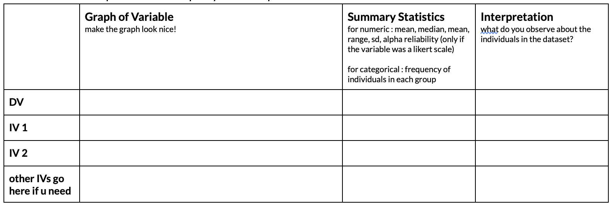

### Your Final Project Dataset in R.

**Finish collecting your final project data, export these data into a .csv format, do some (extra) data cleaning to make your project dataset nice and organized, and then start doing descriptive statistics for your variables.**

[**There are videos and steps in the Final Project Description on how to do this you should watch**](https://docs.google.com/document/d/1DxiIxm_sRtm8t5FEOWhOJluJOo6ZPUI_eZTS13K4CxA/edit?tab=t.0#bookmark=kix.f8xqppo2xcej)**. You will also work on this in Discussion Section!!**

To show you've done this, start filling in some of the descriptive statistics for your final project in the some kind of table (see below for an example of what this could look like.)

