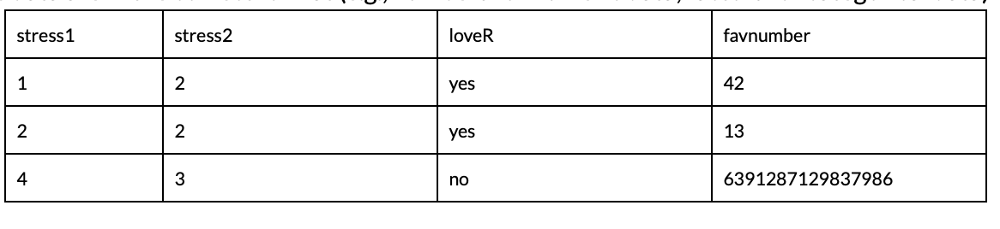
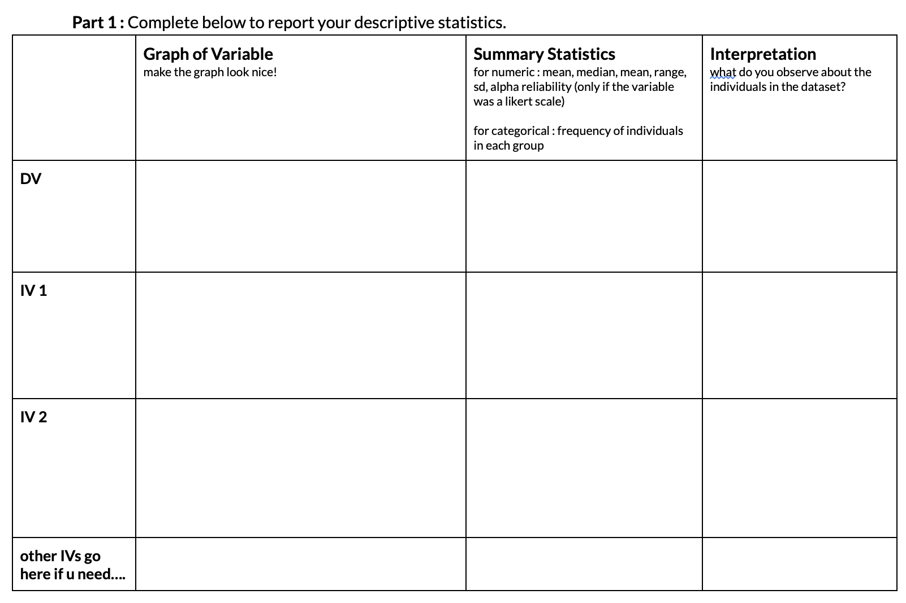

# Week 11 - Monday, November 16th

:::::: {.callout-note collapse="true"}
### Announcements and Agenda and Advertisement(s)

::::: columns
::: {.column width="50%"}
- **THE END IS NEAR.** Three classes (and a brain exam and final project) left. Whew!
- **Brain Exam is final week HELD IN SECTION.** Will review in class and section. On interpreting regression (NHST and multiple regression). The learning has not stopped. But will soon.
- **Final Project :** really really really great to have final project data collected and into R by end of this week.
:::

::: {.column width="50%"}
**Today, on Psych 101...**

- **3:10 - 3:20.** Post R-Exam.
- **3:20 - 4:10.** Experiments and Cat Speeds
- **4:10 - 4:20.** BREAK TIME
- **4:20 - 5:00.** Likert Scales in R
- **5:00 - 6:00.** Final Project Workshop
:::
:::::
::::::

### Class Slides and Materials

```{=html}
<iframe data-external="1" class="slide-deck" src="/calstats/slides/experiment3L_likertR_slides.html" width="800" height="500" title=""></iframe>
```

- [**Complete this Check-In**](https://docs.google.com/forms/d/e/1FAIpQLSc91c7vbtWBqbE2tWFs2y_gVGQVsjUffSXc-7rHeXYiPXYXqQ/viewform?usp=header). Your thoughts on the R Exam and Final Project and rest of the semester.
  - [Part 1 : Anchoring Dataset](https://www.dropbox.com/scl/fo/spf5dvne5wbwi6xuxcqd9/AGPQ6v0i46raSmLrcR1aREo?rlkey=hhuxh3i1u0yadlc9e9n7bcn1z&dl=0)
  - [Part 2 : Full Conspiracy Beliefs Dataset](https://www.dropbox.com/scl/fo/5jc110ffo5f2kary5tm7q/AIQOU0mVJB0rd6bOCw64dVE?rlkey=146n0ta87z4lja9zduylpjboz&dl=0)
- [**Professor Notes**](https://www.dropbox.com/scl/fo/gl6k038pu9duy75jvq1t0/ALCXZvj5iBfl0uCRfZfZiHM?rlkey=kon74xzou91hkhgx8tfjmdet5&dl=0)**.** My R scripts and other notes, saved in real-time.
- [**Final Project Description & Rubric**](https://docs.google.com/document/d/1DxiIxm_sRtm8t5FEOWhOJluJOo6ZPUI_eZTS13K4CxA/edit?usp=sharing)**.** And here's the [Final Project Vision Board](https://docs.google.com/spreadsheets/d/1WMn8SH-yQC-5bNcnQR-Jp5RWkxutVlKNmxCgMDgompI/edit?usp=sharing).

# For Next Class.

## [Chapter 10.](https://catterson.github.io/ystats/chapters/10R_MultipleRegression.html) On Multiple Regression.

And the reading quiz. No R required.

## [Milestone #4.](https://docs.google.com/document/d/1DxiIxm_sRtm8t5FEOWhOJluJOo6ZPUI_eZTS13K4CxA/edit?tab=t.0#bookmark=kix.f8xqppo2xcej) Exporting Your Data and Descriptive Statistics

1.  **Export your final project data from Google Forms.** You may need to do some data cleaning to get this into R. Once you load the data, make sure it "looks good" (each variable has a name; the data are the right type (e.g., number data are numeric).

    

2.  **Then, do some descriptive statistics.** Submitting a 1-2page document that includes the table below.

    

## 
