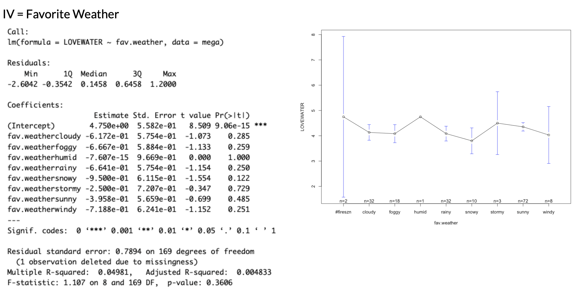
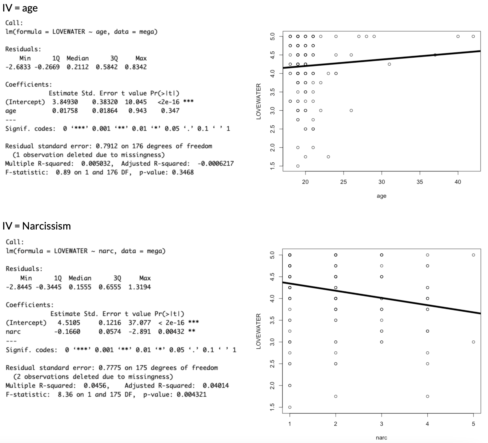

# Week 8 - Monday, October 26th

:::::: {.callout-note collapse="true"}
### Announcements and Agenda

::::: columns
::: {.column width="50%"}
- **THE END IS NEAR.** Four lectures (and an R Exam) left.
- **R Exam is TWO WEEKS.** [Study guide posted](https://docs.google.com/document/d/1myT--E0ePbygFSa3bMxzCb0sb1LnmUOM8XuGlfmq0F4/edit?usp=sharing). Review next week. Adding NHST interpretation. Will be chill. Still time to learn but we are learning so added to the assessment, ya know?
- **Discussion Section**. NHST review and working on Milestone 3.
:::

::: {.column width="50%"}
**Today, on Psych 101...**

- **3:10 - 4:10.** Check-In and NHST Review.
- **4:10 - 4:20.** Break Time.
- **4:20 - 5:00.** More on $R^2$ and other topics.
- **5:00 - ???.** Project Workshop.
:::
:::::
::::::

### Class Slides and Materials

```{=html}
<iframe data-external="1" class="slide-deck" src="/calstats/slides/8_nhst_recap_slides.html" width="100%" height="600px" title=""></iframe>
```

- [**Check-In.**](https://docs.google.com/forms/d/e/1FAIpQLSc7Q4AhxKUG0guX6vp3mqjXjsUdg1jrnMF89tIGTVxvSKdK2g/viewform?usp=dialog) Data for next class.
- [**R EXAM STUDY GUIDE**](https://docs.google.com/document/d/1myT--E0ePbygFSa3bMxzCb0sb1LnmUOM8XuGlfmq0F4/edit?usp=sharing)**.** It will be chill.
- [**Professor Notes**](https://www.dropbox.com/scl/fo/gl6k038pu9duy75jvq1t0/ALCXZvj5iBfl0uCRfZfZiHM?rlkey=kon74xzou91hkhgx8tfjmdet5&dl=0)**.** My R scripts and other notes, saved in real-time.
- [**Final Project Description & Rubric**](https://docs.google.com/document/d/1DxiIxm_sRtm8t5FEOWhOJluJOo6ZPUI_eZTS13K4CxA/edit?usp=sharing)**.** And here's the [Final Project Vision Board](https://docs.google.com/spreadsheets/d/1WMn8SH-yQC-5bNcnQR-Jp5RWkxutVlKNmxCgMDgompI/edit?usp=sharing).

{fig-align="center"}

## For Next Week.

1.  [**Complete Lab 7**](/calstats/labs/Lab7.html)**.** Self-care lab.

2.  **Start Milestone #3.** Drafting your methods section; like a mad-libs. Would recommend doing this before you start building your survey on Google Forms (and would recommend using Google Forms instead of Qualtrics, but if you use Qualtrics to create your survey make sure you are using the Berkeley version.)

3.  **Professor, watching more videos on NHST is my self-care.** Below are some videos. *Note : I recorded these videos in a previous semester (with different class data).* You will likely get different results if you try and replicate these results in this semester's class (though we likely had a different class dataset). a good example of how NHST doesn't really tell us whether the results are "truth" or not, or whether they will replicate.

    ::::: panel-tabset
    #### NHST Recap \[20 min\]

    Focus on the difference between making predictions from our sample and the population, the difference between sampling error and bias, and get a quick(ish) overview of one (confusing) way we try to estimate sampling error called Null Hypothesis Significance Testing (NHST). The p-value and "significance" stuff you may remember from another stats class.

    

    #### Example 1

    ::: {style="position: relative; padding-bottom: 56.25%; height: 0;"}
    <iframe src="https://www.loom.com/embed/67776eb1a41f4b5eaa0ca5312d0663ad" frameborder="1" webkitallowfullscreen mozallowfullscreen allowfullscreen style="position: absolute; top: 0; left: 0; width: 100%; height: 100%;">

    </iframe>
    :::

    {fig-align="center"}

    #### Example 2

    ::: {style="position: relative; padding-bottom: 56.25%; height: 0;"}
    <iframe src="https://www.loom.com/embed/8b755a32fe094e9eb1fc0bd7f16991bd" frameborder="0" webkitallowfullscreen mozallowfullscreen allowfullscreen style="position: absolute; top: 0; left: 0; width: 100%; height: 100%;">

    </iframe>
    :::

    {fig-align="center" width="551"}
    :::::
