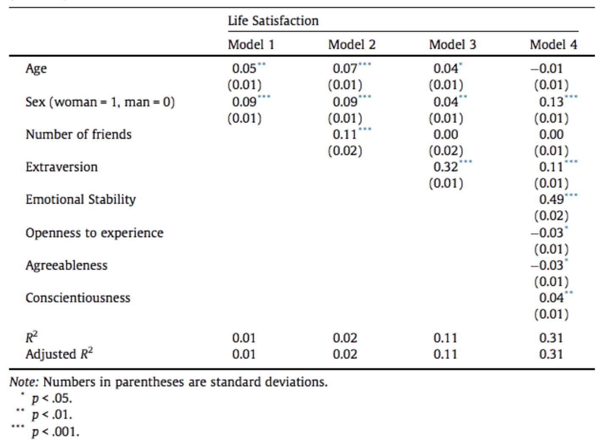
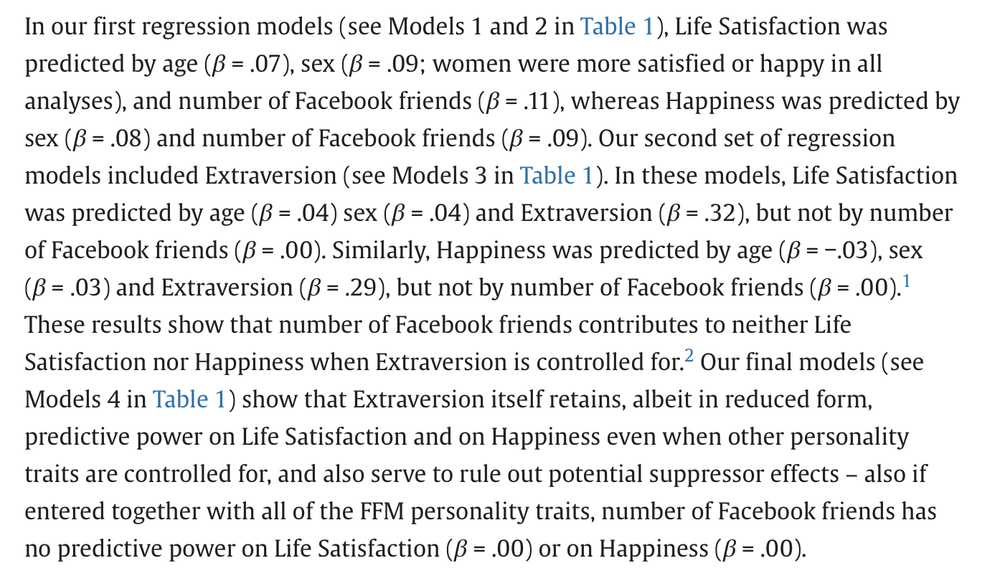

### [Check-In : A Multivariate Regression Table](https://docs.google.com/forms/d/e/1FAIpQLSe4ksB7pNrEpdQcwRG-fOn5Ti5Q85a5ZFJwyC4EckVVhZkA6g/viewform?usp=header)

*Note : number of friends = facebook friends. The numbers reported in parentheses are estimates of **sampling error**.*

{width="655"}

### Interpreting the Regression Table

::::: columns
::: {.column width="60%"}

:::

::: {.column width="40%"}
- Model 1 :

- Model 2 :

- Model 3 :

- Model 4 :
:::
:::::

### From Regression Table to Results Section

::::: columns
::: {.column width="40%"}

:::

::: {.column width="60%"}

:::
:::::

### Multiple Regression : what's going on? {.smaller}

::::::::: panel-tabset
#### Data Cleaning

```{r}
#| echo: true
#| message: false
#| warning: false
#| fig-height: 4
#| fig-width: 12
## Data Cleaning
library(gplots)
d <- read.csv("~/Dropbox/!WHY STATS/0_Shared Folders/101 - Class Datasets/Mini Data/mini_cal_data.csv", stringsAsFactors = T)

d$height[d$height < 40 | d$height > 100] <- NA
d$is.female <- droplevels(d$is.female, exclude = NA)
d$long.hair <- droplevels(d$long.hair, exclude = NA)

par(mfrow = c(1,3))
hist(d$height)
plot(d$is.female, xlab = "Is Female?")
plot(d$long.hair, xlab = "Has Long Hair?")
```

#### Model 1

::::: columns
::: {.column width="60%"}
```{r}
moda <- lm(height ~ long.hair, data = d)
summary(moda)
```
:::

::: {.column width="40%"}
```{r}
#| fig-width: 5
#| fig-height: 5


plotmeans(height ~ long.hair, data = d, connect = F)
```
:::
:::::

#### Model 2

::::: columns
::: {.column width="60%"}
```{r}
modb <- lm(height ~ is.female, data = d)
summary(modb)
```
:::

::: {.column width="40%"}
```{r}
#| fig-width: 5
#| fig-height: 5
plotmeans(height ~ is.female, data = d, connect = F)
```
:::
:::::

#### IV1 \~ IV2

```{r}

plot(d$long.hair ~ d$is.female)
```

#### Model 3

```{r}
modc <- lm(height ~ long.hair + is.female, data = d)
## NO GRAPH FOR THE MULTIPLE REGRESSION
summary(modc)
```


:::::::::

### Multiple Regression : Visualized in Multi-Dimensional Space!

- See the class recording for an interpretation of the plot the code below generates.

- **NOTE : I used AI (Gemini) to generate the code for this graph! Here was my prompt :** "make an interactive 3d plot in R from the dataset d using the numeric outcome variable named height and two categorical predictor variables named long.hair and is.female. Generate a plane from the linear model to fill this 3D plot."

``` r

d <- read.csv("~/Dropbox/!WHY STATS/0_Shared Folders/101 - Class Datasets/Mini Data/mini_cal_data.csv", stringsAsFactors = T)

d$height[d$height < 40 | d$height > 100] <- NA
d$is.female <- droplevels(d$is.female, exclude = NA)
d$long.hair <- droplevels(d$long.hair, exclude = NA)

# PROF used AI (gemini) to generate this code.
##### I used to use the function scatter3d from the "car" library 
##### ....but it stopped working.

# Create the interactive 3D scatter plot
library(plotly) # you may need to install this.
model <- lm(height ~ long.hair + is.female, data = d)
plot_ly(data = d, 
        x = ~long.hair, 
        y = ~is.female, 
        z = ~height, 
        type = "scatter3d", 
        mode = "markers",
        marker = list(size = 5, opacity = 0.8)) %>%
  layout(scene = list(xaxis = list(title = 'Hair Length'),
                      yaxis = list(title = 'Is Female'),
                      zaxis = list(title = 'Height')))

hair_levels <- levels(d$long.hair)
levels(hair_levels)
gender_levels <- levels(d$is.female)

# Create a grid for all combinations
grid <- expand.grid(long.hair = hair_levels, 
                    is.female = gender_levels)

# 3. Predict height across the grid and format as a matrix
z_matrix <- matrix(predict(model, newdata = grid), 
                   nrow = length(hair_levels), 
                   ncol = length(gender_levels))

# 4. Create the plot
plot_ly(d, x = ~long.hair, y = ~is.female, z = ~height) %>%
  add_markers(marker = list(size = 3, opacity = 0.6)) %>%
  add_surface(x = hair_levels, 
              y = gender_levels, 
              z = t(z_matrix), # Transpose to align with axes
              opacity = 0.7, 
              showscale = FALSE) %>%
  layout(scene = list(xaxis = list(title = 'Hair Length'),
                      yaxis = list(title = 'Is Female'),
                      zaxis = list(title = 'Height')))
```

### Reporting Effects in a Regression Table.

**Table 1.** Unstandardized Regression Coefficients; Predicting Height from Long.Hair and Is.Female.

|                             | Model 1 | Model 2 | Model 3 |
|-----------------------------|---------|---------|---------|
| Intercept                   |         |         |         |
| Long.Hair (0 = No; 1 = Yes) |         |         |         |
| Is.Female (0 = No; 1 = Yes) |         |         |         |
| $R^2$                       |         |         |         |

### There's a Package in R For This! {.smaller}

::: panel-tabset
#### the result

**Table 1.** Unstandardized Regression Coefficients; Predicting Height from Long.Hair and Is.Female.

```{r}
#| echo: false
#| message: false
#| warning: false
# install.packages("jtools") # a new package!!!
library(jtools) # make sure you installed the new package first.
export_summs(moda, modb, modc,
             coefs = c("Long Hair (0 = No, 1 = Yes)" = "long.hairYes",
                       "Is Female (0 = No, 1 = Yes)" = "is.femaleYes"))
```

#### the code

``` r
install.packages("jtools") # a new package!!!
library(jtools) # make sure you installed the new package first.
export_summs(moda, modb, modc,
             coefs = c("Long Hair (0 = No, 1 = Yes)" = "long.hairYes",
                       "Is Female (0 = No, 1 = Yes)" = "is.femaleYes"))
```
:::

### Optional : Chapter 12 (on Interaction Effects)

- **Key Idea :** the effect of the IV on the DV *depends on* another IV.

- **Example :** Does the relationship between hair lenght & height depend on whether the person is female or not?

:::{.panel-tabset}

#### The Graph
```{r}
#| echo: false
#| message: false
#| warning: false
modd <- lm(height ~ long.hair * is.female, data = d)
library(interactions)
library(ggplot2)
interactions::cat_plot(modd, 
                       modx = "long.hair",
                       pred = "is.female",
                       interval = TRUE,
                       geom = "bar",
                       colors = c("black", "gray")) + coord_cartesian(ylim = c(60,75))
```

#### The Model
```{r}
#| echo: false
#| message: false
#| warning: false
jtools::export_summs(moda, modb, modc, modd,
             coefs = c("Intercept" = "(Intercept)",
                       "Long Hair (0 = No, 1 = Yes)" = "long.hairYes",
                       "Is Female (0 = No, 1 = Yes)" = "is.femaleYes",
                       "Long Hair * Is Female"= "long.hairYes:is.femaleYes"))
```
:::

### Final Project Workshop : Talk to buddy

::::: columns
::: {.column width="50%"}

:::

::: {.column width="50%"}
ICE-BREAKER :

- light mode : if you HAD to get a tattoo, what would you get? where would you get it? would it face toward you or other people?

- heavy mode : if you could change one thing about your childhood, what would you change?

FINAL PROEJCT :

- what is your project model?

- what multiple regression might make sense?

- where are you feeling STRESSED?
:::
:::::
