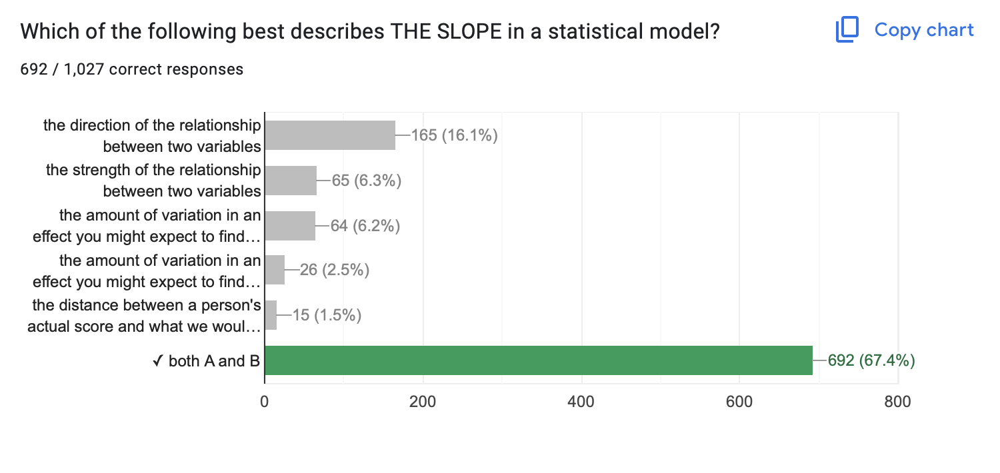
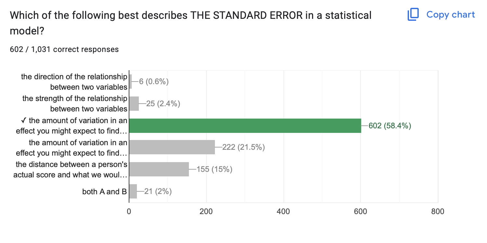
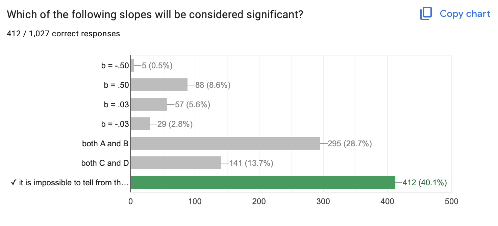
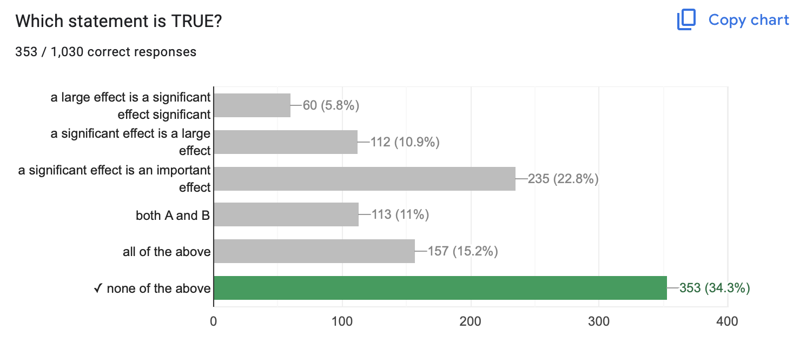
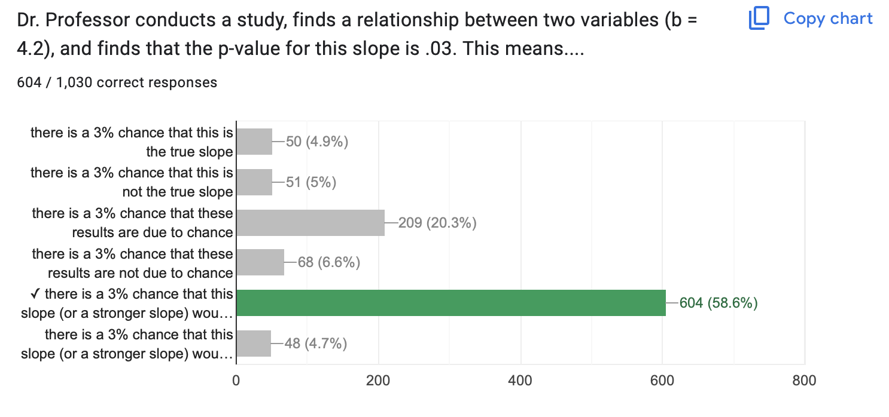
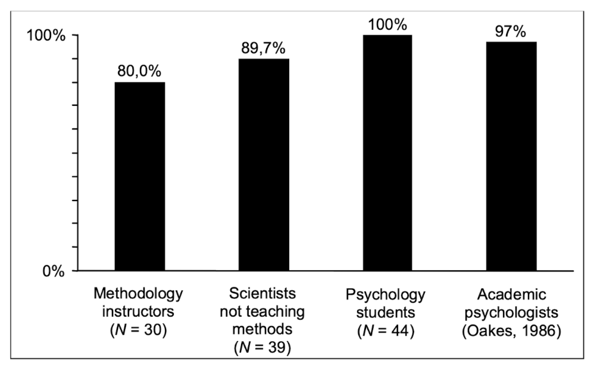
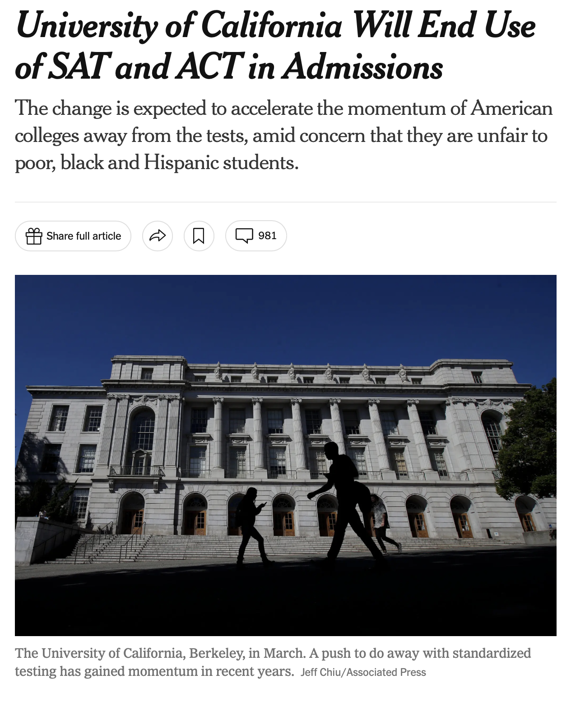
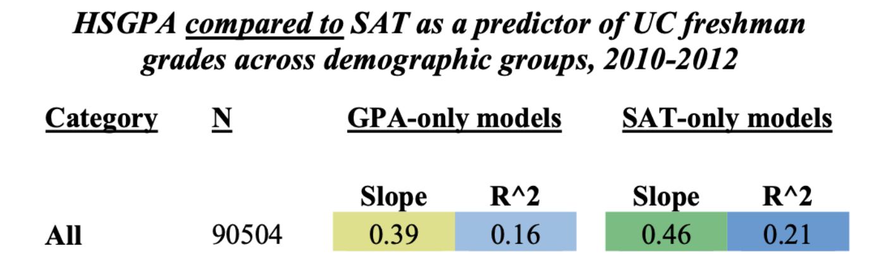
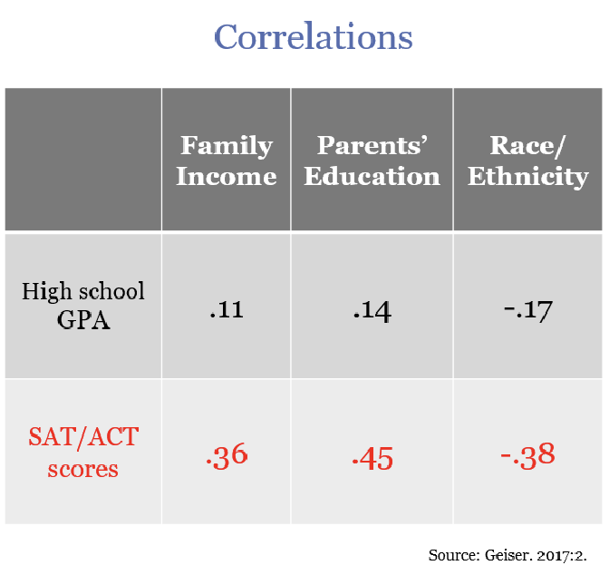

## [Check-In: a quick study from last class we didn't do....](https://docs.google.com/forms/d/e/1FAIpQLSfJC8RLLtQf0Px0yz1nJjx-8CGXFrMcuUg_b3od54kHHPCEHQ/viewform?usp=sf_link)

- No talking, no looking up answers!
- Will use data in lecture :)

{fig-align="center" width="485"}

## Okay, some NHST Examples

::::::::: panel-tabset
#### model 1

::::: columns
::: {.column width="60%"}
```{r}
#| echo: false
#| message: false
#| warning: false
library(car)
library(gplots)
mod1 <- lm(salary ~ yrs.service, data = Salaries)
summary(mod1)
```
:::

::: {.column width="40%"}
```{r}
#| echo: false
#| message: false
#| warning: false
#| fig-width: 5
#| fig-height: 5
plot(salary ~ yrs.service, data = Salaries)
abline(mod1, lwd = 5)
```
:::
:::::

#### model 2

::::: columns
::: {.column width="60%"}
```{r}
#| echo: false
#| message: false
#| warning: false
mod2 <- lm(salary ~ sex, data = Salaries)
summary(mod2)
```
:::

::: {.column width="40%"}
```{r}
#| echo: false
#| message: false
#| warning: false
#| fig-width: 5
#| fig-height: 5
plotmeans(salary ~ sex, data = Salaries, connect = F)
```
:::
:::::
:::::::::

## Ch 8 Review. {.smaller}

::: panel-tabset
### Slope

- Direction & Strength of a Relationship
- Hard to evaluate strength across models if the units differ too.



### Standard Error

- The amount of variation in an effect you might expect to find due to chance if the null hypothesis were "true".



### Significance is Not...

- ...about slope! Large slope & sampling error = NOT SIGNIFICANT



### Significance is Not

- **...about size :** you can be VERY confident that a small effect is not due to sampling error.
- **...about importance :** why does the effect matter?\
- **...about truth :** our estimates of sampling error are all made up.



### Significance Is...

**A p-value of .03 means...there is a 3% chance that this slope (or a stronger slope) would be found due to chance if the true correlation was zero.**



### ...Confusing.

Haller, H., & Krauss, S. (2002). [Misinterpretations of significance: A problem students share with their teachers](https://www.metheval.uni-jena.de/lehre/0405-ws/evaluationuebung/haller.pdf). Methods of Psychological Research, 7(1), 1-20.

{fig-align="center" width="80%"}

### Other Questions?

Break time.

{fig-align="center"}
:::

## RECAP : $R^2$ In Real-Life

::::: columns
::: {.column width="50%"}

:::

::: {.column width="50%"}


**DISCUSS :** what do these linear models tell us about the relationship between GPA, SAT (IVs) and freshman grades (DV)? Why did the researchers not report significance values?
:::
:::::

### $R^2$ is r \* r = a correlation

{width="498"}

## Project Time : Milestone 3

- [**Final Project Description & Rubric**](https://docs.google.com/document/d/1DxiIxm_sRtm8t5FEOWhOJluJOo6ZPUI_eZTS13K4CxA/edit?usp=sharing)**.**

- [Final Project Vision Board](https://docs.google.com/spreadsheets/d/1WMn8SH-yQC-5bNcnQR-Jp5RWkxutVlKNmxCgMDgompI/edit?usp=sharing).

## The End.

{fig-align="center"}
