## [**Check-In**](https://docs.google.com/forms/d/e/1FAIpQLSc91c7vbtWBqbE2tWFs2y_gVGQVsjUffSXc-7rHeXYiPXYXqQ/viewform?usp=header). ouR Exam Thoughts

::::: columns
::: {.column width="60%"}
**After doing the check-in, load the Anchoring Dataset.** We back.
:::

::: {.column width="40%"}

:::
:::::

# Experiments

## DEFINITION : Principles of an Experiment {.smaller}

::::: columns
::: {.column width="40%"}
```         
dependent variable. what the researchers want to predict or explain

experimental manipulation. change only one thing about the variable

extraneous variables as “noise”. other factors that might influence the outcome variable

random assignment. the group people are put in is random; this ensures that all other variables that might affect the result are evenly split across the two groups 

placebo effects. when individuals in the study change their behavior if they expect something to have an effect

external validity. how much does the experimental manipulation represent what someone might experience in real life?

construct validity. how much does the manipulation actually change the variable of interest?

experimenter expectancy effects. if experimenters know what will happen to participants, they may change their behavior in ways that affect the results
```
:::

::: {.column width="60%"}
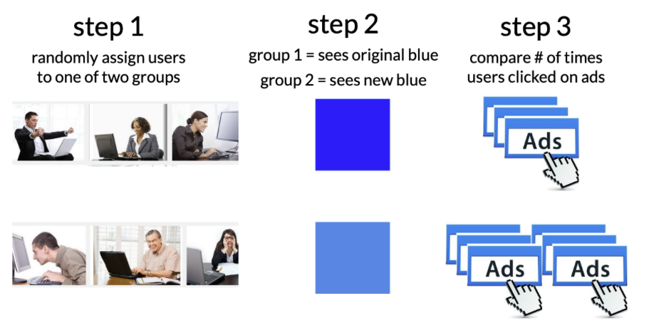{width="646"}
:::
:::::

## Experiment Nuance

### KEY IDEA : Watch out for Misleading Control Variables {.smaller}

**RECAP : the manipulation (A/B Testing) :** researchers create multiple groups (conditions) and change ONE THING (the IV) about a person’s experience in each group & observe the result (the DV).

**KEY IDEA : the comparison group matters!**

- a 2 hour stats class DECREASES boredom compared to…

- a 2 hour stats class INCREASES boredom compared to…

### Science is Hard : Power Posing

::::: columns
::: {.column width="50%"}
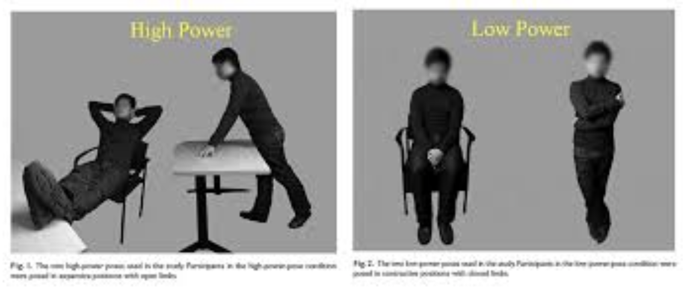](images/clipboard-3273747639.png)
:::

::: {.column width="50%"}
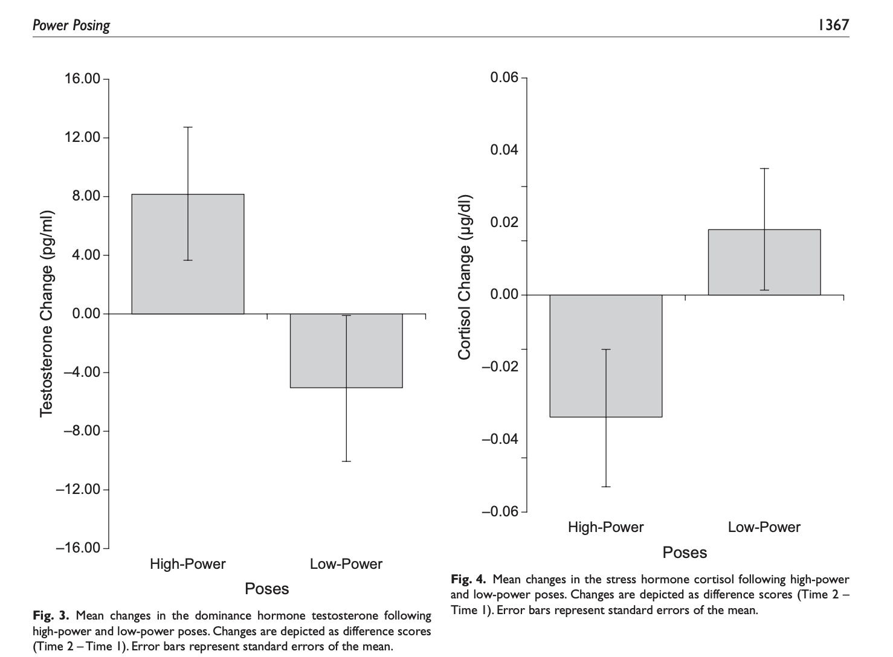
:::
:::::

### Example : Gratitude Study {.smaller}

::::: columns
::: {.column width="40%"}
Read the prompt below. Answer the following questions.

1.  **ICE-BREAKER :** What's something that you are grateful for?
2.  What is the experimental / control condition?
3.  Is this a fair comparison / manipulation? What would be better?
:::

::: {.column width="60%"}
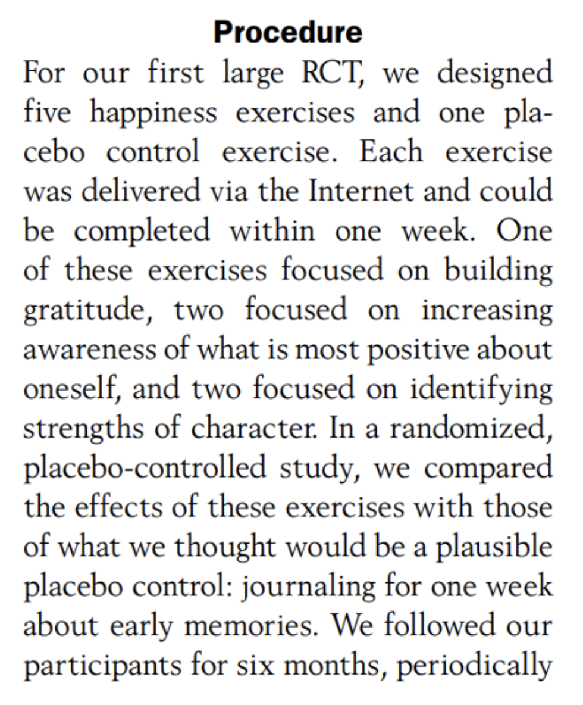
:::
:::::

### Other Questions to Consider : Does the experiment have....

::: panel-tabset
#### placebo effects

Will individuals in the study change their behavior if they expect something to have an effect?

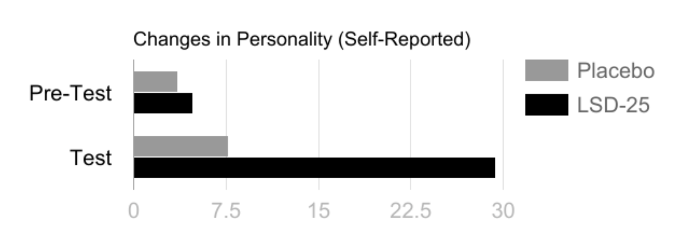

#### external validity

How much does the experimental manipulation represent what someone might experience in real life?

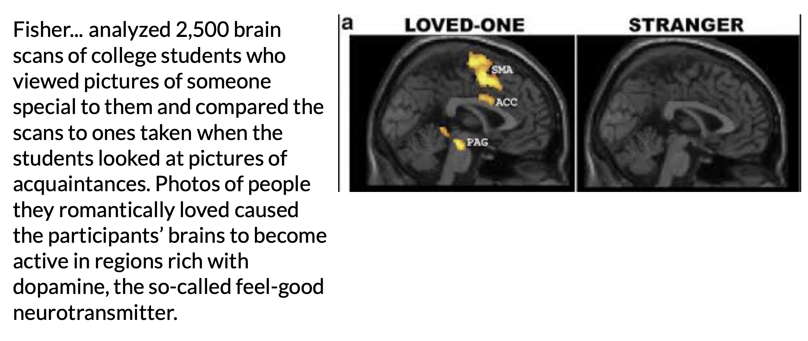

#### construct validity

How much does the manipulation actually change the variable of interest?

{fig-align="center"}

#### expectancy effects

If experimenters know what will happen to participants, will they change their behavior in ways that affect the results?

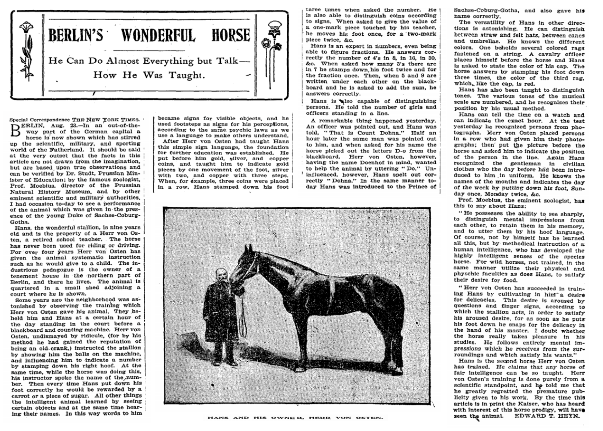{fig-align="center" width="609"}
:::

### Anchoring Experiment

::: panel-tabset
#### Key Questions

- What are some variables that would influence people's beliefs about how fast cats can run???
- What was the manipulation?
  - Avoiding Confounds : What are all the variables that were kept the same across conditions?
  - Potential Confounds : What might be some other differences that might influence people's experience?
- Other Issues? : Placebo effects, external validity, construct validity, expectancy effects? ethics?

#### Random Assignment

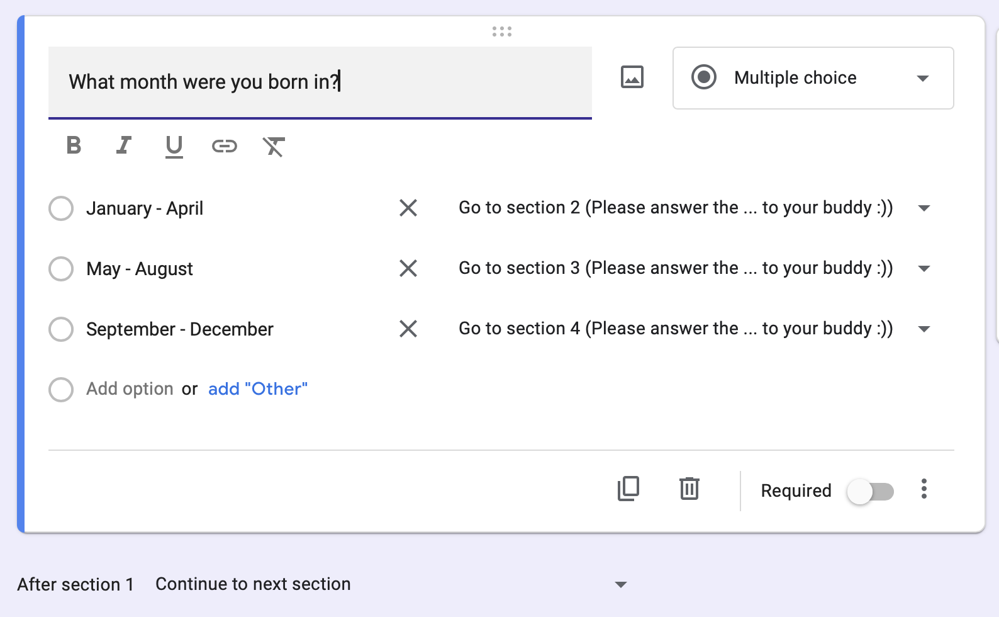{width="627"}

#### High Condition

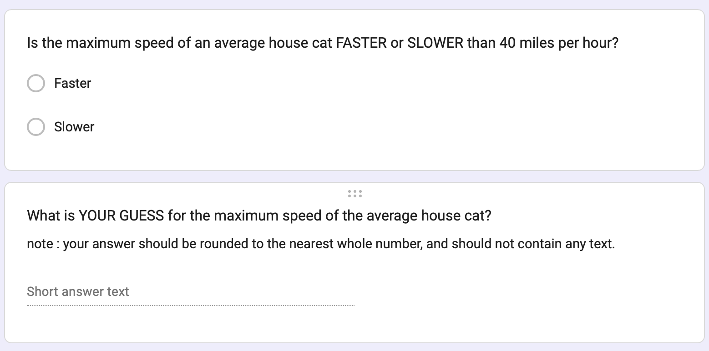{width="657"}

#### Low Condition

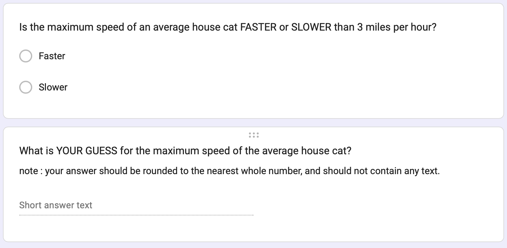{width="668"}

#### Control Condition

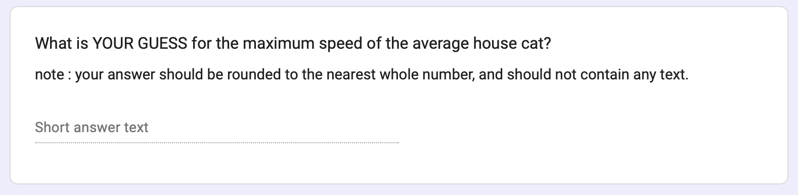{width="666"}
:::

### Anchoring : Question --\> Theory --\> Data {.smaller}

- **Question :** Will the number that people see BEFORE making their own rating influence their decision?

- **Theory :**

  - OPTION A: People who see a HIGHER number before making their own rating will make a HIGHER number than people who see the LOWER number.
  - OPTION B : People who see a LOWER number before making their own rating will make a HIGHER number than people who see the HIGHER number.
  - OPTION C : There will be NO DIFFERENCES between the groups.

## Anchoring in Real-Life

|                                     |                                      |
|------------------------------------|------------------------------------|
| 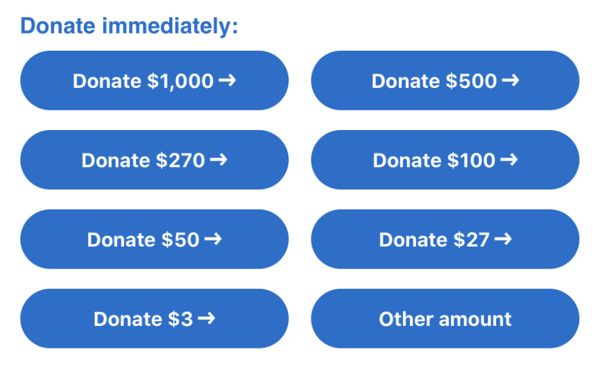 |  |

### YOUR STUDY : an experiment?

-   *Note : not required, and not recommended...something to DISCUSS in the DISCUSSION SECTION for FUTURE RESEARCH.*

::::: columns
::: {.column width="40%"}
**outcome (DV).** what the researchers want to predict or explain

**manipulation (IV).** change only [one thing]{.underline} about the variable.

- **confound variables (“noise”).** other factors that might influence the outcome variable
- **random assignment.** if people put in random groups, then all other confound variables are *random error*.
:::

::: {.column width="60%"}
**DISCUSSION : for your final project topic.**

- What is this question as a linear model?

- What is the key IV (the ONE thing that differs between the two groups)?

- How might you manipulate this variable? (What would be the experimental and control group?)

- What are all the things that you would need or want to try and keep the same (avoid placebo)?
:::
:::::

## BREAK TIME.

<iframe width="560" height="315" src="https://www.youtube.com/embed/w3LjpFhySTg?si=U99lQAeOlPfARHoe" title="YouTube video player" frameborder="0" allow="accelerometer; autoplay; clipboard-write; encrypted-media; gyroscope; picture-in-picture; web-share" referrerpolicy="strict-origin-when-cross-origin" allowfullscreen></iframe>

## PART 2 : Likert Scales in R

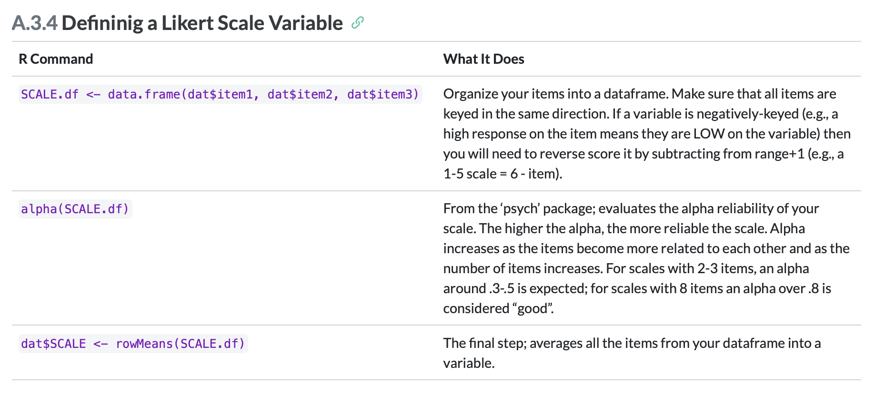{width="587"} 

### RECAP : multiple items –\> one construct

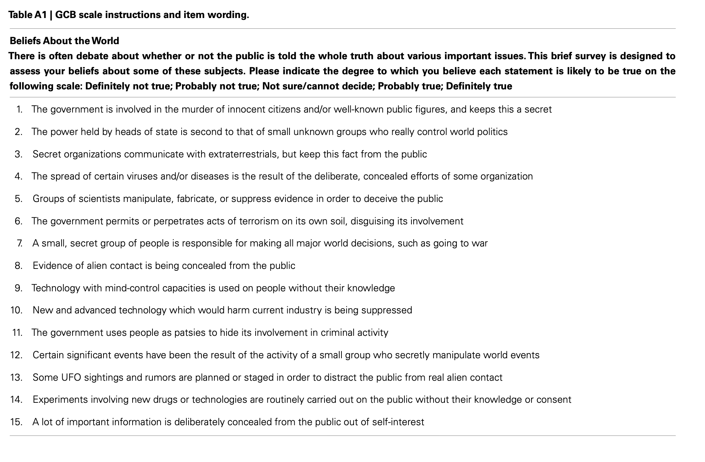{width="597"}

### For the Psychometric Nerds :)

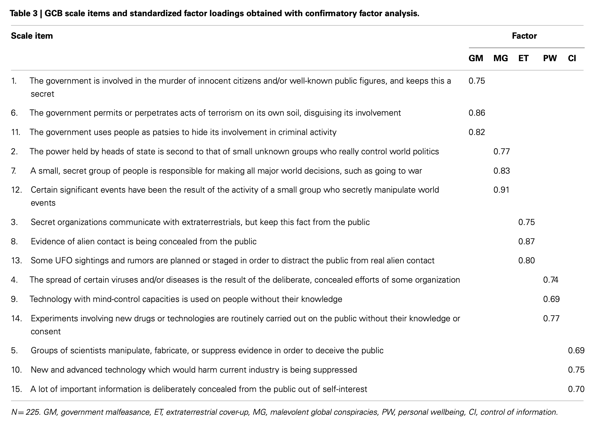{width="684"}

### ACTIVITY in R : defining a conspiracy beliefs scale.


## THE END.

{fig-align="center" width="380"}

