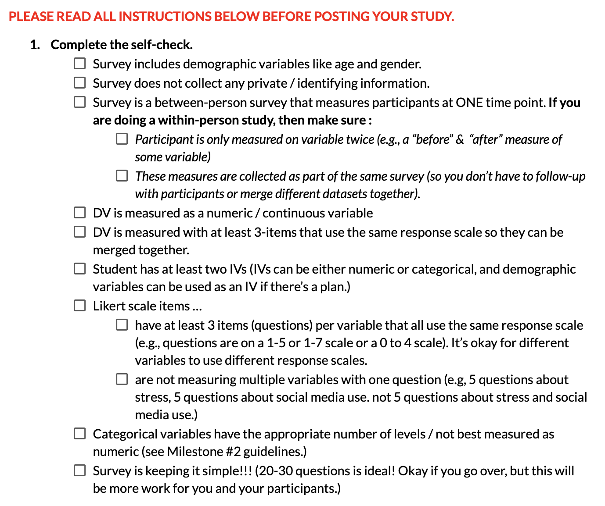
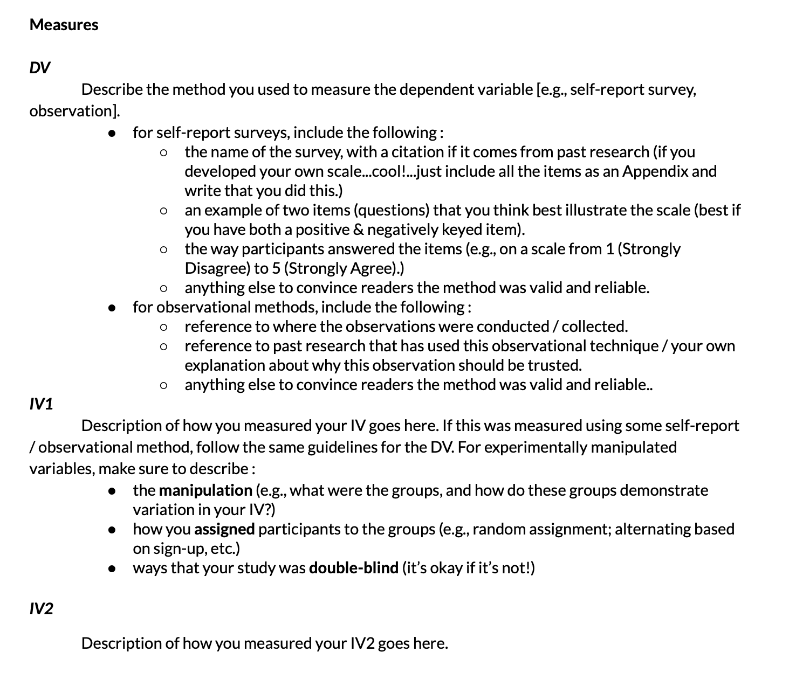
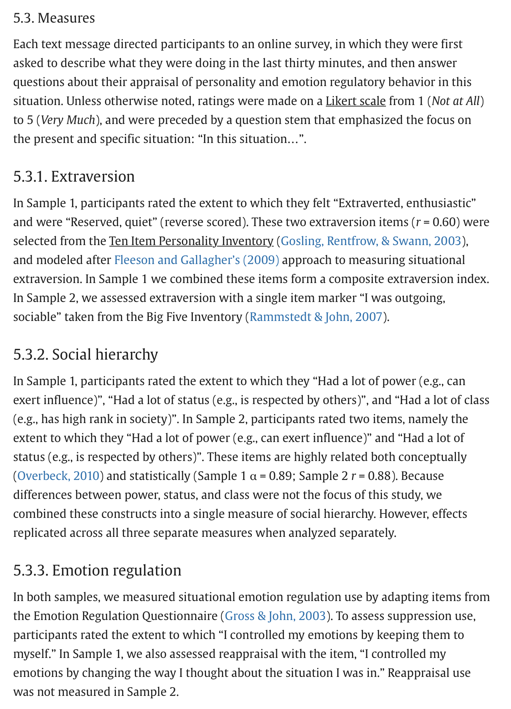
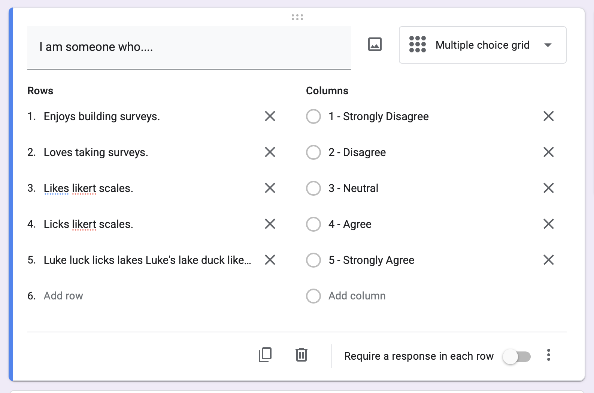
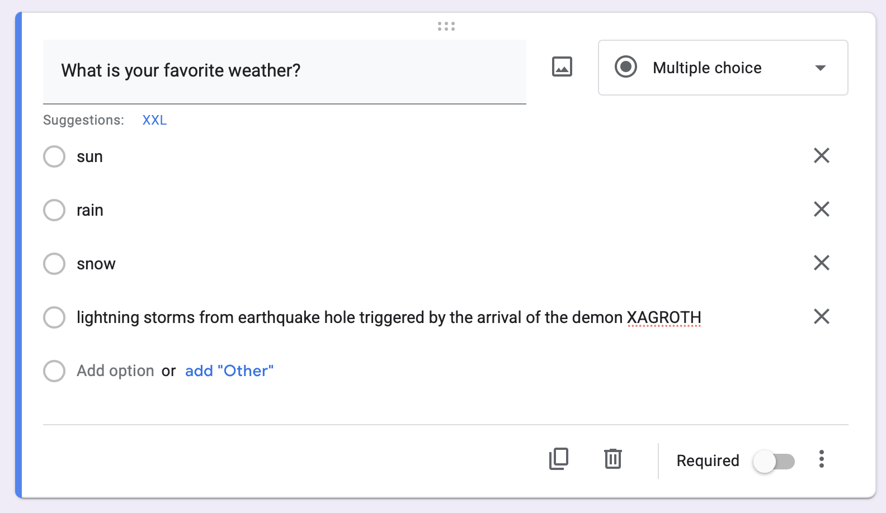
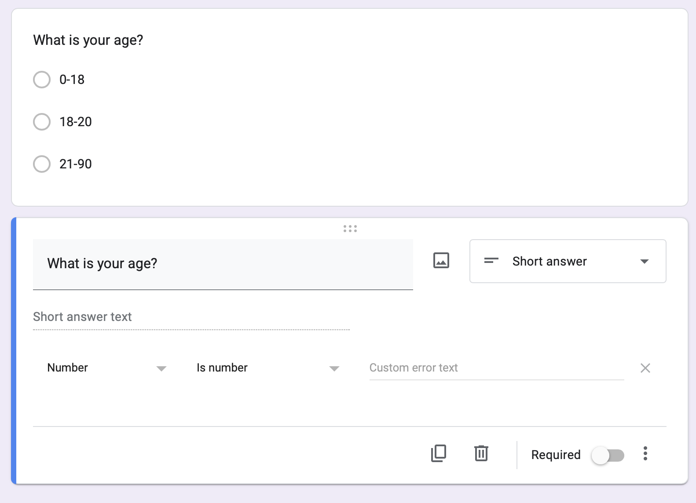

### In-Class R Practice

::::: columns
::: {.column width="40%"}
Instead of a check-in, please access the In-Class R Practice Template.

THIS IS JUST A PRACTICE EXAM.

Professor or GSI or Buddy will check in on you; ask for help if you get stuck.

Any submission will receive FULL CREDIT. The point is to practice for next week :)

Thanks!
:::

::: {.column width="60%"}
**code you may need :**

``` r
head(d) # check the data
hist(d$variable) # graph a numeric variable
plot(d$variable) # graph a categorical variable
mod <- lm(d$dv ~ d$iv) # define a linear model
coef(mod) # find the slope and intercept
summary(mod)$r.squared # report R^2
plot(d$dv ~ d$iv) # graph when IV is numeric (scatterplot)
abline(mod) # draw the model on the scatterplot
gplots::plotmeans(d$dv ~ d$ivF) # graph when IV is categorical
```
:::
:::::

### More Practice
::: panel-tabset
#### The Models

```{r}
#| echo: false
#| message: false
#| warning: false
x <- read.csv("https://www.dropbox.com/scl/fi/kxh61tvf01ur4shqb230h/trust_in_science.csv?rlkey=9ythtv5mz6medhkme3m88j6sk&dl=1", stringsAsFactors = T)
library(gplots)

mod1 <- lm(x$climate_future ~ x$climate_past)
mod2 <- lm(x$climate_future ~ x$residence)

jtools::export_summs(mod1, mod2,
             model.names = c("Model 1", "Model 2"),
             coefs = c("Intercept" = "(Intercept)",
                       "Climate Change Influenced Past Weather" = "x$climate_past",
                       "Residence (0 = Rural, 1 = Urban)" = "x$residenceUrban"))


```

#### The Graphs

```{r}
#| echo: false
#| fig-width: 10
#| fig-height: 5

par(mfrow = c(1,2))
plot(climate_future ~ climate_past, data = x, xlab = "Beliefs Climate Change Influenced Past Weather", ylab = "Belief Climate Change Will Influence Future Weather", main = "Model 1", pch = 19)
abline(mod1, col = "red", lwd = 5)
plotmeans(climate_future ~ residence, data = x, connect = F, main = "Model 2", xlab = "Residence", ylab = "Belief Climate Change Will Influence Future Weather")
```
:::

## BREAK TIME : MEET BACK AT 

# Milestone 3 : Launch Your Study & Draft Your Measures

### Milestone 3 : Launch Your Study

{fig-align="center" width="80%"}

### Milestone 3 : Draft Your Measures

::::: columns
::: {.column width="50%"}
Guidelines

{fig-align="center" width="80%"}
:::

::: {.column width="50%"}
Use Related Research as Examples

{fig-align="center" width="80%"}
:::
:::::

::::::

## Milestone 3 : Launching Your Study (Google Forms) {.smaller}

### Your Survey : DV is NUMERIC with MULTIPLE ITEMS {.smaller}

-   variable measured as likert scale = numeric

-   how to get multiple items for...

    -   hours of sleep

    -   do you like me Y/N

    -   other variables in this room?

### Your Survey : Likert Scales {.smaller}

::::: columns
::: {.column width="50%"}

:::

::: {.column width="50%"}
**Use a Multiple Choice Grid**

-   **Each row is an item.**
    -   All the items use the same "stem" ("I am someone who...")
    -   Do not *require* responses. Okay if folks skip, right?
        -   Attention Checks (e.g., "Mark Strongly Agree for this question.")
        -   BETTER : to keep the survey short; give authentic motivation.
-   **Each column is a response.** Use a 1-5 scale to make it easy / allow for neutral.
:::
:::::

### Your Survey : Categorical Variables {.smaller}

::::: columns
::: {.column width="50%"}

:::

::: {.column width="50%"}
-   **Include demographic variables like age and sex;** give people options to self-identify as something outside a forced binary!
-   **Keep categorical variables to just a few levels;** you will need a LOT of data to capture variation if there are too many levels! 3-4 groups per variable.
:::
:::::

### Your Survey : The Right Type of Variable! {.smaller}

::::: columns
::: {.column width="50%"}

:::

::: {.column width="50%"}
-   **Make sure categorical variables are not better measured numerically.** set "response validation" for any open-ended numbers you hope to collect to make data cleaning easier.

-   **Make sure each variable is measured independently of the others.** For example, if I want to measure the relationship between happiness and reading, I would want to measure these separately.

    -   I am happy.
    -   I like to read.
    -   ~~Reading makes me happy.~~ This mixes up the two variables (the DV and IV). It could be a cool measure on its own (love for reading scale?).
:::
:::::


## THE END.

{fig-align="center" width="498"}
