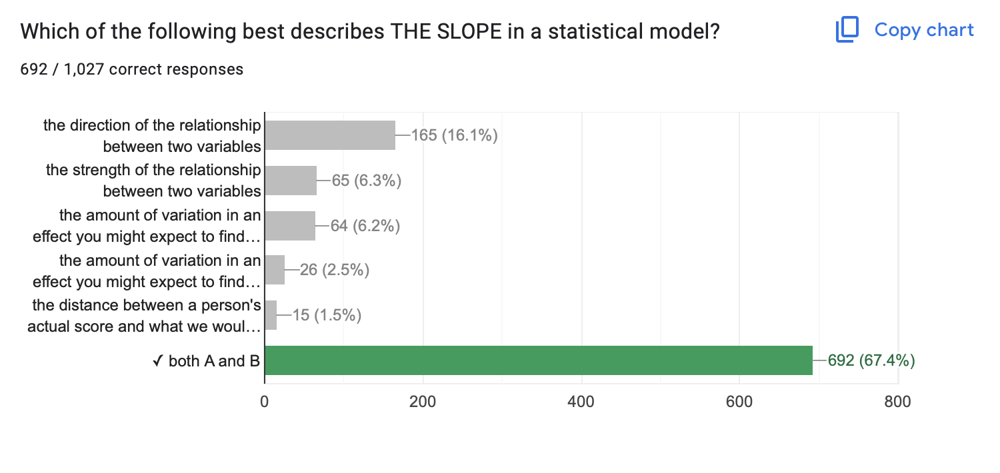
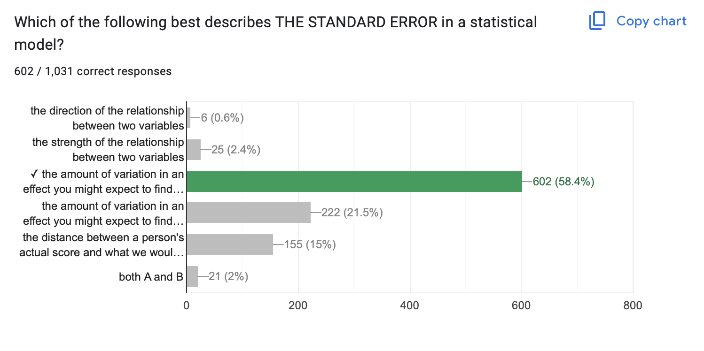
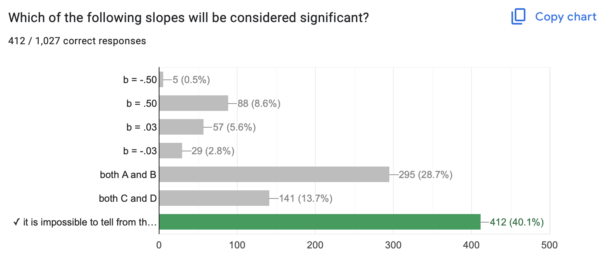
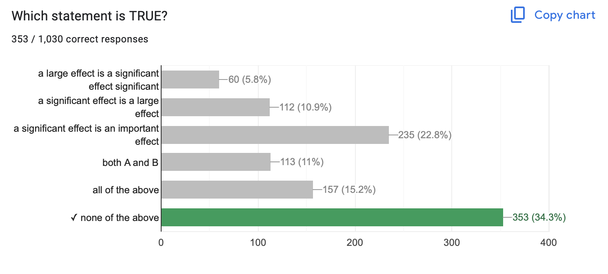
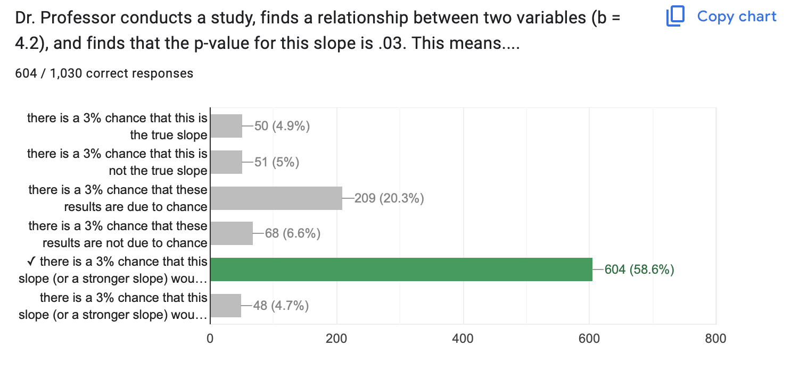
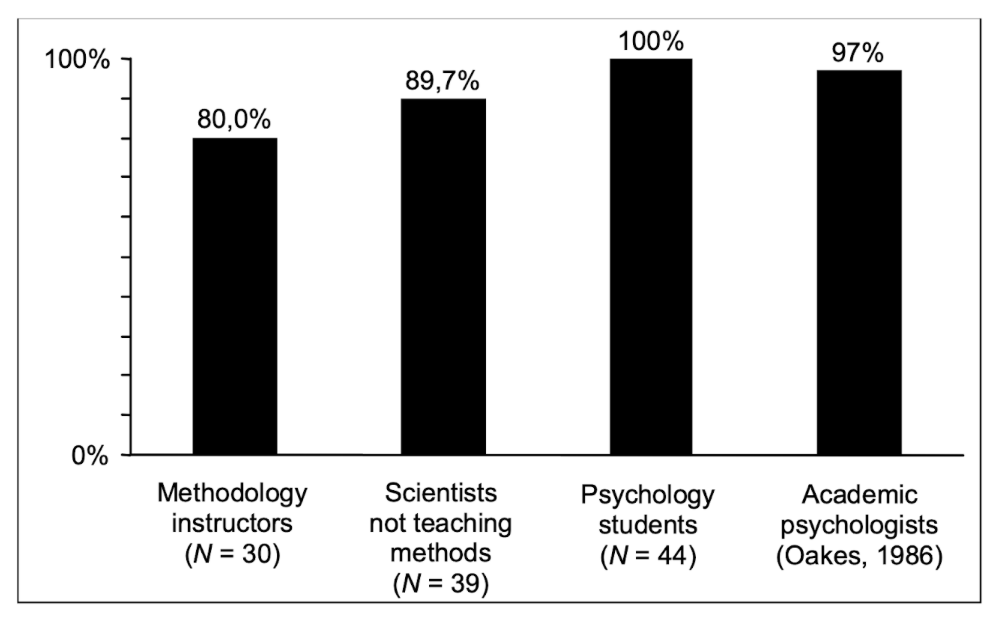

## [Welcome Back : Check-In Here](https://docs.google.com/forms/d/e/1FAIpQLSdyVnc80GrkTtGyaESOJJjjlAUHAUfpgMeiVkpZRo2JhKEbgQ/viewform) {.smaller}


::::: columns
::: {.column width="60%"}
```{r}
#| message: false
#| warning: false
library(car)
library(gplots)
mod <- lm(salary ~ sex, data = Salaries)
summary(mod)
```
:::

::: {.column width="40%"}
```{r}
#| message: false
#| warning: false
#| fig-width: 5
#| fig-height: 5
plotmeans(salary ~ sex, data = Salaries, connect = F)
```
:::
:::::

## More Examples {.smaller}

- **ice-breaker :** dream life (utopia)?
- **the stats & who cares :** what's the slope, significance, R\^2; how would you use this knowledge??

:::::::::::: panel-tabset
#### model 1

::::: columns
::: {.column width="60%"}
```{r}
#| message: false
#| warning: false
mod1 <- lm(salary ~ yrs.service, data = Salaries)
summary(mod1)
```
:::

::: {.column width="40%"}
```{r}
#| message: false
#| warning: false
#| fig-width: 5
#| fig-height: 5
plot(salary ~ yrs.service, data = Salaries)
abline(mod1, lwd = 5)
```
:::
:::::

#### model 2

::::: columns
::: {.column width="60%"}
```{r}
mod2 <- lm(yrs.service ~ sex, data = Salaries)
summary(mod2)
```
:::

::: {.column width="40%"}
```{r}
#| message: false
#| warning: false
#| fig-width: 5
#| fig-height: 5
plotmeans(yrs.service ~ sex, data = Salaries, connect = F)
```
:::
:::::
::::::::::::

## NHST Review. {.smaller}

::: panel-tabset
### Slope

- Direction & Strength of a Relationship
- Hard to evaluate strength across models if the units differ too.

{width="613"}

### Standard Error

- The amount of variation in an effect you might expect to find due to chance if the null hypothesis were "true".



### Significance is Not...

- ...about slope! Large slope & sampling error = NOT SIGNIFICANT

{width="512"}

### Significance is Not

- **...about size :** you can be VERY confident that a small effect is not due to sampling error.
- **...about importance :** why does the effect matter?
- **...about truth :** our estimates of sampling error are all made up.

{width="465"}

### Significance Is...

**A p-value of .03 means...there is a 3% chance that this slope (or a stronger slope) would be found due to chance if the true correlation was zero.**

{width="443"}

### ...Confusing.

Haller, H., & Krauss, S. (2002). [Misinterpretations of significance: A problem students share with their teachers](https://www.metheval.uni-jena.de/lehre/0405-ws/evaluationuebung/haller.pdf). Methods of Psychological Research, 7(1), 1-20.

{width="410"}

### Other Questions?

{width="434"}
:::

### NEXT TIME

::::: columns
::: {.column width="50%"}
1.  sex is related to salary
2.  years of service is related to salary.
3.  sex and years of service are related to each other......
:::

::: {.column width="50%"}
```{r}
mod4 <- lm(salary ~ sex + yrs.service, data = Salaries)
summary(mod4)
```
:::
:::::

## PART 2 : Project Time

### [Final Project Description and Rubric](https://docs.google.com/document/d/1ScvG86PiyyqHO7Ob5bki04XGzCwLodQ4h57n9Jq5DYI/edit?usp=sharing)

-   How does this make you feel?
-   Questions / areas of concern?

### Looking Over Datasets

1.  Which dataset did you choose, and what interests you about this dataset?

2.  Look over the codebook - identify at least two different variables that you are interested in, and explain why you are interested in each one. 

3.  Download the data to your computer, and load the data into R. Make sure the data loaded correctly. Graph ONE of the variables that you are interested in; what do you notice about how people differ on this variable?
