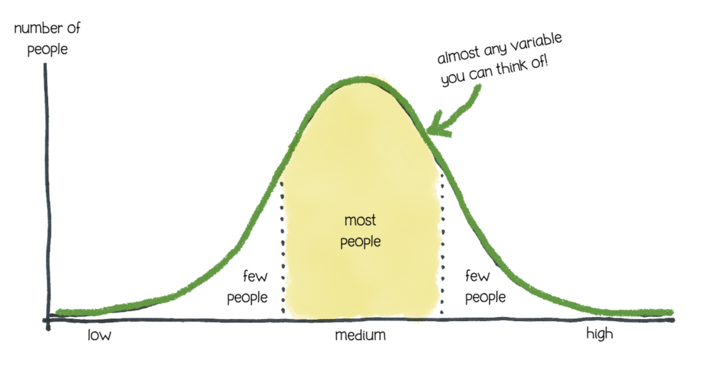
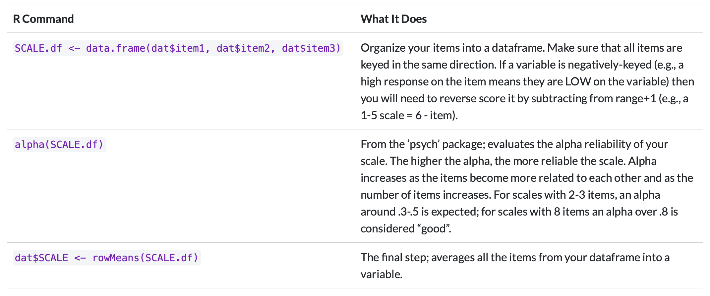
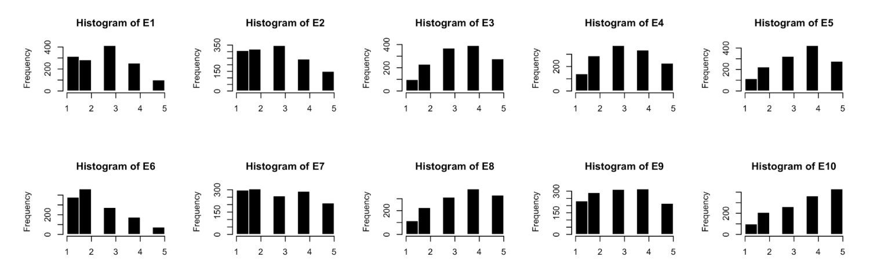
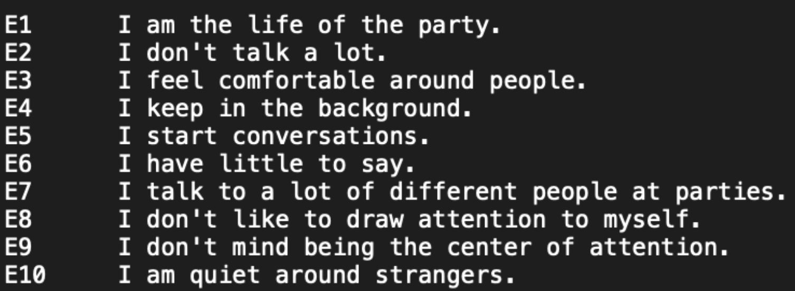
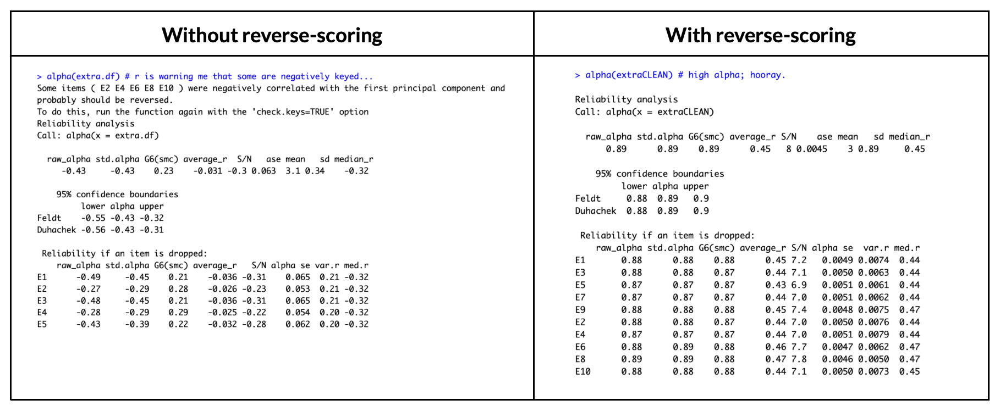
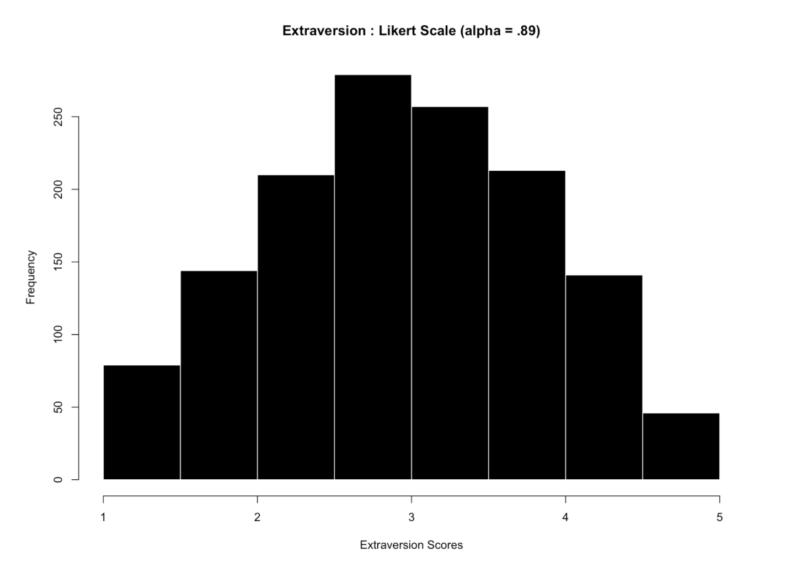

## [Check-In : "Normal People"](https://docs.google.com/forms/d/e/1FAIpQLSecZbrcoW6-o6KxXmznpxSR7h50-akJ40JuDAwG-e51qIT_MQ/viewform?usp=header) {.smaller}

WE ARE BACK IN R 😈

::::: columns
::: {.column width="60%"}

:::

::: {.column width="40%"}
- **Load the dataset.** name it d to follow along.
- **Remove all 0s from the dataset.** different ways to do this; use your favorite internet tool. (Or think through how you might adapt indexing to remove outliers for the entire dataset.)
:::
:::::

## Missing Data {.smaller}

The codebook for this data doesn't say it, but zeros are coded as MISSING DATA.

::: panel-tabset
#### how to know

- I've worked with datasets from this source that use this convention (and explain this feature in the codebook).
- There is no missing data in the dataset, and it is very unlikely that all participants answered all questions.
- The researchers measured personality with the Big Five, which is almost always measured on a 1-5 (or 1-7) scale, that allows for a "neutral" response.

#### indexing approach

```         
d == 0 # evaluates whether each entry in the dataframe is zero.

d[d == 0] # finds these zeros in the dataset.

d[d == 0] <- NA # replaces with zero
```

#### na.strings argument

```         
d <- read.csv("personality_random_number_data.csv", # your path goes here
              stringsAsFactors = T,                 # same as before
              na.strings = "0")                     # replaces 0 with NA
```
:::

## Likert Scales

::: panel-tabset
#### the code

{width="665"}

#### multiple items



#### reverse scoring

- goal : all questions answered such that the higher number = higher extraversion

- problem : for some questions, the higher number = less extraversion

- solution : need to “flip” the questions that measure low extraversion around

  - minimum of scale + maximum of scale = the number to subtract from

  - e.g. a 1-5 scale = 1+5 = 6 - E2 ----\> 

{fig-align="center" width="467"}

#### alpha reliability



#### defining the scale


:::

## PART 2 : Project Time

### [Final Project : Milestone #2](https://docs.google.com/document/d/1ScvG86PiyyqHO7Ob5bki04XGzCwLodQ4h57n9Jq5DYI/edit?usp=sharing)

- **Data Cleaning :** look over the codebook to make sure that there aren’t any data-wide problems you need to resolve.

  - **conspiracy beliefs :** 0 = NA (like the check-in)

  - **attachment :** -1 = NA (similar to the check-in, but adapt the code.)

- **DV =** a continuous variable defined by a likert scale.

  - **conspiracy beliefs :** Q1 - Q15 (see the LAST TABLE of the article for the full questions)

  - **attachment :** there are two scales….need to sort the questions into “Anxiety” and “Avoidance” and maybe reverse score a few (e.g., Q3 = negatively-keyed avoidance)

- **IVs =** a categorical or numeric variable. make sure this variable is DIFFERENT FROM the DV :)

  - **one numeric :** make sure the data look good and do any data cleaning (outlier removal; likert scale creation; etc.) necessary.

  - **one categorical :** make sure there are not too many levels (e.g., “Country” has 186 categories…so you may want to choose a different variable or reduce the levels into larger categories (e.g., USA vs. not USA).

  - can have more IVs if you want, but more work (e.g., extra graphs.)
