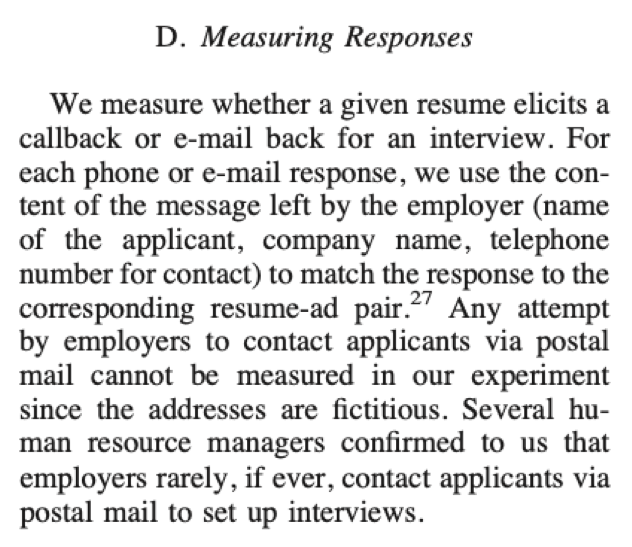

## Week 13 - Thursday, November 19th

### Class Objectives

1.  20 MIN : Introduction & Milestone 1 Review
2.  45 MIN : Interaction Effects
3.  15 MIN : Outlining Introduction

### Class Slides

```{=html}
<iframe data-external="1" class="slide-deck" src="/rm/slides/13_introXE_slides.html" width=100% height="400px"></iframe>
```

### Useful Links

- [**CHECK-IN : Introductions to Interactions**](https://docs.google.com/forms/d/e/1FAIpQLSfCxa3eYx90UC3OUw03dDMBzisPn27M4cNPSjp-sdgJQQinIw/viewform?usp=header)

  - [Full Article](https://www.povertyactionlab.org/sites/default/files/research-paper/3%20A%20Field%20Experiment%20on%20Labor%20Market%20Discrimination%20Sep%2004.pdf) : *Bertrand, M., & Mullainathan, S. (2004). Are Emily and Greg more employable than Lakisha and Jamal? A field experiment on labor market discrimination. American economic review, 94(4), 991-1013.*

- **Interaction Effect Stuff**

  - [Interaction Effect Handout](https://www.dropbox.com/scl/fi/2uk1fbprwsu1cj1g8o747/13P_IntroXEFanoon.pdf?rlkey=xwple67ouzshhimli0xdmlgo0&dl=0)
  - [Professor Interaction Effect Sketching](https://docs.google.com/drawings/d/1lzuuomzdyY9xGuY0UcKme8NeG4XWeyTKQC0IL0zwK5I/edit?usp=sharing)
  - [Chapter 11 from my stats textbook (OPTIONAL)](https://catterson.github.io/ystats/chapters/11R_InteractionFX.html)

  [**Final Project Description & Rubric**](https://docs.google.com/document/d/1QJKm9s8WUXAoYACf_pC9QIWdYyfEOHQNMnP4unkXGYI/edit?usp=sharing)

- [**Vision Board**](https://docs.google.com/spreadsheets/d/14u3w5edvo6KSFRw2U9t1knDANFSGBWOvDjS7-ZGujos/edit?usp=sharing)

## Before Next Class : Milestone #2

**PART 1 : Sketch out an interaction effect**. We started this in class (see the class recording if you missed. Paste this sketch to the vision board.

1.  [**Here’s a template you can use to complete Milestone 2**](https://docs.google.com/spreadsheets/d/1VrEm0QPVdTzFjX7K9GAkjWD_QRXrpnl0iPy26aqYky4/edit?usp=sharing)**.** I also recorded a video ([linked here](https://www.loom.com/share/85d9b902b3e74aef90ff649f50f16015); also in the template) where I walk through how to use this template.

2.  **Find the template confusing? Here’s[another video](https://www.youtube.com/watch?v=On8o9KbeuLQ&source_ve_path=MjM4NTE)** where I walk through how to sketch an interaction effect.

**PART 2 : Finding Past Research on Measuring Your Variables.**

- Look to past research for examples on how to measure the variables you are focusing on in your final project (e.g., DV, IV1, and IV2.)

- Ideally, you can find a specific examples from past research that has measured each variable. You may need to look at different studies for each variable (e.g., maybe one study you found measures your DV in a way that you like, and another study measures IV1).

- If you can't find a way to measure or manipulate a variable in your study, just write a few sentences describing (a) how you might define this variable and (b) whether you think it would make sense to measure (observation or self-report) or manipulate (an experiment) the variable.

- Below are two examples (one from a published study, one a written example for a variable that has not been measured in past research.)

| Published Study Example (variable = Interview Callbacks) | Written Example (variable = love for water) |
|----|----|
| {fig-align="center" width="483"} | I'm interested in measuring love for water. I'd define this as how much a person enjoys and seeks out tap water. I think it would make sense to measure this with a self-report survey -  you could ask people straightforward questions like "How much do you love tap water" on a 1-5 scale. You could also observe this by seeing whether people drink from a water fountain, or whether they choose to fill up a bottle with tap water or fancier drink. |
