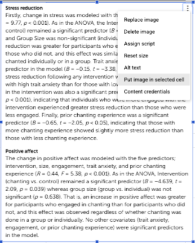

## Week 9 - Thursday, October 22nd

### Class Goals

1.  Review Dig Deeper results.
2.  Introduce the idea of an experiment.
3.  Students all learning; Professor not rushing; we all enriched and nourished by knowledge of research methods.

:::::: {.callout-note collapse="true"}
### Announcements and Agenda

::::: columns
::: {.column width="50%"}
- **Dig Deeper Deadline Delayed :** November 5th
- **Final Paper = Final Poster.** Will start in a few weeks.
:::

::: {.column width="50%"}
- **11:00 - 11:45.** Check-In and Dig Deeper Part 1.
- **11:45 - 12:35.** Introduction to Experimental Methods.
:::
:::::
::::::

### Class Slides

```{=html}
<iframe data-external="1" class="slide-deck" src="/rm/slides/9_precausation_slide.html" width="100%" height="600px" title="" border="5px"></iframe>
```

### Useful Links

- [**CHECK-IN : tinyurl.com/twitterpattern**](https://docs.google.com/forms/d/e/1FAIpQLSf8Fo8cJBEUGCYlMg75pnYjFKqriEGVFRYYQOIsSPvEAcIszg/viewform)
- [Dig Deeper Assignment](/rm/notes/digdeeper.qmd)
- [Vision Board](https://docs.google.com/spreadsheets/d/14u3w5edvo6KSFRw2U9t1knDANFSGBWOvDjS7-ZGujos/edit?usp=sharing)

## Before Next Class

### Readings for Class Week (and our Quiz)

1.  [**Dig Deeper Part 2 : Evaluating the Measures and Methods**](https://www.loom.com/share/d7f0758e63ee419f8d9de8b2dd3446f2)**.** A professor guide to evaluating the measures and methods of your paper. Whew!

2.  [**Chapter 5 - Experiments.**](https://kpu.pressbooks.pub/psychmethods4e/chapter/experiment-basics/)A review of some of the basics of experimental design.

### Week 9 Discussion Questions.

1.  **WE DID THIS IN CLASS ON THE DIG DEEPER TAB : Complete Part 1 (Finding the Research Article).** Make sure you are finding a specific empirical article - you might need to do some...digging...to find the right article (a study where the researchers studied a group of participants; not a review article or literature review.) Okay to have questions, but try to find something!

2.  **ON THE DIG DEEPER TAB : Complete Part 2 (Evaluating the Measures and Methods).** Okay if you have questions or are confused - just do your best. Highlight any questions / places where you are stuck in yellow to help flag them for me (and us!) I've posted an example to help get y'all started.

3.  **ON THE DIG DEEPER TAB (Results) :** Paste a screenshot of what you think is the most relevant part of the results section. (Relevant meaning the results say something about the relationship between your DV and your IV.) I've posted an example. NOTE : to paste a screenshot into the correct cell, click the cell you want to insert the image into, paste the image into the spreadsheet, click the three dots in the top right corner of the image, and then click "Put image in selected cell" (see below). The image will insert into the cell - you may need to make the row height taller in order to see the image.

    {width="210"}

4.  **ON THE WEEK 10 TAB :** In class (and in the readings) we walked through the basics of an experiment. What's a question or something you want to learn more about regarding experiments?
