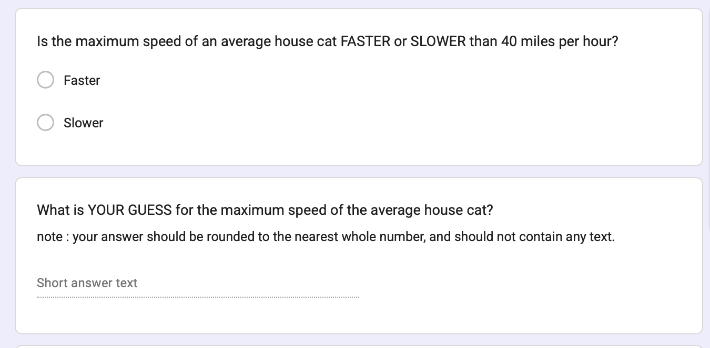
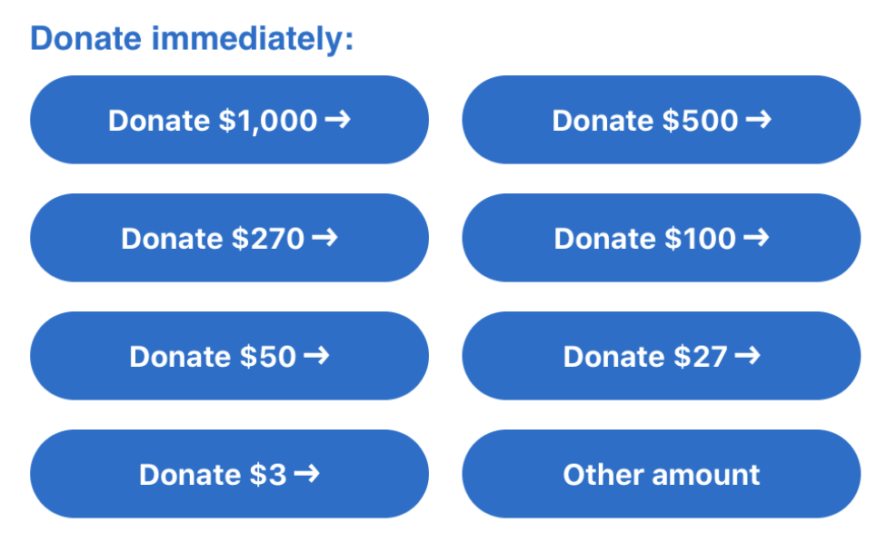

## [**CHECK-IN**]()

::: panel-tabset
#### Anchoring Data

```{r}
#| message: false
#| warning: false
#| include: false
library(googlesheets4)
library(gt)
library(tidyverse)
options(knitr.kable.NA = "")
gs4_deauth()
anchor <- read_sheet("https://docs.google.com/spreadsheets/d/1hPzlbSV6fex0aJbEd4zPPmrNcdEGrp-5u4reqpVdQhI/edit?usp=sharing", sheet = "Form Responses 1")

# anchor <- read.csv("~/Downloads/9A_Eichstaedt_SP24.csv", stringsAsFactors = T)
names(anchor)
anchor <- anchor[,c(7, 9, 11:13, 15, 17:19)]
names(anchor) <- c("condition", "catH", "treeH", "have.catH", "hikeH",
                   "catL", "treeL", "have.catL", "hikeL")
head(anchor)

anchor$condition <- as.factor(anchor$condition)
levels(anchor$condition) <- c("LOW", "HIGH")

anchorH <- anchor[anchor$condition == "HIGH",]
anchorL <- anchor[anchor$condition == "LOW",]

names(anchorH)[1:5] <- c("condition", "cat", "tree", "have.cat", "do.hike")
names(anchorL)[c(1, 6:9)] <- c("condition", "cat", "tree", "have.cat", "do.hike")

anchor <- rbind(anchorH[,c(1:5)],
                anchorL[,c(1,6:9)])

## Data Cleaning

library(gplots)
hist(anchor$cat)
hist(anchor$tree)
anchor$tree[anchor$tree > 1500] <- NA
anchor$have.cat <- as.factor(anchor$have.cat)
anchor$do.hike <- as.factor(anchor$do.hike)
plot(anchor$condition)
plot(anchor$have.cat)
plot(anchor$do.hike)

## Experiments

plot(condition ~ have.cat, data = anchor)
plot(condition ~ do.hike, data = anchor)

## Models
plotmeans(tree ~ condition, data = anchor)
plotmeans(cat ~ condition, data = anchor)
```

### Anchoring (Study

:::: {.columns}
    
::: {.column width="50%"}

outcome (DV). what the researchers want to predict or explain

manipulation (IV). change only one thing about the variable

confound variables (“noise”). other factors that might influence the outcome variable

random assignment. if people put in random groups, then all other confound variables are *random error*.

:::
    
::: {.column width="50%"}



:::
    
::::


### Anchoring (Real-Life Example)



### Anchoring (How Use?)


:::

### Anchoring

::: panel-tabset
#### Anchoring Study (Real-Life Examples)

|     |     |
|-----|-----|
|     |     |
:::

# Part 2 : [Digging Deeper](https://catterson.github.io/rm/notes/digdeeper.html) {.smaller}

## RECAP : evaluate the measure ([vision board review](https://docs.google.com/spreadsheets/d/14u3w5edvo6KSFRw2U9t1knDANFSGBWOvDjS7-ZGujos/edit?usp=sharing)) {.smaller}

 \## NEXT : try to make the result make sense.

# Part 1 : Experiments {.smaller}

### KEY IDEA : Watch out for Misleading Control Variables {.smaller}

**RECAP : the manipulation (A/B Testing) :** researchers create multiple groups (conditions) and change ONE THING (the IV) about a person’s experience in each group & observe the result (the DV).

**KEY IDEA : the comparison group matters!**

- a 1.5 hour research methods class DECREASES boredom compared to…

- a 1.5 hour research methods class INCREASES boredom compared to…

### Science is Hard : Power Posing

- What is the experimental / control condition?

- Is this a fair comparison / manipulation?

::::: columns
::: {.column width="50%"}
[](https://faculty.haas.berkeley.edu/dana_carney/power.poses.PS.2010.pdf)
:::

::: {.column width="50%"}

:::
:::::

### Example : Gratitude Study {.smaller}

::::: columns
::: {.column width="40%"}
Read the prompt below. Answer the following questions.

1.  **ICE-BREAKER :** What's something that you are grateful for?
2.  What is the experimental / control condition?
3.  Is this a fair comparison / manipulation? What would be better?
:::

::: {.column width="60%"}
{width="364" height="600"}
:::
:::::

### okay.

{fig-align="center" width="466"}

### Other Questions to Consider : Does the experiment have....

::: panel-tabset
#### placebo effects

Will individuals in the study change their behavior if they expect something to have an effect?


#### external validity

How much does the experimental manipulation represent what someone might experience in real life?


#### construct validity

How much does the manipulation actually change the variable of interest?

{fig-align="center"}

#### expectancy effects

If experimenters know what will happen to participants, will they change their behavior in ways that affect the results?


:::

### 
