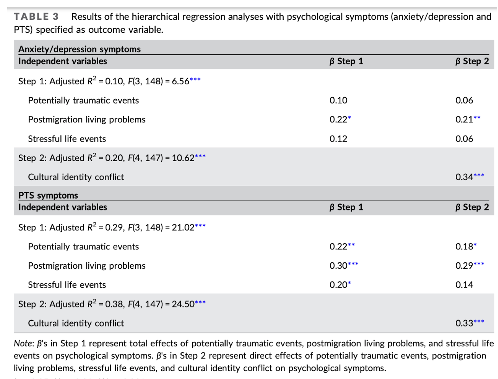
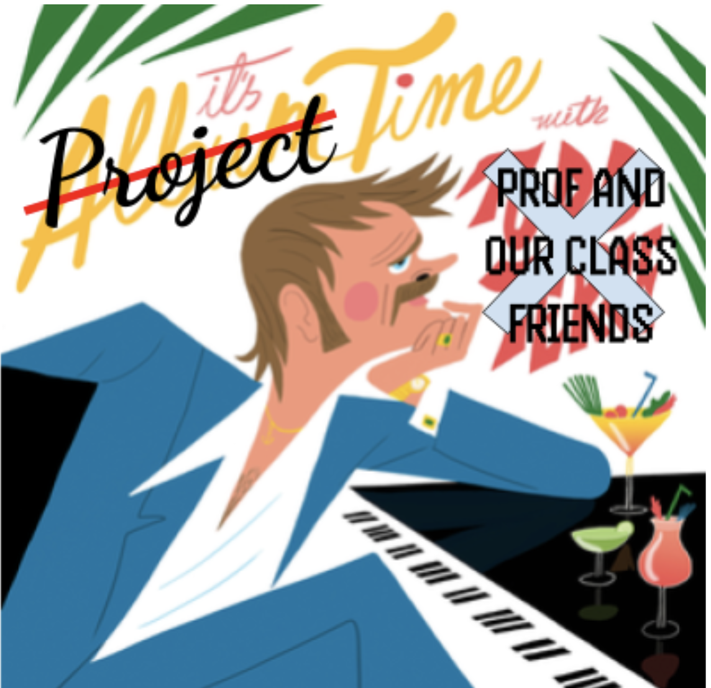
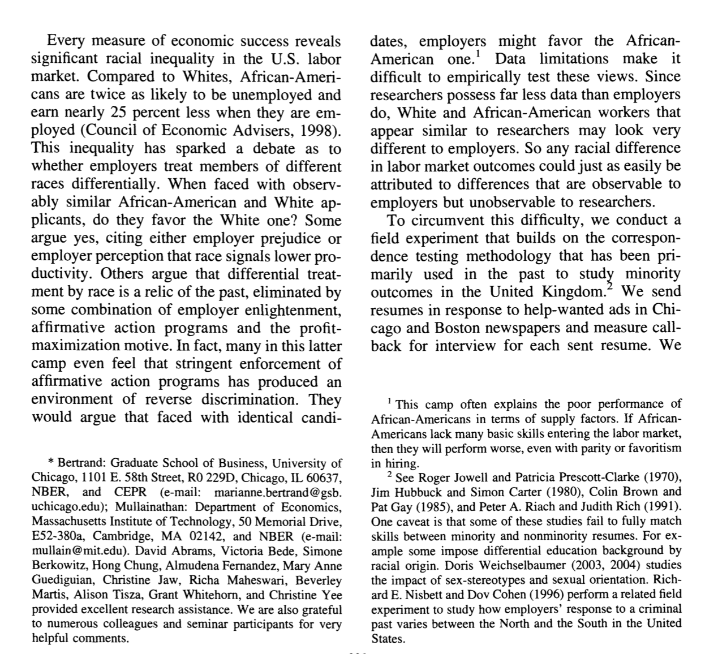
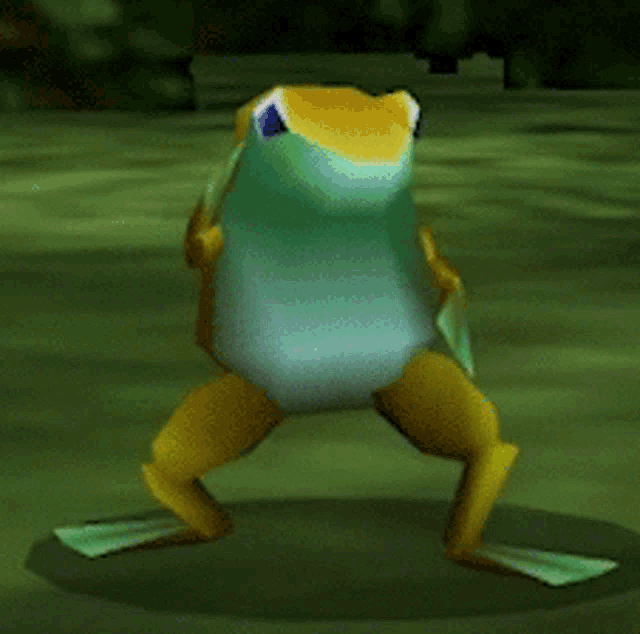

## [Check-In : Refugee Study](https://docs.google.com/forms/d/e/1FAIpQLSfXDma6OLDL3LZgEs_3z_pyHepAz7SsAVv3eU7gIRxTViZ5Ug/viewform?usp=header)

::::: columns
::: {.column width="70%"}

:::

::: {.column width="30%"}
- scan the results (table 3)
:::
:::::

## [**Final Project Description and Rubric**](https://docs.google.com/document/d/1QJKm9s8WUXAoYACf_pC9QIWdYyfEOHQNMnP4unkXGYI/edit?usp=sharing)

## PART 1 : STARTING A LITERATURE REVIEW

- **In the Vision Board :** what's a topic that you care about or might want to learn more about?

- **On Google Scholar :** search for this topic (add psychology); what do you learn from the titles?

- **Choose one Article :** what is the APA citation? how much has this article been cited? what do you learn from the abstact?

## PART 2 : INTRODUCTIONS

## ACTIVITY : Find a sheet of paper and pencil; draw this cube as precisely as possible.

{fig-align="center" width="46%"}

### Introduction Deconstruction. {.smaller}

::: r-fit-text
Start broad, but focus to your specific question!

|  |  |
|-------------------|-----------------------------------------------------|
| **Section** | **Brief Explanation** |
| **1. The Opening** | Describe the question you have, and explain why this question matters |
| **2. The Review** | Describe what past research and theory has to say on the question and your theory. Your goal is to give the reader the background they need to understand why you are doing your study; you don’t need to cover EVERY single issue on your topic.. |
| **3. The Critique** | Explain why the past research is not “the final truth”, and what other new questions might be important to consider (and why these questions matter). Only point out limitations with past research that you will address in your study; other limitations that you think future research will address should go in the discussion section. |
| **4. The Current Research** | Explain what specific questions your study will address. Be clear by stating each idea as a hypothesis with language like, “I predict” or “My first hypothesis”. |
:::

## ACTIVITY : identify parts of an introduction. {.smaller}

::::: columns
::: {.column width="70%"}
{fig-align="center" width="80%"}
:::

::: {.column width="30%"}
1.  The Opening
2.  The Review
3.  The Critique
4.  The Current Research
:::
:::::

## DEFINITION : patterns in writing

1.  **THE POINT :** What are you trying to say?

2.  **THE EVIDENCE :** What is some evidence that supports this point? This could be empirical (e.g., a summary of past research on the topic), but also logic or real-life experiential examples work here.

3.  **WHO CARES :** Why does this matter? How does this connect to your main thesis?

## ACTIVITY : identify parts of an introduction. {.smaller}

::::: columns
::: {.column width="70%"}
{fig-align="center" width="80%"}
:::

::: {.column width="30%"}
1.  **THE POINT :** What are you trying to say?

2.  **THE EVIDENCE :** What is some evidence that supports this point? This could be empirical (e.g., a summary of past research on the topic), but also logic or real-life experiential examples work here.

3.  **WHO CARES :** Why does this matter? How does this connect to your main thesis?
:::
:::::

## THE EVIDENCE : logic vs. empirical evidence. {.smaller}

:::::: r-fit-text
::::: columns
::: {.column width="50%"}
*"Think first of swallowing the saliva in your mouth, or do so. Then imagine expectorating it into a tumbler and drinking it! What seemed natural and "mine" suddenly becomes disgusting and alien. Or picture your self sucking blood from a prick in your finger; then imagine sucking blood from a bandage around your finger! What I perceive as separate from my body becomes, in the twinkling of an eye, cold and foreign."*

- Gordon Allport (1955). Becoming: basic considerations for a psychology of personality. Yale University Press.
:::

::: {.column width="50%"}
In a study of 45 female college students, a sweaty shirt was rated as more disgusting when it was associated with an outgroup than when associated with an ingroup (Reicher et al., 2016).

- S.D. Reicher, A. Templeton, F. Neville, L. Ferrari, & J. Drury, Core disgust is attenuated by ingroup relations, Proc. Natl. Acad. Sci. U.S.A. 113 (10) 2631-2635, https://doi.org/10.1073/pnas.1517027113 (2016).
:::
:::::
::::::

## ACTIVITY : start outlining your introduction {.smaller}

**The Opening :**

1.  What is your topic :
2.  What evidence (past research) has been done on this :
3.  Why do we / should we care :

**Past Research on IV1 :**

1.  What is one variable you think might influence the DV?
2.  What evidence (past research) has been done on this IV (and its relation to the DV)?
3.  Why do we / should we care?

## NEXT WEEK : More Project Time {.smaller}

{fig-align="center" width="434"}
