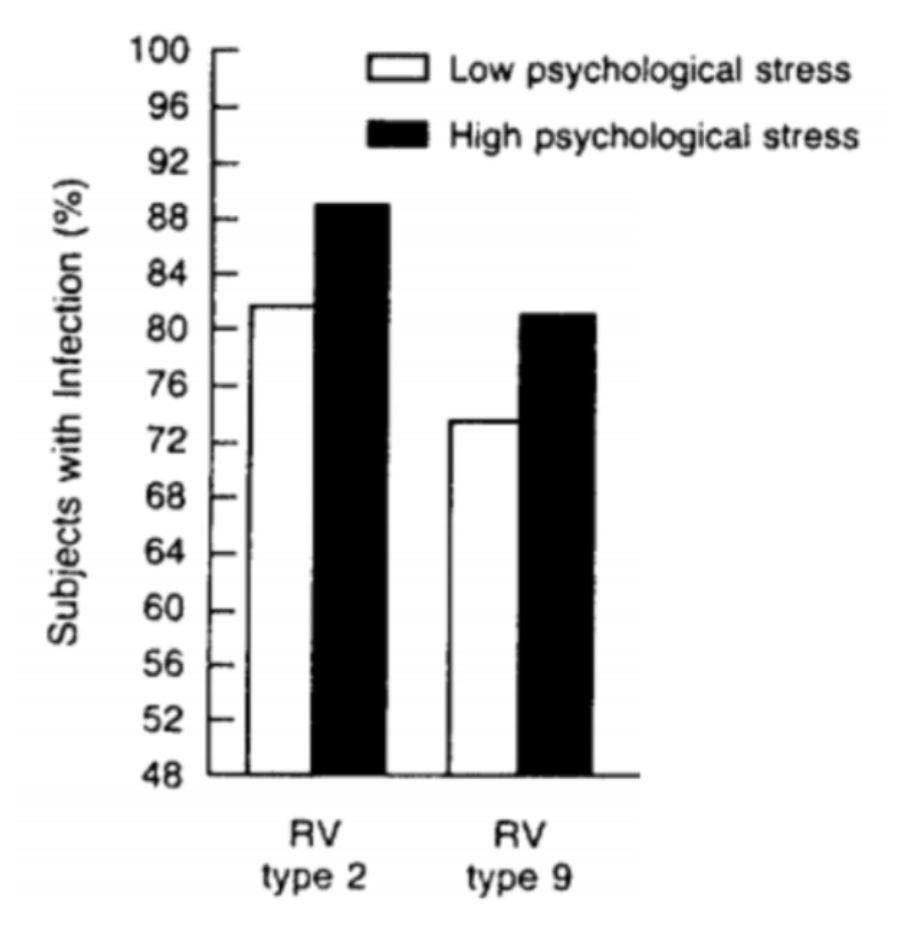
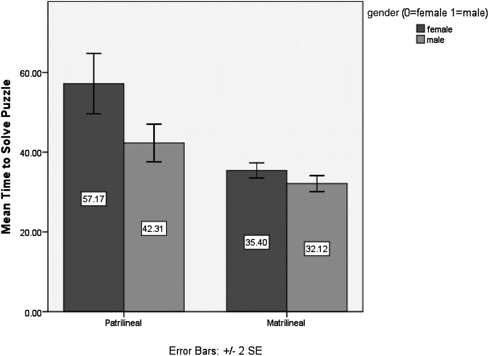
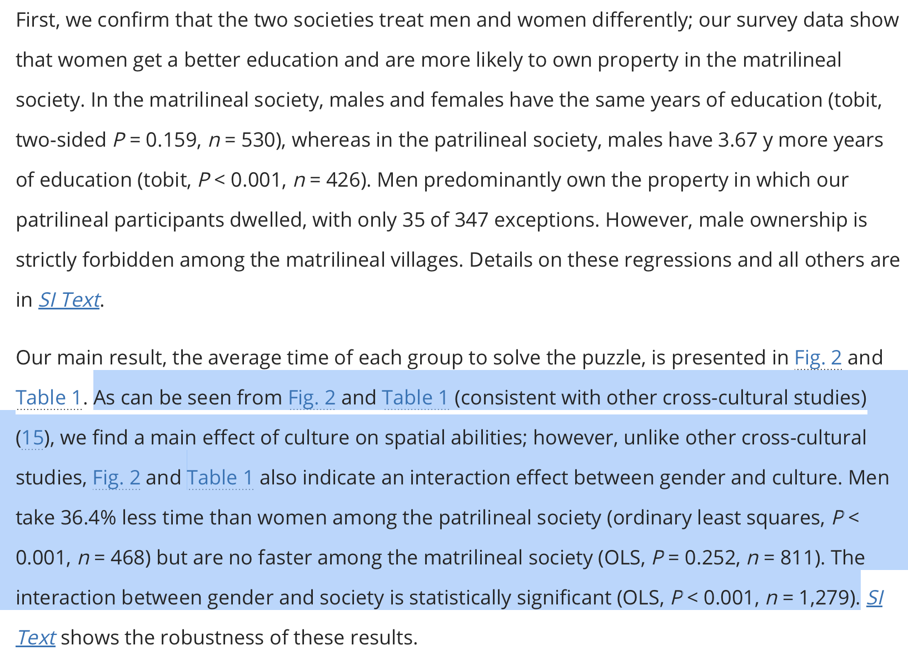
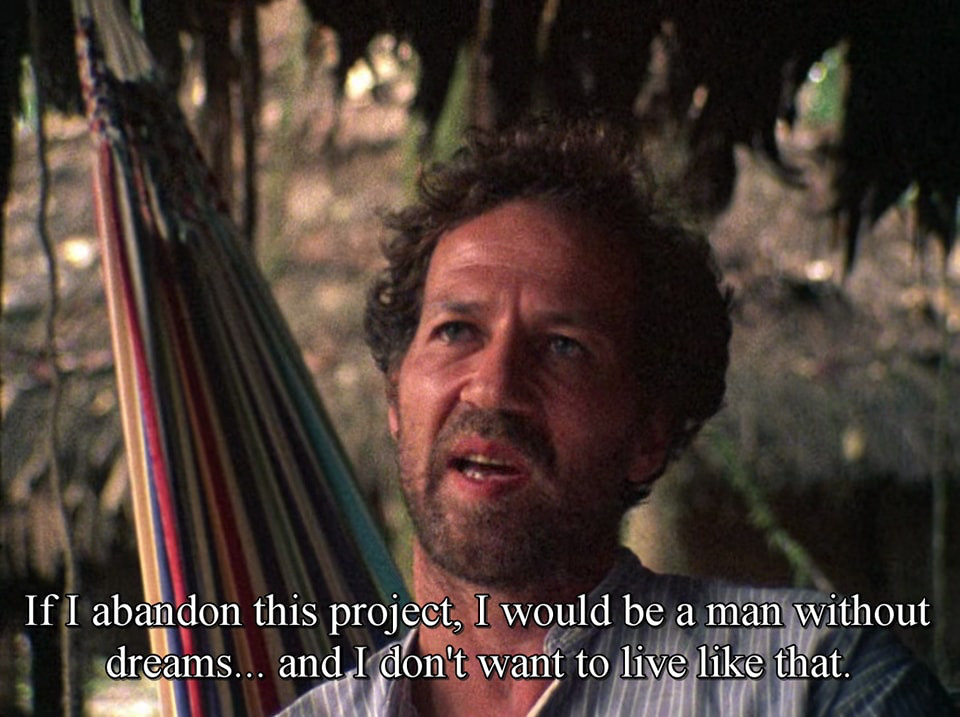
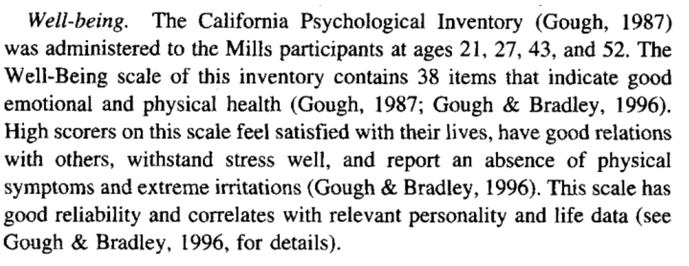
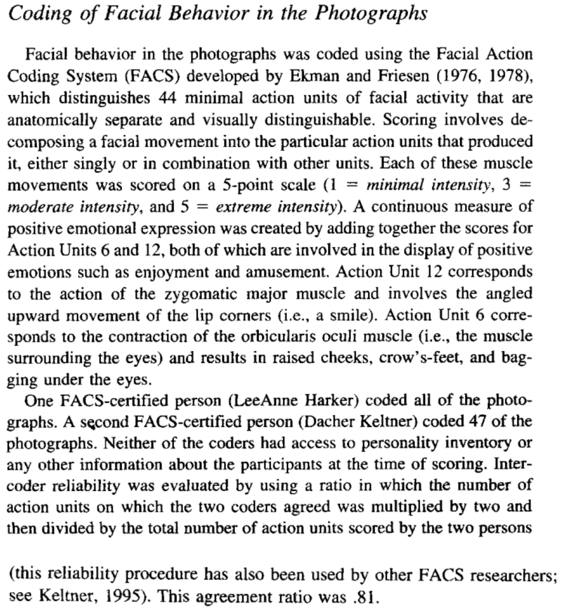

## Check-In : More Interaction Effects {.smaller}

::: panel-tabset
#### Graph A

{width="80%"}

#### Graph B

{width="80%"}
:::

## Check-In Review (Graph A) {.smaller}

::::: columns
::: {.column width="60%"}

:::

::: {.column width="40%"}
The similar effect of stress at the various levels of each standard control variable (i.e., the lack of interaction between stress and each control variable) has already been mentioned. Of special importance in interpreting this study is the fact that stress had the same effects in all the challenge-virus groups regardless of the infectious status of apartment mates or prechallenge serologic status.
:::
:::::

## Check-In Review (Graph B) {.smaller}

::::: columns
::: {.column width="60%"}

:::

::: {.column width="40%"}

:::
:::::

## PART 1 : REVIEWING YOUR INTERACTION EFFECTS {.smaller}

-   [**Final Project Description and Rubric**](https://docs.google.com/document/d/1QJKm9s8WUXAoYACf_pC9QIWdYyfEOHQNMnP4unkXGYI/edit?usp=sharing)

## PART 3 : METHODS

### EXAMPLE 1. Well-Being {.smaller}

::::: columns
::: {.column width="50%"}

:::

::: {.column width="50%"}
what is the measure? (self-report or observation) how is this measure reliable? (test-retest; inter-item; inter-judge; etc.) how is this measure valid? (face validity; convergent validity; etc.)
:::
:::::

### EXAMPLE 2. Smiling {.smaller}

::::: columns
::: {.column width="50%"}

:::

::: {.column width="50%"}
what is the measure? (self-report or observation) how is this measure reliable? (test-retest; inter-item; inter-judge; etc.) how is this measure valid? (face validity; convergent validity; etc.)
:::
:::::

## NEXT WEEK : Milestone 3 {.smaller}

-   Intro Outline
-   Measure Draft
-   Whew.

