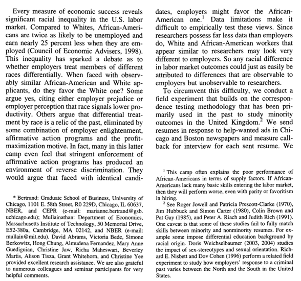
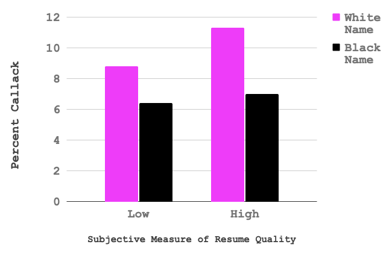
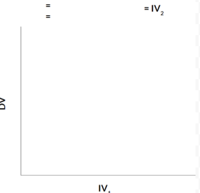
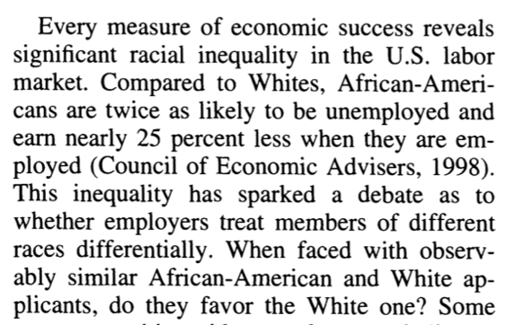

## [Check-In : Introduction Outlines](https://docs.google.com/forms/d/e/1FAIpQLSfCxa3eYx90UC3OUw03dDMBzisPn27M4cNPSjp-sdgJQQinIw/viewform?usp=header)

{width="534"}

## PART 1 : Interaction Effects

::::: columns
::: {.column width="60%"}
{width="643"}
:::

::: {.column width="40%"}
1.  **MAIN EFFECT OF RACE:** Average effect of White vs. Black Names on Callback.

2.  **MAIN EFFECT OF QUALITY :** Average effect of High vs. Low Resume Quality on Callback.

3.  **INTERACTION EFFECT :** How the effect of *resume quality* DEPENDS ON *race*.
:::
:::::

### Sketching Your Own Interaction Effect.

[see professor demo](https://docs.google.com/drawings/d/1lzuuomzdyY9xGuY0UcKme8NeG4XWeyTKQC0IL0zwK5I/edit?usp=sharing)

## PART 2 : Introduction Writing

{width="546"}

### ACTIVITY : identify parts of an *argument* {.smaller}

::::: columns
::: {.column width="70%"}
{width="778"}
:::

::: {.column width="30%"}
1.  **THE POINT :** What are you trying to say?

2.  **THE EVIDENCE :** What is some evidence that supports this point?

3.  **WHO CARES :** Why does this matter?
:::
:::::

### KEY IDEA : evidence can be logic or empirical {.smaller}

:::::: r-fit-text
::::: columns
::: {.column width="50%"}
*"Think first of swallowing the saliva in your mouth, or do so. Then imagine expectorating it into a tumbler and drinking it! What seemed natural and "mine" suddenly becomes disgusting and alien. Or picture your self sucking blood from a prick in your finger; then imagine sucking blood from a bandage around your finger! What I perceive as separate from my body becomes, in the twinkling of an eye, cold and foreign."*

- Gordon Allport (1955). Becoming: basic considerations for a psychology of personality. Yale University Press.
:::

::: {.column width="50%"}
In a study of 45 female college students, a sweaty shirt was rated as more disgusting when it was associated with an outgroup than when associated with an ingroup (Reicher et al., 2016).

- S.D. Reicher, A. Templeton, F. Neville, L. Ferrari, & J. Drury, Core disgust is attenuated by ingroup relations, Proc. Natl. Acad. Sci. U.S.A. 113 (10) 2631-2635, https://doi.org/10.1073/pnas.1517027113 (2016).
:::
:::::
::::::

### ACTIVITY : start outlining your introduction {.smaller}

**The Opening :**

1.  What is your topic :
2.  What evidence (past research) has been done on this :
3.  Why do we / should we care :

**Past Research on IV1 :**

1.  What is one variable you think might influence the DV?
2.  What evidence (past research) has been done on this IV (and its relation to the DV)?
3.  Why do we / should we care?

**Past Research on IV2 :**

1.  What is another variable you think might influence the relationship between the DV and IV1?

2.  What evidence (past research) has been done on this IV (and its relation to the DV)?

3.  Why do we / should we care?

## NEXT WEEK : More Project Time {.smaller}

{fig-align="center" width="434"}
