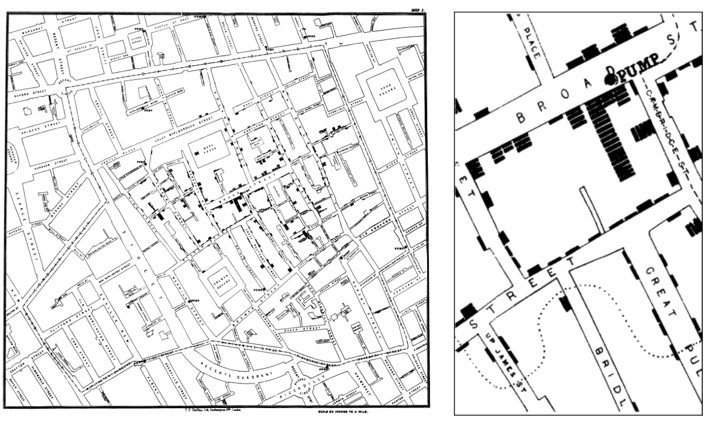
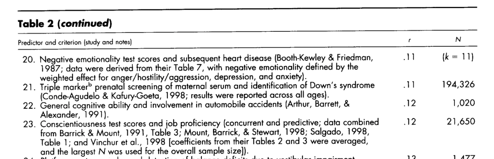
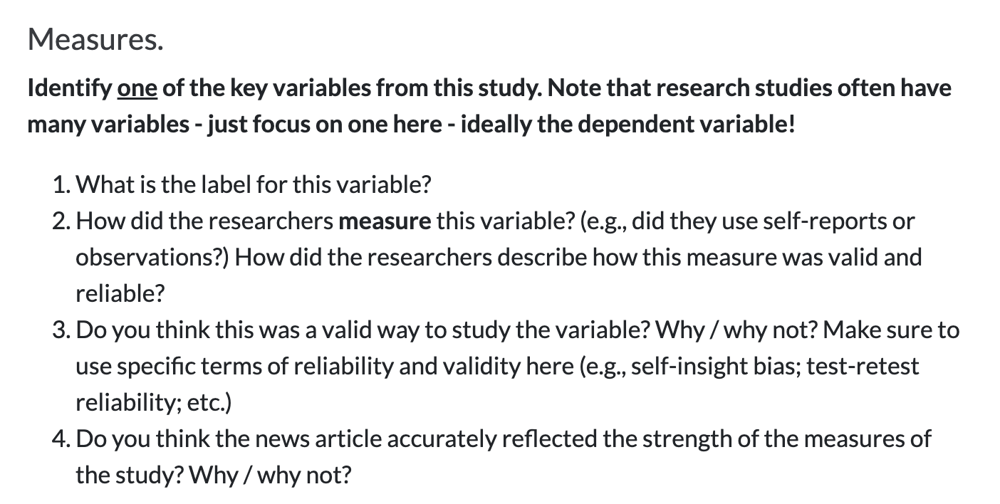

## [Check-In : Interruptions Data](https://forms.gle/7vVrzuGYU9VjEJJh7)

::: panel-tabset
### Graphs

```{r}
#| echo: false
#| message: false
#| warning: false
library(googlesheets4)
library(gt)
library(tidyverse)
options(knitr.kable.NA = "")
gs4_deauth()
d <- read_sheet("https://docs.google.com/spreadsheets/d/1Vw8ezL6BeXRronRFLAZUEpUZoETND_hra80u-RQFCGM/edit?usp=sharing", sheet = "sp26")
d$Date <- format(d$Date, "%m/%d")
names(d) <- c("time", "i1", "lod", "i2", "Date")
d$i1[d$i1 > 60] <- NA
d$i2[d$i2 > 60] <- NA
d <- d[d$time > "2026-07-01",]
mod <- lm(d$i2 ~ d$i1)
```

```{r}
#| echo: false
#| message: false
#| warning: false
#| fig-height: 5
#| fig-width: 10

par(mfrow = c(1,2))
hist(d$i1, xlab = "Interruptions Counted at Time 1", main = "Time 1", col = "black", bor = "white", breaks = 10, xlim = c(0,60), ylim = c(0,15))
hist(d$i2, xlab = "Interruptions Counted at Time 2", main = "Time 2", col = "black", bor = "white", xlim = c(0,60), ylim = c(0,15))
```

### Descriptive Statistics

```{r}
#| echo: false
tt <- data.frame(c(round(mean(d$i1, na.rm = T), 2), round(sd(d$i1, na.rm = T), 2), round(range(d$i1, na.rm = T), 2)),
                 c(round(mean(d$i2, na.rm = T), 2), round(sd(d$i2, na.rm = T), 2), round(range(d$i2, na.rm = T), 2)))
names(tt) <- c("Time 1", "Time 2")
row.names(tt) <- c("Mean", "Standard Deviation", "Minimum Value", "Maximum Value")
knitr::kable(tt)
```

### Predictive Statistics

Correlation = `{r} round(summary(mod)$r.squared^.5, 2)`

```{r}
#| fig-height: 5
#| fig-width: 5
#| echo: false
#| message: false
#| warning: false

plot(x = d$i1, y = d$i2,
     xlab = "Interruptions at Time 1",
     ylab = "Interruptions at Time 2")
abline(mod, lwd = 5)
```
:::

# Part 1 : Patterns in the Data {.smaller}

{fig-align="center" width="80%"}

### KEY IDEA : statistics describes patterns in the data {.smaller}

::::: columns
::: {.column width="40%"}
In the linear regression analysis, lead authors of color again wrote abstracts with significantly fewer power words *B* = − 0.102, *t*(1191) = − 3.497, *p* \< 0.001. (From the [Objectivity Interrogations](https://www.nature.com/articles/s41598-024-63236-z#Sec18) article.)
:::

::: {.column width="60%"}
```{r}
#| echo: false
#| warning: false
#| message: false
#| fig-width: 5
#| fig-height: 5

d <- read.csv("~/Dropbox/!GRADSTATS/gradlab/Exams/objectivityposted.csv", stringsAsFactors = T)
library(gplots)
d$POC <- as.factor(d$pocu)
levels(d$POC) <- c("White Scholar", "Scholar of Color")
plotmeans(power ~ POC, data = d)
```
:::
:::::

### KEY IDEA : pictures can lie {.smaller}

::::: columns
::: {.column width="40%"}
In the linear regression analysis, lead authors of color again wrote abstracts with significantly fewer power words *B* = − 0.102, *t*(1191) = − 3.497, *p* \< 0.001. (From the [Objectivity Interrogations](https://www.nature.com/articles/s41598-024-63236-z#Sec18) article.)
:::

::: {.column width="60%"}
```{r}
#| echo: false
#| warning: false
#| message: false
#| fig-width: 5
#| fig-height: 5

plotmeans(power ~ POC, data = d, ylim = c(0,12))
```
:::
:::::

### KEY IDEA : good to get a sense of how large patterns are.

- [Meyer et al. (2001) article on effect sizes](https://www.dropbox.com/s/r0uwvdqezzvlvdb/2001_Meyer_EffectSizes.pdf?dl=0).

- [Correlation Visualizer](https://rpsychologist.com/correlation/)

- [Guess the Correlation](https://www.guessthecorrelation.com)



# Part 3 : [Digging Deeper](https://catterson.github.io/rm/notes/digdeeper.html) {.smaller}

## ACTIVITY : evaluate the measure ([vision board review](https://docs.google.com/spreadsheets/d/14u3w5edvo6KSFRw2U9t1knDANFSGBWOvDjS7-ZGujos/edit?usp=sharing)) {.smaller}



# NEXT WEEK : Experiments & Patterns in Data

BYE.

{fig-align="center"}
